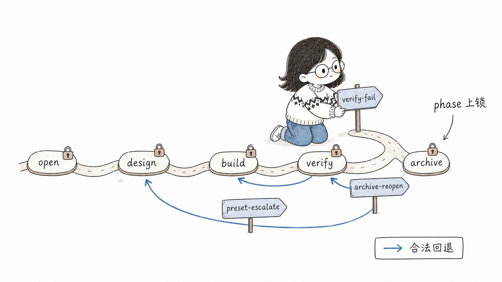

在真实的软件工程研发中，需求变更、代码重构与测试修复都是不可避免的常态。除了按部就班向前流转，Comet 还提供了一套完备且受状态机严格保护的合法修改与回退通道。本文详细梳理各个场景下的正确处理方式。

## 本地编辑后平滑继续任务

无论是 Native 还是 Classic 工作流，在 Build、Verify 或归档前，系统均会完整保留你在工作区中的实际改动，由当前 Agent 核实改动范围与影响后继续推进。无需为了常规的代码微调而重新创建变更：

- **源码或测试用例调整**：完整保留仍然有效的工作成果，仅重新补跑受影响或缺失的检查；
- **brief、Spec、Design Doc 仅微调文案但接口契约未变**：核对确认后，保留原有的人工批准与阶段状态；
- **核心目标、验收标准或技术选型发生实质改变**：说明变化影响，重新唤起对应的人工确认流程；
- **在验收通过、尚未交付时微调文档**：核对影响并刷新相关检查后继续归档流程，不重复执行已完成的操作。

## 核心前提：阶段 phase 禁止手动修改

`.comet.yaml` 中的 `phase` 由状态机内核严格维护。直接运行 `set phase build` 会被系统底层强行拒绝。任何阶段回退都必须通过**合法的状态流转事件（transition event）**触发，且每项事件均受守卫核验保护。

仅在极端异常的手动恢复场景下，才可使用 `COMET_FORCE_PHASE=1` 进行强制覆盖（命令会输出明确的安全告警）：

```bash
COMET_FORCE_PHASE=1 node "$COMET_STATE" set <name> phase verify
```

日常正常开发请始终使用下述标准流转通道。

## 合法的状态流转事件全览

| 转换事件名称          | 流转方向                | 触发场景                                           |
| --------------------- | ----------------------- | -------------------------------------------------- |
| `open-complete`       | 前进：open → design     | 需求探索完毕，规格文档全部就绪                     |
| `design-complete`     | 前进：design → build    | 架构方案获得确认，Design Doc 已落盘                |
| `build-complete`      | 前进：build → verify    | 编码实现完毕，自动化构建测试全绿                   |
| `verify-pass`         | 前进：verify → archive  | 质量验收全量通过，出具验证报告                     |
| **`verify-fail`**     | **回退：verify → build** | 验收未通过，或你需要打回重写代码                   |
| **`preset-escalate`** | **回退：build → design** | hotfix / tweak 预设发现改动超标，平滑升级到全流程   |
| **`archive-reopen`**  | **回退：archive → verify** | 归档前想重新验证或做最后微调                       |
| `archived`            | 终态归档                | 归档全部完成                                   |

<p align="center">
  
</p>

<p align="center">阶段状态不可强行篡改；任何回退动作均需通过合法的状态机流转事件触发</p>

## 常见场景一：在 build 阶段中途微调 Spec

在编码过程中，增量 Spec（delta spec）完全允许适度修正。依据改动规模分别处理：

| 改动规模 | 触发原因                       | 规范处理路径                                                 | 是否改变阶段 phase |
| -------- | ------------------------------ | ------------------------------------------------------------ | ------------------ |
| **轻度** | 补充边界用例、修正模糊用词     | 直接编辑增量 Spec 并追加至 `tasks.md`，提交 Git 时如实记录理由 | 否，在 build 原地处理 |
| **中度** | 涉及接口变动、组件调整或数据流 | 主动暂停确认 → 调起头脑风暴更新 Design Doc 与增量 Spec       | 否，在 build 原地处理 |
| **重度** | 引入全新的业务 capability      | 主动暂停确认 → 通过 `/comet-open` 为新模块另起独立变更        | 另起新任务从 open 开始 |

<Note>
  轻度和中度微调<strong>无需回退 phase</strong>——它们直接在 build 阶段原地自愈。只有出现超出当前变更边界的全新能力时，才建议拆分出新的独立任务。
</Note>

## 常见场景二：代码编写不满意，想从验证阶段退回重修

如果流程已经进入 verify 阶段，但在测试中发现重大逻辑缺陷希望重新编写：

```bash
node "$COMET_STATE" transition <change-name> verify-fail
```

触发回退后的状态机表现：
- `phase`：回退为 `build`；
- `verify_result`：更新为 `fail`；
- `verification_report` 与 `branch_status` 完好保留，分支状态继续保持 `pending`。

修改完代码并通过本地测试后，再次推进至 `build-complete` 重新发起验收。

## 常见场景三：验证已通过，但在归档前还想最后调整

在进入 archive 阶段后，若在最终确认时发现遗漏了某些测试或想微调细节：

```bash
node "$COMET_STATE" transition <change-name> archive-reopen
```

触发重新打开后的状态机表现：
- `phase`：退回至 `verify`；
- `verify_result`：重置为 `pending`；
- `branch_status`：保持 `pending`；
- `verified_at`：清空为 `null`。

随后再次运行 `/comet-verify` 重新核验，确认无误后再进入归档。

## 常见场景四：将轻量预设（hotfix / tweak）平滑升级为全流程

在运行 hotfix 或 tweak 过程中，若发现改动超出预期需要补充正规的架构设计文档：

```bash
node "$COMET_STATE" transition <change-name> preset-escalate
```

该原子命令会一次性将工作流类型切换为 `full`、将 `phase` 退回至 `design`，并清理临时标记。随后系统会自动唤起 `/comet-design` 补齐 Design Doc。你可以继续使用已有的代码和测试。

## 常见场景五：恢复时发现本地有未提交的代码改动

在重新唤起 `/comet` 恢复任务时，若检测到本地工作区存在未提交的改动：
- **明确归属于当前变更**：自动吸纳进当前任务中，不重复编写；
- **属于你的其他临时改动**：系统主动暂停并询问：是合并进当前变更、另起新任务、暂存保留、还是舍弃；
- **改动归属不确定**：系统主动暂停，列出文件清单等待你确认，不擅自越界推进。

<Warning>
  未提交改动仅属于客观代码事实，<strong>不会自动触发打勾或推进阶段</strong>。必须完成归因、测试通过并通过守卫核验后才可放行。
</Warning>

## 下一步

- [自动推进机制](/zh/concepts/auto-transition) — 掌握状态流转事件与 next 指令
- [状态管理](/zh/concepts/state-management) — 深入理解状态机底层字段
- [恢复中断的工作](/zh/guides/resuming-workflow) — 遭遇中断后的恢复实操
- [决策停顿点速查](/zh/concepts/decision-points) — 掌握各个关键节点的裁决标准
