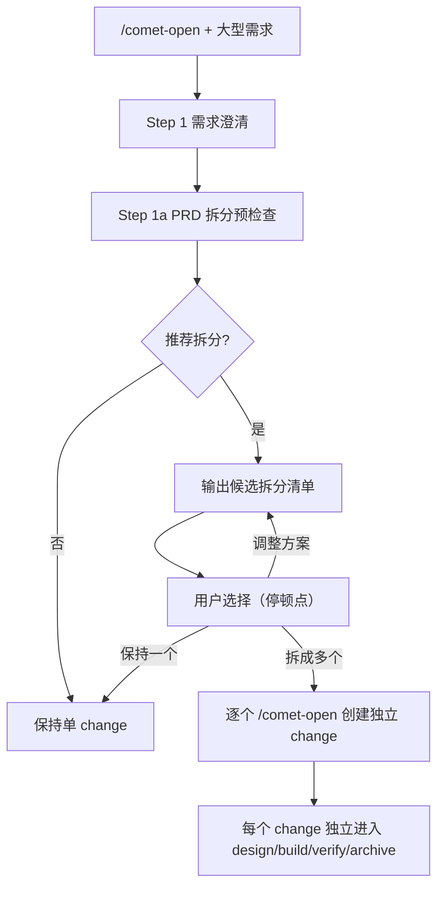
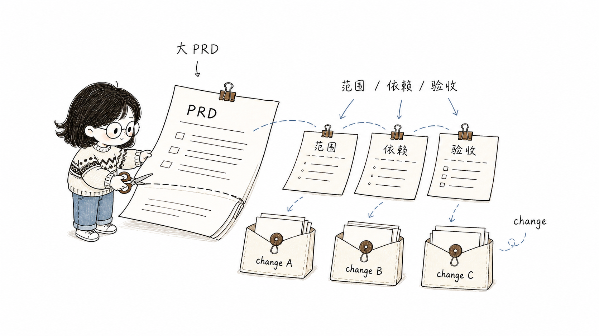

实际开发中，需求往往始于一份大型 PRD、产品路线图或完整方案。如果将整份需求纳入单个 change，容易导致任务膨胀、delta spec 混乱，局部受阻还会拖累全局交付进度。Comet 在 open 阶段支持 PRD 拆分：在创建产物文件前，先帮你把大需求拆解为多个职责明确、可独立流转的 change。

## 它解决什么问题

| 维度 | 不拆分 | 拆分后 |
| --- | --- | --- |
| 任务规模 | 单个 change 塞入几十个任务，中断恢复成本高 | 任务按变更拆分聚焦，恢复快且定位准 |
| delta spec | 多个功能混在一个 delta，范围模糊难以审计 | 每个 change 对应清晰独立的 delta |
| 交付节奏 | 必须等所有模块全部做完才能归档 | 各 change 独立设计、验证并小步归档 |
| 风险隔离 | 局部延期或失败会阻塞整体进度 | 各部分独立推进，互不干扰 |
| 团队协作 | 所有人挤在同一个 change 中改动 | 不同成员或小组可并行认领不同 change |

## 什么时候触发拆分

PRD 拆分预检查在 `/comet-open` 完成需求澄清之后、正式创建文档之前触发。当输入满足以下任一情况时生效：

- 输入为大型 PRD、路线图或完整产品方案
- 需求澄清摘要包含多个**独立**功能、模块、用户路径或阶段性里程碑

只要命中以下**任一**信号，Comet 就会主动建议拆分：

| 触发信号 | 说明 |
| --- | --- |
| 包含多个可独立设计、构建、验证或归档的 capability | 各模块完全可以独立流转推进 |
| 包含多个模块或用户链路，且部分链路可先交付 | 例如后端 API 与前端页面可以分期上线 |
| 存在清晰的阶段里程碑 | 例如 MVP → 体验增强 → 性能优化 |
| 预计产生多个 delta spec 或超过 3 个大型任务 | 说明需求范围已经超出单个 change 能容纳的量 |
| 局部失败或延期不应影响其余部分交付 | 团队需要按业务优先级分批交付 |

## 拆分流程



<p align="center">
  
</p>

<p align="center">大型 PRD 先拆成独立 change，范围、依赖和验收都写清楚后再逐个推进</p>

### 候选拆分清单

当建议拆分时，Comet 会为每个候选变更列出以下信息：

- 建议的 change 名称
- 目标与范围边界
- 明确的非目标（Out of Scope）
- 模块依赖关系或推荐执行顺序
- 对应的核心验收场景

### 停顿点：确认拆分策略

在正式创建 `proposal.md`、`design.md` 或 `tasks.md` **之前**，Comet 会停下来等待你确认：

1. **创建多个 OpenSpec changes**：按候选清单逐个创建独立的 change。
2. **保持为一个 change**：继续走单 change 流程，并在后续文档中记录不拆分的原因。
3. **调整拆分方案**：说明修改思路后，Comet 会重新整理并给出候选拆分清单，供你再次确认。

<Warning>
  在拆分方案确认前，Comet 不会创建 `proposal.md`、`design.md` 或 `tasks.md`。若选择“保持为一个 change”，Comet 会在 proposal 中记入决策原因，方便后续追溯。
</Warning>

## 每个 change 如何创建

确认拆分后，每个拆分出来的子项都会分别通过 `/comet-open` 创建独立变更。请勿使用 `/opsx:new`，原因如下：

- `/comet-open` 会同时创建 OpenSpec 产物**和** `.comet.yaml`，让每个 change 都由 Comet 状态机管理。
- `/opsx:new` 只生成 OpenSpec 文档，创建的 change 脱离了状态机监管，无法通过 `/comet` 自动恢复与守护。

在批量拆分模式下：

- 进入每个拆分子项时会标注“已确认拆分项”，并自动附带该项的目标、边界、非目标与验收场景。
- 已确认的拆分项默认跳过拆分预检查（除非该子项本身仍包含多个相互独立的复杂能力）。
- **单个拆分项完成 open 阶段后不会自动进入 `/comet-design`**。拆分全部完成后会暂停，由你决定优先启动哪一个 change。

## 拆分后的推进方式

拆分完成后，工作区中会生成多个 active change。推进步骤如下：


- 每个 change 独立走完 design → build → verify → archive 全流程。
- 一个 change 归档后，直接运行 `/comet` 挑选下一个 active change 继续推进。
- 各 change 之间可以声明依赖顺序（候选清单中已标注），但 Comet 不会强制串行，你完全可以并行开发互不影响的部分。

## 中断恢复

批量拆分无需引入专用的复杂状态文件，直接借助现有的 active changes 即可实现断点恢复：

- 拆分流程若被意外打断，重新执行时会先扫描已创建的 active changes。
- 只要已存在包含合法 `.comet.yaml` 的拆分项，**不会重复创建**。
- 未创建的拆分项会依据你此前确认的清单，通过 `/comet-open` 继续补充创建。
- 若会话丢失导致已确认清单无法恢复，Comet 会重新向你确认候选清单后再继续。

## 真实场景示例

### 场景 1：用户系统重构

输入一份 PRD，包含“用户注册登录、个人资料、权限管理、操作审计”四个功能块。

```
你：/comet 帮我实现完整的用户系统，包含注册登录、个人资料、权限管理、操作审计
```

Comet 完成需求澄清后，Step 1a 识别出这是 4 个独立 capability，建议拆分：

| 候选 change | 目标 | 非目标 | 依赖关系 |
| --- | --- | --- | --- |
| `user-auth` | 注册、登录、Token 刷新 | 权限模型、审计日志 | 无 |
| `user-profile` | 个人资料 CRUD、头像上传 | 认证基础逻辑 | `user-auth` |
| `user-rbac` | 角色与权限分配机制 | 资料编辑页面 | `user-auth` |
| `user-audit` | 操作审计日志记录与查询 | 具体业务增删改逻辑 | `user-auth` |

你选择“创建多个 changes”。Comet 依次创建 `user-auth`、`user-profile`、`user-rbac`、`user-audit`，每个都是独立的 active change。

推进时先从基础依赖项 `user-auth` 开始：

```
/comet
```

Comet 列出这 4 个 active change，你选中 `user-auth`，走完完整的 design → build → verify → archive 流程，归档后再继续推进 `user-profile`。

### 场景 2：数据库与架构迁移

输入一份迁移方案，包含“替换底层数据库、重写数据访问层、适配上层 API、更新前端字段”。

```
你：我们要把项目从 MySQL 迁移到 PostgreSQL，包括 ORM 替换、API 层改造和前端字段适配
```

Comet 判断存在明显的阶段性里程碑（后端先行、前端跟进），推荐拆分：

| 候选 change | 目标 | 推荐执行顺序 |
| --- | --- | --- |
| `db-migrate-postgres` | 数据库 Schema 迁移、数据搬迁脚本 | 1 |
| `rewrite-data-access` | ORM 与数据访问层重写 | 2（依赖 1） |
| `api-layer-adapt` | API 层字段和类型适配 | 3（依赖 2） |
| `frontend-field-adapt` | 前端界面字段与类型适配 | 4（依赖 3） |

这里的依赖具备严格的先后顺序，候选拆分清单中明确标注了执行顺序，你按 1 → 2 → 3 → 4 稳步交付。

### 场景 3：无需拆分的紧凑需求

输入一个边界明确的小需求：“给现有笔记模块加一个富文本编辑器和图片粘贴功能”。

Comet 澄清后判断这属于单个 capability（笔记编辑体验增强），未触发拆分信号（既无多个独立模块，也无需分阶段上线），**不建议拆分**，直接进入单 change 流程。

如果 Comet 推荐拆分，但你确认本次改动必须一并上线（例如前后端破坏性接口必须同时发布），选择“保持为一个 change”即可，Comet 会在 proposal 中记录不拆分原因。

## 拆分机制与轻量预设的关系

PRD 拆分只发生在 **full workflow 的 open 阶段**。hotfix 与 tweak 预设面向紧凑改动，不涉及拆分。如果在 hotfix 开发过程中发现改动面超出预期（涉及跨模块改造、新增公共 API 或变更 Schema），应主动升级到 full 流程，交由 full 的 open 阶段重新评估是否需要拆分。

详见[轻量预设](/zh/presets/hotfix)。

## 相关文档

- [工作流核心概念](/zh/concepts/workflow) — 理解 open 阶段在五阶段流程中的位置
- [open 阶段详解](/zh/phases/open) — open 阶段的完整执行步骤与产物
- [项目目录结构](/zh/guides/project-structure) — 拆分后多个 change 的存储结构
