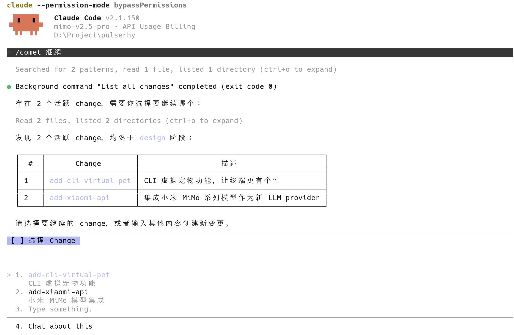
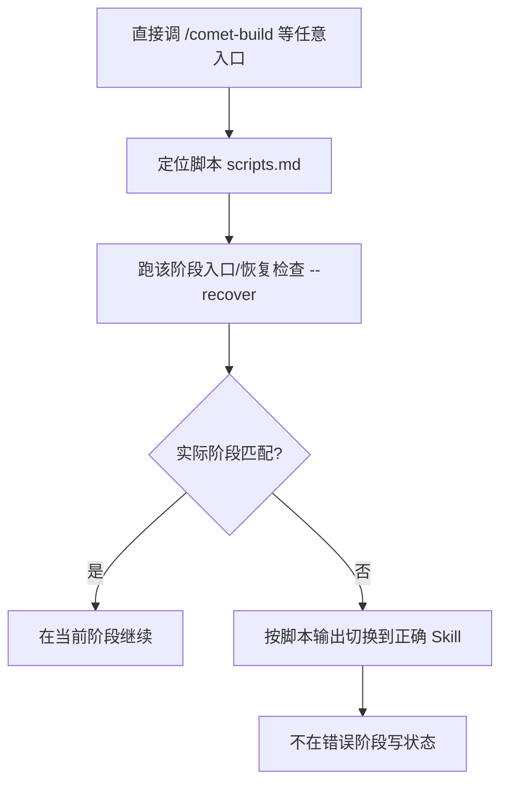

发生会话中断、上下文压缩或切换工作设备后，只需输入 `/comet 继续`。Comet 会优先读取项目配置，自动路由到 `/comet-native` 或 `/comet-classic`，并由相应工作流解析磁盘上的最新状态。两套工作流各自独立管理所属的 change。

## 最短恢复路径

在你的 Agent 界面中直接发送：

```text
/comet 继续
```

Comet 完全不依赖不会保留的对话上下文：在 Classic 模式下，它会重新读取项目配置、OpenSpec 规格、`.comet.yaml` 状态以及磁盘上的运行证据。

<Tip>
  <strong>日常恢复无需先执行 <code>comet status</code> 或 <code>comet doctor</code>。</strong>
  这两个命令是排查工具，仅在<strong>怀疑环境或配置异常</strong>时使用（如 CLI/Skill 未就绪、状态路由异常、产物证据缺失等）。日常要继续工作时，直接输入 <code>/comet</code> 即可一步到位。
</Tip>

## 也可以直接用自然语言说“继续”

自 0.4.0-beta.4 起，`comet init` 和 `comet update` 会自动将一段 Comet 恢复指引注入到项目的 `AGENTS.md` 与 `CLAUDE.md` 中。长时间运行的开发遇到上下文被压缩、新建会话或换端操作时，Agent 可能忘记当前会话正由 Comet 管理，而你也可能未输入斜杠命令。此时 Agent 会先运行只读的 `comet resume-probe` 探测命令，判断诸如“继续刚才的用户系统重构”是否能匹配到现有的 change，再决定是否重新唤起工作流。

| 交互场景 | 探测结果 | 行为表现 |
| --- | --- | --- |
| 明确要求继续、验证、归档或提交指定 change，且状态允许 | 返回 `auto_resume` | 自动进入对应阶段的正式入口 |
| 新会话仅语义模糊匹配到某个 change，或只有项目级选择意图 | 返回 `ask_user` | 必须先向你确认意向，确认后再进入 |
| 存在多个候选 change、状态冲突或需要你决定 | 返回 `ask_user` | 暂停并只问一个具体问题等你确认 |
| 仅咨询问题、明确表示不走流程，或当前已在 Comet 流程中 | 返回 `out_of_scope` | 不重复进入工作流 |
| 没有任何活跃中的 active Comet change | 返回 `none` | 不触发恢复动作 |

该机制仅约束 Comet 的无感恢复探测，且完整保留项目原有自定义规则。探测命令会按配置顺序检查一套工作流，配置损坏时不会自动改用其他方式。若希望彻底关闭自然语言触发的被动探测，可在 `.comet/config.yaml` 中设置 `ambient_resume: false`。该配置不影响显式 `/comet` 调用，也不会跳过既有的关键停顿点。

详见[恢复探测命令](/zh/cli/resume-probe)。

## Classic 恢复机制深度解析

<Note>
  本节属于<strong>底层实现原理</strong>：旨在说明 <code>/comet-classic</code> 在内部重读了哪些文件、遵循怎样的状态路由表。日常使用中你只需发送 <code>/comet 继续</code>，后续的状态判定与路由跳转均由 Comet 自动完成。
</Note>

`/comet-classic` 的韧性恢复依托于以下三条核心设计：

| 机制 | 说明 |
| --- | --- |
| **重读文件，解耦会话历史** | 每次恢复均在磁盘上即时扫描 active change 并读取 `.comet.yaml`，不凭聊天记忆猜测当前阶段 |
| **文件状态优先，自动纠偏元数据** | 若 `.comet.yaml` 记录与磁盘实际代码或文件冲突，以文件为准，Comet 自动纠偏状态元数据后继续推进 |
| **阶段规则路由确定** | 依据 `phase`、`workflow`、`verify_result` 等关键字段，精准分发至对应阶段 Skill（含轻量预设：build 阶段 hotfix → `/comet-hotfix`、tweak → `/comet-tweak`） |

恢复时的状态路由矩阵（从上到下按命中优先级分发）：

| 当前状态 | `/comet-classic` 路由目标 |
| --- | --- |
| `archived: true` | 变更已归档，提示流程已全部完成 |
| `verify_result: pass` | 路由至 `/comet-archive`（执行归档前审计与确认） |
| `verify_result: fail` | 停留在验证失败停顿点（等待你选择针对性修复或接受偏差） |
| `phase: verify` 或任务全部勾选完成 | 路由至 `/comet-verify` |
| `phase: build` | 按 workflow 分发至 `/comet-hotfix`、`/comet-tweak` 或 `/comet-build` |
| `phase: design` 或已有 change 但缺少 Design Doc | 路由至 `/comet-design` |
| `phase: open` 或 `.comet.yaml` 缺失 | 路由至 `/comet-open` |
| 磁盘上无任何活跃 change | 路由至 `/comet-open` 创建新变更 |

当工作区只存在**一个**活跃 Classic change 时，`/comet-classic` 会自动选中并进入；若存在**多个**活跃 change，则会打印候选列表供你手动挑选。

若通过自然语言继续任务并命中多个 active change，Comet 不会替你私自决定，恢复探测会固定返回 `ask_user` 等待你选定目标。

### Classic Change 的工作区复用

在创建或恢复 Classic change 时，Comet 会首先核验该 change 绑定的分支及 Git worktree。若存在已登记的匹配 worktree，Comet 将直接复用；若本地分支存在但 worktree 已丢失，恢复流程会自动重建。当工作目录、分支与 worktree 状态冲突时，Comet 会停顿等待你明确抉择，不会自动切换到无关工作区。

请确保在目标项目根目录下执行 `/comet` 或 `/comet 继续`。若有多个活跃 change，先选定目标再继续推进；切勿直接手动跨目录拷贝 change 文件夹来进行所谓的“手动恢复”。

## 跨设备与跨平台恢复

所有支持跨设备恢复的 Classic 状态均保存在 Git 追踪的仓库文件中：`.comet/config.yaml`、OpenSpec 规格根目录（新项目为 `docs/openspec/`）、各 change 的 `.comet.yaml` 与运行证据文件，以及 `docs/superpowers/`。因此，只要将代码推送到远端并在另一台机器或另一个 Agent 平台拉取，输入 `/comet` 即可直接进入工作流。Native change 的跨设备恢复请参考[恢复手册](/zh/native/recovery-playbook)。

<Note>
  请特别留意：工作区中尚未提交（uncommitted）的代码改动不会随 <code>git push</code> 同步到远端。更换机器前请务必先将代码 <code>commit</code> 并 <code>push</code>，否则新设备上虽然保留了 <code>tasks.md</code> 的勾选记录，但会缺失未提交的业务代码实现。
</Note>

### 跨设备断点恢复全景

只要 Git 仓库状态同步，无论你在哪台机器、使用哪款 IDE 或 Agent 客户端，`/comet` 都能从文件状态重建断点继续推进，无须手动传达背景信息。



## 上下文被压缩后的应对策略

如果当前变更所在的会话被平台强制压缩，重新发送 `/comet` 即可。Comet 会重新读取配置进入对应流，Classic 内部按恢复协议重新加载状态；并在必要时读取 `brainstorm-summary.md`、handoff 交接包和 `.comet/subagent-progress.md`。开发者无需手动翻阅或拼接这些底层文件。

## 从任意阶段入口定向恢复

日常恢复推荐统一使用 `/comet`。各个独立的阶段入口主要用于高级手动调试或断点介入：`/comet-open`、`/comet-design`、`/comet-build`、`/comet-verify`、`/comet-archive`、`/comet-hotfix`、`/comet-tweak`。

Comet 提供确定性入口校验：每个阶段 Skill 被调用时，都会在后台自动定位脚本并先执行入口校验与恢复检查（即 `comet state check <change-name> <phase> --recover`，不需要你手动运行），流转始终以磁盘上的实际文件为准：

- 若检查发现当前的 `phase`、`workflow` 或代码证据属于**另一个**阶段，Comet 会按检查输出自动切换到正确阶段，**不在错误状态下写入新数据**；
- 若工作区存在未提交代码改动，会按规则自动做变更归因。



<Tip>
  如果你明确知晓当前所处的阶段，完全可以跳过总入口路由，直接执行对应阶段 Skill。前置入口守卫会自动拦截任何与文件状态不符的调用。
</Tip>

## build 阶段恢复的特殊场景

build 阶段涉及代码生成与任务调度，相对最为复杂，但常见场景下 `/comet-classic` 均已实现全自动恢复：

| 现场状态 | 恢复行为 |
| --- | --- |
| `build_pause: plan-ready` 且执行配置齐全 | 重新发起同一次联合决策确认，你确认后自动清除挂起标记并推进 |
| `build_pause: plan-ready` 且 plan 存在，但执行配置缺失 | 重新进入 plan-ready 联合决策，**提示你补齐**执行模式、TDD 及审查配置（不会无故重新生成 plan） |
| `build_pause: plan-ready` 但 plan 文件丢失 | 判定为状态损坏，回退至 `/comet-build` 修复或重新生成 plan |
| `isolation`、`build_mode` 或 `tdd_mode` 未设置 | 返回对应配置节点，**引导你补充完成设置** |
| 配置均已就绪，尚有未完成任务 | 读取 `tasks.md` 中下一个未打勾的任务继续执行 |

在 subagent 模式（`build_mode: subagent-driven-development`）下恢复时，主会话**不会**直接编写业务代码，而是作为调度中心继续协调后台子代理分工执行。

## 存在未提交改动时的处理

如果工作区存在未提交的代码改动，Comet 会自动进行**变更归因**，无需你在提示词中手动说明修改了什么：

- **归属于当前 change**：自动吸收合并入当前实现并继续推进。
- **与当前 change 无关**：自动停顿并询问你的处理意向（并入当前变更 / 拆分为新 change / 本地保留 / 放弃更改）。
- **来源无法判定**：暂停并输出差异文件列表与判定依据，等待你确认。

已被 `.gitignore` 忽略的构建产物（如 `node_modules/`、`dist/` 等）会被自动剔除，不计入用户变更。

<Warning>
  工作区未提交改动（dirty worktree）仅代表代码客观事实，<strong>不会自动修改</strong> <code>.comet.yaml</code> 的 <code>phase</code> 或私自勾选 <code>tasks.md</code>。只有在通过变更归因、通过验证并满足阶段 Guard 条件后，工作流状态才会正式演进。
</Warning>

## 常见的人工介入场景

`/comet-classic` 会自动串联所有无歧义的执行步骤，但遇到**核心决策点**时必须等你决定。恢复过程中常见的人工交互节点包括：

- **验证未通过**（`verify_result: fail`）：需要你决策针对性修复还是接受已知偏差
- **plan-ready 暂停**：需要你确认实现方案并选择隔离等级与执行模式
- **build 策略缺失**：需要你补全 `isolation`、`build_mode` 或 `tdd_mode`
- **无法判定的未提交代码**：需要你明确该批代码的归属意图
- **多个活跃中的 change**：需要你指定当前要继续的具体任务

除上述情况及各阶段固有的审查停顿点（详见[五阶段决策与停顿点](/zh/concepts/decision-points)）之外，其余中间过程 `/comet-classic` 均会自动推进。

## 何时调用 comet status 与 comet doctor

这两条命令定位为**离线诊断工具**，并不是每次恢复都要跑的前置条件：

| 命令 | 推荐使用时机 |
| --- | --- |
| `comet status` | 想要在终端查看“当前变更处于哪个阶段、声明的产物是否完整”，或怀疑路由异常、证据脱节时 |
| `comet doctor` | 怀疑底层开发环境或依赖损坏时：例如全局 CLI 或 Skill 丢失、`.comet.yaml` 格式损坏、入口无法进入等 |

```bash
comet status        # 查看当前 active change 的阶段、任务进展及 runtime_eval 状态
comet doctor        # 深度诊断环境依赖、配置合法性及 Skill 安装完整性
```

其中 `runtime_eval` 会在磁盘上真实校验步骤产物是否完好，若发生丢失会明确打印修复建议（如 `run <命令> or restore missing evidence`）。

## 相关文档

- [恢复探测命令](/zh/cli/resume-probe) — 了解自然语言被动恢复的只读探测原理
- [状态异常排查与修复](/zh/guides/state-recovery) — 状态文件损坏或路由出错时的处理方法
- [项目文件结构](/zh/guides/project-structure) — 了解状态和产物在项目里的实际存放位置
- [自动流转机制](/zh/concepts/auto-transition) — 了解恢复后状态机如何推进
- [五阶段决策与停顿点](/zh/concepts/decision-points) — 整理流程中所有需要你决定的节点
