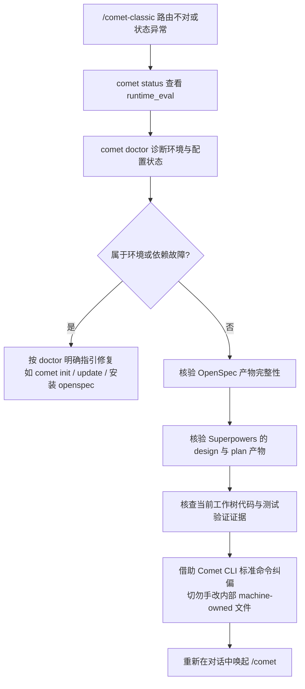

正常场景下的断点接续只需执行统一入口 `/comet`（详见[恢复中断的工作](/zh/guides/resuming-workflow)）。当进入 Classic 模式后，内部 `/comet-classic` 会基于磁盘文件自动推导当前阶段。本文重点聚焦内部状态异常、路由偏差或文件损坏等非正常情况的排查与修复。

面对状态异常时，首要原则是**恢复仓库的真实实际状态**，再让工作流基于真实证据继续推进。不要为了绕过校验而强行手工篡改状态字段。

<p align="center">
  
</p>

<p align="center">状态恢复先诊断真实文件证据，再按提示修复。不要为了推进流程手工伪造状态。</p>

## 首先自查：是偶发中断还是状态真正损坏

| 现象 | 问题性质 | 应对手段 |
| --- | --- | --- |
| 会话中断、上下文被压缩、切换了工作设备 | 正常的日常中断 | 直接执行 `/comet`（详见[恢复中断的工作](/zh/guides/resuming-workflow)） |
| 自然语言请求命中多个 active change | 需要你明确目标，并非状态损坏 | 查看恢复探测返回的 `reason`，明确告知要恢复的目标 change 名称 |
| 工作区存在未提交的代码改动 | 需先完成变更归因，并非状态损坏 | 确认改动属于哪一个 change，明确归属后继续 |
| `/comet-classic` 路由到的阶段不符合预期 | 元数据可能与磁盘文件事实存在脱节 | `/comet-classic` 会以文件为准自动纠偏；若依然偏差，运行诊断命令排查 |
| `.comet.yaml` 缺失或解析报错 | 状态文件损坏 | 运行 `comet doctor` 获取自动化修复建议 |
| 声明的产物或测试证据在磁盘上丢失 | 产物证据缺失 | 运行 `comet status` 查看 `runtime_eval` 检查点提示 |

## 核心诊断命令

```bash
comet resume-probe . --utterance "继续刚才的工作"  # 只读探测是否应自动唤起恢复
comet status        # 查看活跃 change 的 phase、任务完成度及 runtime_eval 详情
comet doctor        # 诊断环境依赖、Skill 完整性以及 .comet.yaml 的合规性
```

添加 `--json` 参数便于脚本或外部 Agent 解析。日常排查直接查阅默认的人类可读终端输出即可。

恢复探测仅负责进入 workflow 前的只读意图判断。当其返回 `ask_user` 时，往往是在新会话中向你确认是否要继续相关变更，或是存在多个候选、需要你抉择关键选项，并不代表当前状态出现损坏。详情请参考[恢复探测命令](/zh/cli/resume-probe)。

### comet status 检查重点

针对每个活跃中的 change，该命令会输出：`phase`、任务完成度 `done/total`、`workflow | build_mode`、当前运行步 `run_step`、运行时模式 `runtime_mode`、`runtime_eval`（核验声明的各步骤产物是否真切落盘）、`design`、`plan`、`verify_result`，以及下一步操作建议 `next:`。

若 `runtime_eval` 校验失败，终端会直接输出形如 `run <命令> or restore missing evidence (...)` 的操作提示，按需补齐缺失证据或重新运行该步骤即可。

### comet doctor 诊断范围

深度校验 Comet CLI 本地版本、OpenSpec CLI 环境、Superpowers 依赖、核心工作目录（`docs/superpowers/specs`、`docs/superpowers/plans`）、各 Agent 平台的 Skill 部署完整性、内置脚本、CodeGraph 状态，以及各个 change 的 `.comet.yaml` 格式有效性和 `runtime_eval` 证据链。常见提示包括：`npm install -g @fission-ai/openspec@latest`、`run: comet init`、`run: comet update --scope ...`。

## 典型故障现象与排查方案

| 故障现象 | 潜在诱因 | 优先处理步骤 |
| --- | --- | --- |
| `comet status` 显示没有下一步动作建议 | `.comet.yaml` 丢失或内容格式严重损坏 | 执行 `comet doctor` 查看修复建议 |
| build 阶段无法正常流转至 verify | 遗漏了 `build_mode`、`isolation` 或 `tdd_mode` 决策 | 再次调用 `/comet`，让 Classic 状态机引导你补选对应策略 |
| verify 已通过但无法触发 archive | 缺失验证报告、分支绑定关系发生偏移或状态校验未通过 | 补齐验证报告，切回绑定的工作分支，并由 verify guard 保持 `branch_status: pending` |
| 执行归档后变更依然显示为 active | 手动跨目录移动了文件，或状态同步发生脱节 | 运行 `openspec status` 核对目录，再重新调用归档命令接续（具备幂等性） |
| `/comet-classic` 报错提示 `.comet.yaml` 格式非法 | 该文件此前被手动编辑导致语法或结构错误 | 优先执行 `comet doctor` 自动修复；严重时直接从 Git 历史记录检出恢复 |

## 韧性恢复基本准则

- **永远以文件为证据**：OpenSpec 规格、Design Doc、实施 Plan、真实测试日志以及 Git 工作树是系统状态的唯一可信来源。
- **禁止手动篡改由 Comet 自动维护的 Run 内部字段**（如 `.comet/run-state.json` 等 machine-owned 文件）。
- **不要混淆关键字段**：`build_pause` 与 `build_mode` 承担完全不同的职责，切勿混为一谈。
- **不绕过 verify 失败停顿点**：遇到验证不通过时，必须由开发者主动选择修复缺陷或确认接受偏差。
- **禁止手工伪造 archive 归档标记**：归档必须经由 `/comet-archive` 或 `comet archive` 命令合规收敛。
- **切勿直接编辑 `.comet.yaml` 手动推进阶段**：阶段演进必须通过 `comet guard --apply` 或 `comet state transition` 校验后推进。

## .comet.yaml 缺失或内容损坏的处理办法

`/comet-classic` 内部设计了完备的容错修复路径：

- 若 `.comet.yaml` 丢失，系统会回退至 `openspec status --json` + `tasks.md` + `docs/superpowers/` 的文件状态反向推导并重建元数据。
- 若格式被改乱，系统以磁盘上的实际文件为准，可通过 `comet state set` 快速纠偏后继续。
- 若处于 `phase: open` 但 proposal、design、tasks 均已就绪，可先运行 `comet guard --apply` 纠偏并自动推进阶段。

若文件损坏过于严重导致无法自动修复，可直接通过 `git checkout` 检出上一次提交的 `.comet.yaml`，再运行 `comet doctor` 核验。

## 推荐排查流程图



## 相关文档

- [恢复探测命令](/zh/cli/resume-probe) — 了解如何区分自动接续、人工确认与不应入流的请求
- [恢复中断的工作](/zh/guides/resuming-workflow) — 日常正常中断只需一步唤起 `/comet`
- [项目文件结构](/zh/guides/project-structure) — 了解工作流状态在仓库中的实际存放位置
- [状态管理机制](/zh/concepts/state-management) — 深入了解 `.comet.yaml` 字段设计与守卫机制
