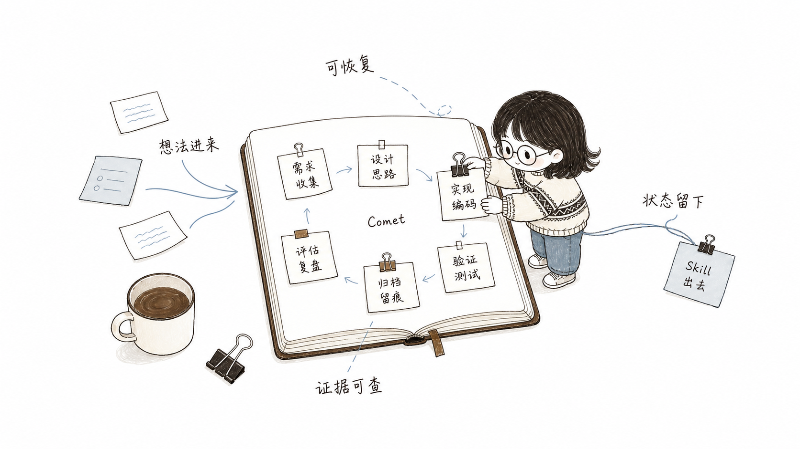
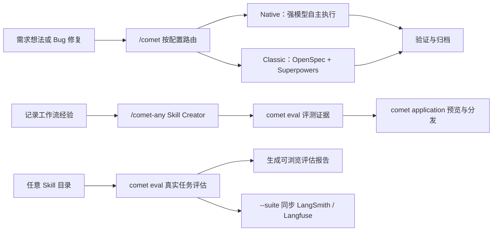

Comet 提供支持中断恢复的开发工作流，同时集成了 Skill 创建、评估与发布工具。你可以根据项目需要选择两套独立的工作流：

- **Native**：面向云端旗舰模型。通过明确需求范围、任务状态与验收证据进行约束，由模型自主决定具体实现策略。
- **Classic**：面向需要清晰步骤引导的模型。融合 OpenSpec 与 Superpowers，按严格的五阶段流程稳步推进变更。

  

项目配置、change 文档与验证证据共同持久化任务状态

## 你可以用 Comet 做什么

- 在 Agent 对话中输入 `/comet`，根据项目配置进入 Native 或 Classic 流程，完成需求创建、代码实现、验证与归档。
- 在 Agent 对话中输入 `/comet-any`，把自己的工作流整理并打包成可复用的 Skill。
- 运行 `comet eval`，在隔离的真实任务环境中评测本地 Skill 的实际表现。
- 运行 [`comet dashboard`](/zh/dashboard/overview) 启动只读看板，直观查看 Classic、Native 及 Supervisor Change 的阶段进度、子任务明细、验收结果、风险警告与 Git 状态。
- 运行 `comet application distribute` 预览并确认后，将 `/comet-any` 生成的 SDK 应用分发到各个平台。
- 运行 `comet status` 与 `comet doctor`，随时掌握当前阶段进度、下一步操作建议以及环境诊断报告。

## 不使用 Comet vs 使用 Comet

| 特性       | 没有 Comet                                                                         | 使用 Comet                                                                                                                                                                                                         |
| ---------- | ---------------------------------------------------------------------------------- | ------------------------------------------------------------------------------------------------------------------------------------------------------------------------------------------------------------------ |
| 中断恢复   | Agent 需要消耗额外的 Token 重建上下文，才能继续开发。                              | 直接基于 `.comet/config.yaml`、change 文档与运行证据恢复，完全不依赖上一轮会话上下文                                                                                                                         |
| 阶段控制   | Agent 容易跳步或遗漏验收，比如代码写完了文档却没勾选、或者在设计阶段就擅自写代码 | Native 严格约束循环产出与验收证据；Classic 提供带硬性质量门禁的五阶段流程，**当前阶段未全部达标不允许进入下一阶段**，避免交付出未经完整验收的变更                                                                     |
| 自动推进   | 需要人工记住复杂的 Skill 顺序并频繁手动接管                                        | Comet **自动推进**核心流程，**除需要你确认的决策点外，全程无需人工干预**                                                                                                                                        |
| 工作区管理 | 开发者需要手动创建、切换并记住每个任务对应的 Git 分支和 worktree                    | 创建 change 时即可自由选择 `current`、`branch` 或 `worktree`；Comet 会**自动创建并绑定工作区，并在恢复工作时准确切回对应目录，无需关心分支问题**                                                                                             |
| 并行协作   | 开发者必须自己拆解任务、理清依赖、分配工作目录、跟踪进度并手动合并                 | Supervisor Change **自动生成任务依赖图（DAG），分析任务关联，支持多会话与 Agent Teams 并行开发**，为各子任务准备**独立 worktree**，并在最终集成时统一验收                                                               |
| 个人记忆   | 每次开启新任务都要反复向 Agent 交代自己的语言习惯、技术偏好和协作风格               | **持续记录用户偏好与协作经验**，按任务提供相关记录，减少重复说明同一偏好。你可以查看、纠正、遗忘或回滚记录。                                                                                              |
| 项目知识   | 每个 Agent 都要重新摸索一遍项目架构、依赖关系和编码约定，反复消耗时间与 Token      | **根据执行情况自动记录项目事实与架构经验**，在任务执行中按需召回                                                                                                                                                 |
| 约束强度   | 单一流程很难同时兼顾不同能力档位的模型                                              | 强模型走轻量约束的 Native；更需规范引导的模型走 Classic，同时提供针对小改动的 hotfix 与 tweak 轻量预设                                                                                                            |
| 组合 Skill | 仅能写单个 `SKILL.md`，无法模块化组合、无法声明依赖、难以分发                       | 通过 `/comet-any` 生成带阶段产物、业务校验与恢复能力的 **SDK Skill 应用**——支持灵活组合 Rule、Hook 与依赖；**支持多平台分发**（通过 `comet application distribute` 分发到 39 个主流 AI 编码平台）                     |
| Skill 评估 | 单次运行未报错，凭借手感判断 Skill 的表现和稳定性。                                           | 通过 `comet eval` 在隔离环境中运行**真实评测任务**，结合多维 Rubric 评分体系与 `pass@k` / `pass^k` 指标**量化评估**能力与稳定性；评测失败时自动**归因**并给出修改建议。 |

  

Comet 根据项目文件持久化状态恢复 change，完全不依赖上一轮对话

## 主要入口

日常开发变更统一在 Agent 中输入 `/comet` 即可。它会自动读取项目配置并进入 Native 或 Classic 流程。各阶段的专用 Skill 属于底层路由，通常无需手动调用。

<CardGroup cols={2}>
  <Card title="Native 工作流" icon="meteor" href="/zh/concepts/native-workflow">
    面向云端旗舰模型，聚焦需求范围、状态与验收证据，由模型自主探索实现路径。
  </Card>
  <Card title="经典 Spec 工作流" icon="signature" href="/zh/concepts/workflow">
    面向需要明确阶段引导的模型/私有化部署模型，结合 OpenSpec 与 Superpowers 严格按五阶段推进。
  </Card>
  <Card title="CLI 操作台" icon="terminal" href="/zh/guides/install-and-update">
    用于环境安装、健康诊断、版本更新、Skill 管理、离线评测与多平台发布。
  </Card>
  <Card title="/comet-any Skill Creator" icon="blackberry" href="/zh/skill-creator/getting-started">
    用于创建、优化或组合可复用的 Skill 工作流。
  </Card>
  <Card title="Skill 评估系统" icon="vial-circle-check" href="/zh/eval/quickstart">
    通过可视化的评测报告验证 Skill 表现，为发布提供实测证据。
  </Card>
</CardGroup>

## 相关设计资料

<Info title="Comet 与业界实践对照" icon="scale-balanced">
  阅读 [Comet 与业界实践对照](/zh/concepts/comet-vs-industry)，了解 Comet 在评测体系、运行时、工作流控制与 Skill 分发上采用的现代工程实践。
</Info>

## 安装后你会得到什么

运行 `comet init` 后，Comet 会将所需的 Skill、Rule、Hook、运行时脚本以及平台适配文件安装到项目目录或全局环境。

<Tip>
  要开启你的第一次项目变更，请阅读 [快速开始](/zh/quickstart)。要创建自定义的复用 Skill，请阅读 [组合任意 Skill 快速上手](/zh/skill-creator/getting-started)。
</Tip>
