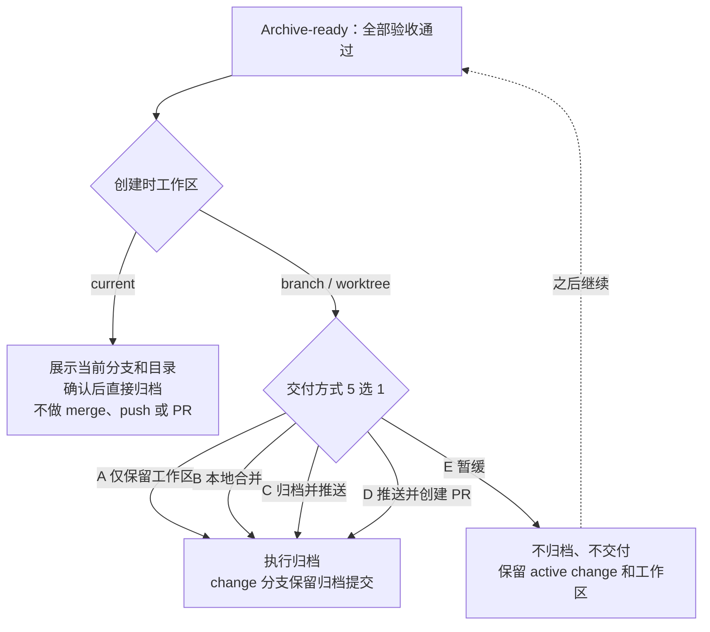

在默认 SDK 任务中，流程会先走完 Verify 阶段并确认接受当前验收结论，随后由 Runtime 执行归档。新创建的任务支持在当前会话内直接闭环验收；历史存量任务则严格尊重原有验收约定。Git 提交、分支合并、远端推送及 Pull Request 将严格按照你已授权的范围分别执行与核验。

## SDK 任务的归档与交付流程

1. **核对验收结论并确认**：仔细查阅完整验收结论，确认接受当前结果，或针对缺陷选择继续修复、微调需求。Agent 基于当前提案与状态版本提交决策。若你事前已明确委托“测试全部通过后自动接受并归档”，则可在验收通过后连续执行归档；否则系统仍会停顿等待你明确确认。
2. **执行归档操作**：若系统响应已提示归档完毕，直接核对交付结果即可；若仍有挂起的归档动作，执行当前 `continuation` 给出的 `comet native archive <change-name> --json`。若需提前核对改动，可追加 `--dry-run` 进行预览，切勿自行添加兼容模式下的 `--finish` 参数。
3. **完成 Git 交付闭环**：Runtime 确认归档完成后，Agent 会依照项目的 Git 提交规范执行已获批准的操作，并核对本地 Commit 与远端分支状态。请注意：SDK Run 的完成仅代表 SDK 层面的工作流归档就绪，并不等同于代码已经推送到远端或 PR 已经创建。

Supervisor 复合任务可在子项验收绑定条件均达成时，按流程声明自动完成父级集成并清理临时工作区；若工作区存在未提交改动或状态未明，系统会安全保留现场。若执行过程中发生中断，应优先回溯原 Run，依照返回的恢复路径接续推进，切忌以二次归档试图跳过尚未完成的交付步骤。

对于尚未推进完毕但业务上已废弃的任务，可先运行 `comet native cancel <change-name> --dry-run --json` 预览取消影响。正式取消操作会安全保留已有代码、Commit、分支与工作区现场；已正式归档的历史任务不可通过取消来替代交付。

<Note>
  下述五种 `--finish` 选项及内置 Git 自动化操作主要针对兼容模式（Compat）任务。新创建的 SDK 任务统一遵循上述的标准归档与独立交付流程。
</Note>

<Accordion title="兼容模式（Compat）：旧版任务参考">

所有验收项均已通过且变更进入就绪状态（Archive-ready）后，需要你决策本次归档的具体交付方式。是否需要人工裁决、界面会提供哪些选项，取决于创建该 change 时所选定的工作区模式。在做出选择前，Comet 会完整展示当前分支、目标主干分支、物理路径及各项选项的预期影响，你可当场确认，亦可选择暂缓处理。

在需要明确接受 Verifier 结果的场景中，Comet 会同步呈现交付选项。你可以合并回复“接受当前结果，仅保留工作区”，亦可直接指定本地合并、推送到远端或一键提 PR。Agent 会将你的明确决策转译为归档参数，避免反复重复确认；但若新增了额外的交付动作或影响范围发生变化，仍会再次提示核验。

## 归档前预检机制

进入 Archive-ready 状态后，Runtime 会在 `continuation` 中给出预检或已确认的归档指令。选定交付策略后，对应命令会自动附带 `--finish` 参数；对于已核准的归档，可在单次调用中一并完成预检与执行前复核。若需核对自定义 Commit 信息，可先行运行 `archive --dry-run`。

预检机制会全方位扫描归档产物、当前工作区干净度与生成文件列表。一旦发现阻碍因素，会明确列出阻塞诱因、涉及路径及下一步确认命令。`--dry-run` 绝不会产生真实的归档、提交、分支合并或远端推送；只有在预检明确通过后，方可执行 Runtime 返回的唯一确认命令。

## 遵循项目 Commit 规范

Comet 的内置 Git 提交操作会严格触发项目已配置的 Git Hook。Agent 会在提交前核查仓库的 Commit Message 约定；若有格式要求，可通过 `--commit-message` 定制归档提交说明，在选择本地合并时还可通过 `--merge-message` 定制 Merge 说明。两项参数均原生支持中文与多行文本排版，预览阶段会展示最终文本，命令重试时也会完整保留。具体用法详见 [Native 命令概览](/zh/scripts/comet-native#归档)。

## 交付选项与工作区隔离的关系

在新建 change 时，你可以选择沿用当前目录，也可以让 Comet 自动创建独立分支或 Git worktree。流转至 Archive 时，交付策略直接取决于最初的工作区选择：

- **current 本地工作区**：变更直接在当前所在分支与目录中实施，归档时无需选择复杂的交付方式。Comet 会展示当前分支与路径，明确说明归档**不会擅自执行任何 merge、push 或 PR 操作**；你确认无误后直接就地完成归档。
- **branch / worktree 物理隔离**：变更运行在独立的临时分支与物理目录中。归档后是否需要合回目标分支、是否推送远端或拉起 PR，完全由你定夺。Comet 会直观展示当前的 change 分支、目标集成主干及工作区路径，并提供以下五项互斥选项供你裁决。

## 五项互斥交付选项

| 选项编号 | 对应参数 | 实际交付效果 |
| --- | --- | --- |
| A 仅保留工作区 | `keep` | 完成归档并在 change 分支上生成归档 Commit；不合并、不推送、不拉 PR，原样保留当前分支与物理目录 |
| B 本地合并 | `merge` | 完成归档并生成归档 Commit，随后将 change 分支本地合并进目标分支；不推送远端、不建 PR |
| C 归档并推送 | `push` | 完成归档并生成归档 Commit，随后直接将 change 分支推送到远端仓库；不合并进目标主干、不建 PR |
| D 推送并创建 PR | `pull-request` | 完成归档并生成归档 Commit，推送 change 分支后，以目标分支为 base 自动发起 Pull Request |
| E 暂缓归档 | — | 暂不执行归档与交付，安全保留当前 active change 与完整工作区现场，稍后继续处理 |

若选择 A–D，Comet 会携带对应参数执行归档（`--finish keep|merge|push|pull-request`）；若选择 E，则流程在当前检查点安全停顿。全流程决策拓扑如下：

## 各交付选项执行后的 Git 状态对比

选项 A–D 均会在 change 分支上安全创建归档 Commit，核心差异在于 Commit 生成后的后续动作：

- **A 仅保留工作区**：change 分支新增一条归档提交，目标主干分支保持原样，本地分支与工作区物理目录完全保留。本次归档绝不会清理该 worktree。
- **B 本地合并**：change 分支的归档提交被本地合并入目标主干分支，远端仓库完全不受影响。
- **C 归档并推送**：归档提交随 change 分支一同推送到远端 Git 仓库，目标主干分支不发生变动，亦不自动创建 PR。
- **D 推送并创建 PR**：分支推送至远端后，以目标分支为基准建立 PR，后续的代码审查与合并交由团队 PR 协作流处理。
- **E 暂缓归档**：归档与交付动作均处于挂起状态，本地 Git 仓库不发生任何提交或分支变更。

选择选项 A 保留的 worktree 不会在归档时被移除；而对于选择 B、C、D 成功完成归档的任务，若该 worktree 已经没有未提交的散落文件，Comet 会主动提示是否清理该临时 worktree，由你最终确认。

## 归档前的最终人工确认门禁

归档前是否需要额外的一道明确确认，由配置项 `native.archive_confirmation` 控制，默认为 `automatic`：

- `automatic`：当 Verify 最终验收全部通过后，Runtime 可自动执行归档动作。自动归档绝不会越权替你决定交付策略——若使用了 branch 或 worktree 隔离，仍必须在 A–E 中由你选定一项。
- `required`：最终 Verify 验收通过后，Runtime 会在最终的 Archive 候选集处停下，等待你针对本次归档给出明确授权。中间的常规排错修复轮次绝不会打扰你；选择暂缓归档同样会完整保留当前 active change。

配置规则详见 [Native 配置 · 归档确认](/zh/native/configuration#归档确认)。

当 `required` 策略生效时，Comet 会安全挂起，等待你明确批准；获得授权后，才会执行带 `--confirmed` 标志的正式归档命令。`--dry-run` 仅供无副作用预览，不计入确认。`--confirmed` 仅在 change 真实处于等待最终归档授权的 Archive-ready 状态时才被采纳，修复流转的中间状态不会索取该参数。若在等待批准期间产品需求或验收基准发生了变更，change 会自动退回 Shape 阶段重新收敛，先前的验证结论与归档授权立即失效。

## 暂缓归档后的接续机制

若选择了选项 E，当前 change 保持为活跃的 active 状态，工作区物理文件与所有已打勾的测试结论完整封存。下一次在 Agent 中要求继续该 change 时，Runtime 会重新读出先前记录的状态元数据与下一步指引，平滑唤醒至 Archive-ready 检查点，重新展示同样的交付决策项。

若在挂起期间你手动改动了用户可见的需求或验收规则，change 会自动退回 Shape 阶段重新对齐目标，并重新跑通验证，绝不会机械复用失效的旧验证结论与归档批准。

## 归档中断与并行 Change 的容灾兜底

当 Archive 事务在执行途中遭遇异常中断时，Runtime 会完整保留事务断点与可执行状态，重试时直接从已成功的步骤断点接续。详细恢复规则请参考[恢复手册](/zh/native/recovery-playbook)。

若项目 Git Hook 拦截了 Commit Message 或 Merge Message，已完成的归档数据安全保留，未竟的 Git 收尾动作将留存至恢复流程继续推进。Agent 会依循团队规范修正未完成步骤的文本说明并重试事务，绝不重复生成已完成的 Commit 或重复发布 Spec。恢复时会自动沿用原先选定的交付策略；只有在出现新的歧义时才会再次发问。在恢复彻底完成前，Status 状态会如实标记交付待完成。

若多个活跃的 active change 引用了同一份基础 Spec，Archive 阶段会率先提示明确归档次序，按序处理后再进入本节的交付选项。排序与锁控制规则请参考[多 Change 并行与冲突控制](/zh/native/multi-change-and-conflicts)。

延伸阅读：[Native 产物与状态](/zh/native/artifacts-and-state)、[多 Change 并行与冲突控制](/zh/native/multi-change-and-conflicts) 以及 [恢复手册](/zh/native/recovery-playbook)。

</Accordion>
