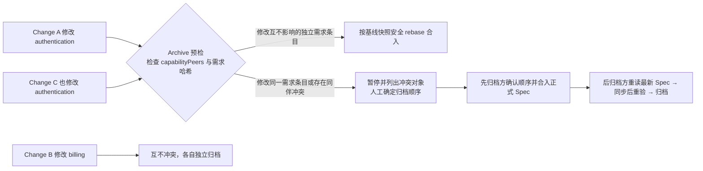

开发团队经常同时推进多个需求：一边在改登录重试策略，一边在加报表导出功能。如果把它们混在同一个分支或同一个对话里，代码改动、测试结果和需求文档很容易搅成一团。

Native 允许在同一个仓库中同时维护多个独立 Change，日常全流程都可以在对话里用自然语言指挥 Agent 完成，底层用两层机制保证互不干扰：

1. **Git worktree 隔离代码**：让并发编码的多个 Agent 各写各的目录和分支，互不覆盖未提交修改。
2. **需求级 Spec 冲突检测与归档冲突处理**：在修改项目正式规格前，按能力（capability）和具体需求条目（Requirement ID）检查冲突，先理清业务契约的演进顺序，再做代码集成。

## 一、先选对组织方式

| 需求之间的关系 | 推荐做法 |
| --- | --- |
| 属于同一个大目标，需要拆成多个子模块协同集成、统一全量验收 | 使用 [Supervisor Change](/zh/native/supervisor-change)，由父任务统筹依赖调度、串行集成和最终终审。 |
| 彼此独立的业务目标，可以各自编码、各自测试、分别上线 | 为每个目标分别创建独立的 Native Change。 |

下文重点说明如何同时规划和并行开发多个独立的 Native Change。

## 二、共享分支规划多个 Shape，按需延迟开工

在 Git 项目中，不必一上来就为每个刚冒出来的想法新建一堆 worktree。你可以先在同一分支上，让 Agent 依次为多个需求建好 Shape 做澄清和方案评审（非 Git 项目仍使用单 change 的当前工作区流程）。

例如，你可以先在对话里提出第一个需求 `/comet 调整登录重试与账号锁定策略`，规划完之后接着提第二个需求 `/comet 给数据看板增加异步 CSV 导出`。每个 Change 各自保存独立的 `brief.md`、草拟 Specs、验收项和审批记录；需要切回前一个继续补充时，直接说“切回 `session-retry-policy` 继续规划”即可。

同一规划目录同一时刻只由一个 Agent 写入；如果需要让多个 Agent 同时编写材料或代码，直接告诉 Agent 为每个任务使用独立 worktree。

### 批准 Shape 后暂缓进入 Build

想先把两三个需求的方案一口气确认完、稍后再分批开工时，在最终确认直接告诉 Agent：“确认这个方案，但先别开始写代码”。

Agent 会在后台确认时自动附带 `--defer-build` 以及状态版本号、预期动作等保护参数（只传 `--defer-build` 不会生效，必须伴随你的明确批准）。批准会保存下来，创建执行工作区和进入 Build 会推迟到你后续通知开工时。

## 三、开工时自动准备独立 Build worktree

当你准备开工某一个已批准的 Change 时，在对话中告诉 Agent“开始实施 `session-retry-policy`”即可。Agent 会在后台触发开工，Runtime 会自动判断当前规划工作区是否还有其他活跃 Change：

- **没有其他活跃 Change**：直接沿用当前工作区进入 Build，不额外建 worktree。
- **仍有其他活跃 Change**：Runtime 自动执行交接，并在响应中返回新工作区路径（`executionCwd`）：
  1. 创建独立分支（默认 `comet/<change-name>`；如果已被占用，自动追加 `-build`、`-build-2` 等后缀避免冲突）与独立 worktree（`.worktrees/<change-name>`）；
  2. 把原 Run、change 正式材料和已确认的 Shape 批准完整交接到新 worktree；
  3. 后续编码都在新 worktree 中进行；原规划目录会被 Hook Guard 自动保护，禁止继续写入已交接任务的代码，但你仍可在原目录查看其状态，或切换到其他 Shape 继续规划。

### 交接前的四条基线保护

自动准备 Build worktree 基于当前分支的已提交代码（`HEAD`），交接本身**不会**替你自动提交或推送，防止把半成品误带进新分支：

1. **已跟踪代码需先提交**：如果 change 产物目录和 `.comet/config.yaml` 之外存在未提交的已跟踪代码修改，Runtime 会暂停并提示先提交实施基线，提交后再继续即可。
2. **未跟踪文件留在原目录**：未跟踪的临时文件不会自动带入新 worktree。
3. **复用已有分支或 worktree 时必须保持干净且基线一致**：如果目标分支已存在，它必须与当前 `HEAD` 指向同一个提交；如果复用的 worktree 中存在未提交改动，或已经包含该 change 的 Runtime 归属记录，Runtime 会保留双侧现场并拒绝覆盖。
4. **交接中途中断可直接重试**：保留目标目录，重新让 Agent 继续即可完成剩余交接，不会重复创建 Builder 或覆盖已完成步骤。

## 四、一开始就直接隔离开发

如果你一开始就明确要开多个窗口并发开发，或者当前目录已经有未提交改动、已有其他活跃 Change，只需在提需求时说一句“用独立 worktree 开发这个需求”。

如果没有主动说明隔离方式：

- 当前目录干净且没有其他活跃 Change 时，默认在当前目录（`current`）直接推进；
- 一旦当前目录有未提交工作、已有其他活跃 Change，或你提到需要隔离/并行，Agent 会自动弹出单选题让你选择 **A（当前目录 `current`）**、**B（新分支 `branch`）** 或 **C（独立 `worktree`）**，并在后台创建对应分支与目录。

## 五、工作区绑定与分支校验

Runtime 会把每个 Change 的隔离方式、change 分支、目标分支和工作区目录持久化绑定，每次写入和推进前都会核验，拦截三类常见失误：

- 在主目录误改属于独立 worktree 的业务代码；
- 本地手动切了 Git 分支后，沿用上一个 Change 的状态继续推进；
- 复制旧会话里的上下文，在错误目录执行 Build 或 Archive。

普通状态查询和诊断只检查当前所在的工作区，不会自动扫描本机所有 worktree。要操作独立 worktree 里的任务，把 Agent 窗口切到对应目录即可。如果只是本地误切了分支，切回原绑定分支就能继续；如果确实要在当前分支接管一个没有运行中动作的空闲任务，告诉 Agent 在当前分支重绑即可（后台会确认无未核对执行后再调用 `--rebind`）。

## 六、需求级 Delta Spec 合并与归档冲突处理

在 Native 中，每个产品能力（capability）的正式规格存放在项目的 `specs/<capability>/spec.md`。修改已有能力时，change 目录中通过 `delta.yaml` 记录需求级变更操作（`add`、`modify`、`remove`、`rename`），并附带目标需求条目的前置哈希（`expected_hash`）与完整需求基线快照（`base_requirements`）。

这样的细粒度设计，让多 Change 并行归档既安全又灵活：



具体分三种情况：

1. **修改不同能力**（例如 `authentication` 与 `billing`）：全程独立并行 Build、Verify 和 Archive，代码合并由常规 Git 流程处理。
2. **修改同一能力但无语义冲突**：基于需求条目的前置哈希和独立性校验，Runtime 能区分哪些需求条目互不影响，在安全范围内完成合并。
3. **修改同一需求条目或存在并发同伴冲突**：
   - Archive 预检（`archive.prepare`）会提前发现冲突并暂停，列出冲突的同伴 Change（`capabilityPeers`）或具体冲突的需求 ID，**不会直接覆盖主 Spec**；
   - 你在对话中决定先归档哪一个，Agent 会在后台附带 `--serial-first <change-name>` 确认顺序并将先归档方合入正式 Spec；
   - 后归档一方拉取最新的正式 Spec，结合自己的 `brief.md` 保留双方意图并重新整理目标规格，执行 Runtime 给出的同步动作，并针对最新基线补跑受影响的验证，再继续归档。

## 七、归档前的需求范围一致性核对

Archive 还会核对当前 Change 声明的目标 Specs 和验收项是否与 Shape 阶段确认的基线一致：

- 代码内部重构、清理实现细节但需求未变时，归档正常推进；
- 目标 Specs 范围或验收标准发生未经确认的偏离时，流程会退回 Shape 重新确认，防止正式规格变更绕过你的审批。

## 八、并行过程中你需要做哪些决定

日常的分支创建、worktree 交接、绑定校验和预检都由 Agent 和 Runtime 自动处理，你通常只在四个关键节点拍板：

1. 新提需求时，决定建独立 Change 还是用 Supervisor Change 拆分；
2. 当前目录已有未提交改动或活跃 Change 时，选择 `current`、`branch` 还是 `worktree`；
3. 分支或工作区与绑定记录不一致时，选择切回原分支还是在当前分支重绑；
4. 多个并行 Change 改动同一份能力 Spec 且存在冲突时，决定归档先后顺序以及后归档一方的同步结果。

<Accordion title="底层原理与终端排障命令（日常由 Agent 自动执行，无需手敲）">

以下为 Agent 在共享规划、延迟开工、worktree 创建和分支重绑时调用的公开命令，供需要深入了解或手动排查时参考：

```bash
# 在当前分支规划多个 Shape 并切换当前任务
comet native new session-retry-policy --isolation current --json
comet native new dashboard-export --isolation current --json
comet native select session-retry-policy

# 批准 Shape 但暂缓创建执行工作区与进入 Build
comet native next session-retry-policy --summary "Shape confirmed" \
  --confirmed --defer-build --expected-state-version <n> --expected-action confirm-shape

# 开工触发自动创建 Build worktree 并返回 executionCwd
comet native next session-retry-policy --session <会话标识> --json

# 创建时直接指定分支或独立 worktree（可选 --change-branch / --worktree-path）
comet native new session-timeout --isolation branch --target-branch main
comet native new session-timeout --isolation worktree --target-branch main

# 空闲 Run 显式重绑到当前分支
comet native select <change-name> --rebind --json
```

</Accordion>

延伸阅读：[Supervisor Change：让大型任务安全并行](/zh/native/supervisor-change)、[Native 的运行时保护与故障恢复](/zh/native/safety-and-recovery) 与 [Native 任务恢复](/zh/native/recovery-playbook)。
