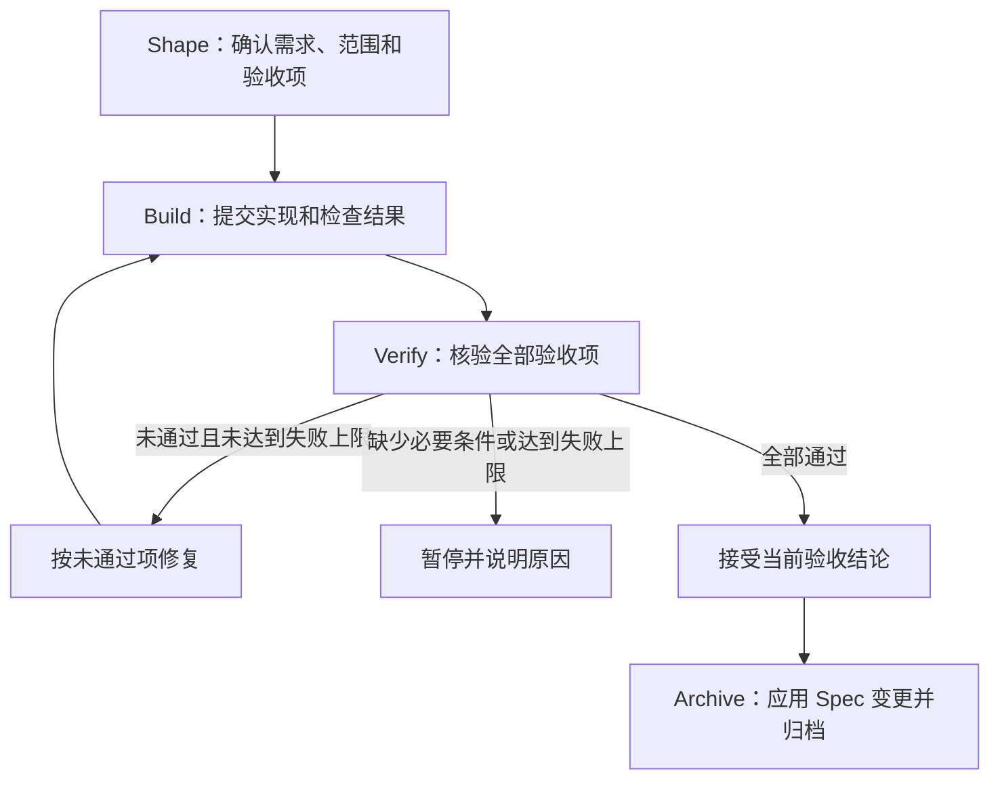

Native Loop 从你确认 Shape 后开始。Builder 按已确认的需求提交实现，Verifier 检查当前实现是否满足全部验收项。实现有缺陷时，Native 将未通过的验收项带回 Build，供下一轮修复。验收通过并接受当前结果后，Runtime 才会归档。

## 确认 Shape，再开始实现

Shape 提案会列出本次 change 的目标、范围、关键决定和验收项。确认前先核对哪些行为必须交付，哪些明确排除在本次范围外。这些内容会写入 `brief.md` 和相关 Specs，供 Build 和 Verify 使用。决策范围见 [哪些决定需要你确认](/zh/native/decision-ownership)。

如果你希望先确认方案、稍后再开始编码，可以在批准 Shape 时延后 Build。Comet 会保留批准，开始实现时再准备工作区。操作见 [多 Change 并行与冲突控制](/zh/native/multi-change-and-conflicts)。

## 示例：区分登录失败的提示

假设你要调整登录页面。密码错误时显示“账号或密码错误”，触发限流时显示“尝试次数过多，请稍后再试”。本次只改提示，服务端的返回码和限流规则保持原样。

| 进度 | Agent 做什么 | 你会看到什么 |
| --- | --- | --- |
| Shape 待确认 | 在 `brief.md` 中写明改动范围，把密码错误和限流分别列为验收项。 | 你核对两种提示和不改动的行为，确认后允许开始 Build。 |
| 第一次 Build 和 Verify | Builder 提交实现。Verifier 发现密码错误提示正确，但限流时仍显示相同文案。 | 第一项通过，第二项未通过。Native 保留 Shape 批准，把未通过项带回 Build。 |
| 修复后的 Build 和 Verify | Builder 补上限流分支。Verifier 检查限流提示，也核对修复未改变密码错误的行为。 | 两项均通过后，可以查看验收证据并接受当前结果。 |
| Archive | Runtime 将已确认的 Spec 变更应用到项目 Specs，并归档 change。 | Agent 报告归档位置，并按你指定的范围核对 Git 交付。 |

如果第二轮只是修正已批准的限流提示，继续修复实现。如果你希望改成“显示剩余等待秒数”，这涉及新的展示规则，先更新 Shape 提案并确认。相关文件见 [Native 产物与状态](/zh/native/artifacts-and-state)。

## 在 Build 和 Verify 之间迭代

Builder 实现已确认的需求，运行必要检查并提交结果。Verifier 将这次实现与原始请求、正式需求材料和验收项逐条核对。检查如何执行、何时可以复用，以及何时使用独立审查，见 [验证与修复](/zh/native/verification-and-repair)。

如果实现需要修复，下一轮 Build 优先处理未通过项，并检查修复影响的其他行为。再次进入 Verify 时，仍要覆盖这个 change 的全部验收项。如果问题需要改变目标、范围或验收标准，Agent 会更新 Shape 提案，交给你确认受影响的决定。

验收失败达到配置上限时，Runtime 会暂停自动修复，返回当前原因和可执行的下一步。失败上限见 [Native 配置](/zh/native/configuration)。

## 接受验收结论并归档

当全部验收项通过后，Agent 会向你展示当前实现的验收结论、检查结果和已知限制。你可以接受结果，也可以要求继续修复。如果你已明确同意“全部通过后自动接受并归档”，Agent 可在满足该条件时直接推进。

归档完成后，Git 提交、推送或创建 Pull Request 仍按你确认的交付范围执行。见 [归档与交付](/zh/native/archive-and-delivery)。
