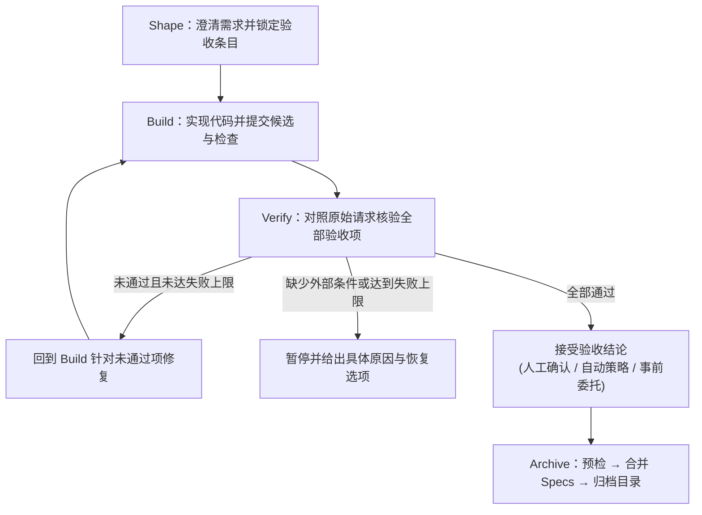

在日常用 AI 写代码时，最常见的问题不是模型写不出代码，而是“聊着聊着偏离了原需求”“测试没跑全就说完成了”“修了一个 Bug 弄坏了另一个功能”。

**Native Loop** 把一次开发变更归并为四个边界清晰的阶段：**Shape**（澄清并锁定验收标准）、**Build**（编写实现并提交检查结果）、**Verify**（对照原始请求逐项核验全部验收项）和 **Archive**（应用 Spec 变更并归档）。日常使用中，你只需用自然语言和 Agent 对话，所有状态推进与校验命令都由 Agent 在后台自动调用 Runtime 完成，只在需要你拍板、出现外部阻塞或达到失败上限时停下来。



## 一、Shape：把口头想法变成可核验的验收条目

在 Agent 对话中直接输入 `/comet <你的需求>` 即可启动任务，不需要自己敲 CLI 命令。Agent 会在后台自动调用创建命令，并把你的**原始请求原文**（通过 `--task` 参数）原样存进运行记录（Run）中。这样在后续 Verify 阶段，验收者就能直接对照你的原话核对，防止整理文档时悄悄漏掉要求。

在 Shape 阶段，Agent 会先查明代码库现状，再按你的配置向你澄清会影响可见结果的歧义（澄清机制见 [Sequential 与 Batch 澄清](/zh/native/clarification-modes)，决策分工见 [哪些决定需要你确认](/zh/native/decision-ownership)）。整理完 `brief.md` 和目标 Specs 后，流程分两步完成：

1. **提取结构化验收条目**：Agent 从正式文档中提取逐条可验证的验收标准并提交给 Runtime（`shape.prepare`），由 Runtime 为每条分配稳定 ID（如 `A1`、`A2`）。Native 不强迫文档套用死板模板，但提交给 Runtime 的验收条目必须清晰、可验证且不重复。
2. **明确确认后才进入 Build**：Agent 向你展示完整 Shape，包括目标与范围、关键决定、全部验收项和非目标边界（Non-goals）。只有你在对话中明确确认后，Runtime 才放行进入 Build。

如果你打算先敲定几个需求方案、稍后再写代码，只需在确认时告诉 Agent“确认方案，但先不开始写代码”。Agent 会在后台自动附带 `--defer-build` 参数保存批准，把创建工作区和进入 Build 推迟到你后续要求开工时（详见 [多 Change 并行与冲突控制](/zh/native/multi-change-and-conflicts)）。

## 二、实战示例：从第 1 轮修复到归档

以一个具体需求 `login-error-message` 为例：登录页密码错误时提示“账号或密码错误”，触发限流时提示“尝试次数过多，请稍后再试”；只改前端文案与分支处理，不改服务端状态码和限流规则。

| 阶段 | Agent 与 Runtime 在背后做什么 | 你的参与与看到的结果 |
| --- | --- | --- |
| **Shape** | 在 `brief.md` 中写明范围、两条验收项（A1 密码错误、A2 限流提示）和“不改服务端”的非目标，向 Runtime 提交验收条目。 | 审阅完整方案并在对话中确认；Runtime 保存批准并进入 Build。 |
| **Build（第 1 轮）** | Builder 读取需求与上下文（含自动注入的适用个人偏好与项目知识），修改前端代码并运行界面测试，在后台一次提交候选实现与测试结果。 | 无需手动触发下一步，Runtime 校验回报后直接进入 Verify。 |
| **Verify（第 1 轮）** | Verifier 以只读视角对照原始请求和全部验收项：模拟 401 时提示正确（A1 `passed`），但模拟 429 时仍显示密码错误（A2 `failed`）。 | 第 1 轮总判定 `fail`。Runtime 保留已确认的 Shape，将 A2 的失败依据带回 Build（`iteration` 递增）。 |
| **Build + Verify（第 2 轮）** | Builder 补上 429 分支并重跑受影响的界面测试，提交第 2 轮候选。Verifier 核验 A2 通过，同时确认 A1 未受影响，复用仍有效的接口检查结果。 | A1、A2 全部 `passed`，Runtime 生成最新的 `verification.md`。 |
| **Archive** | 接受结果后依次完成预检、合并 Specs 与目录归档（`archive.prepare` → `archive.execute` → `archive.finalize`）。 | 收到归档位置摘要；按你在对话中确认的交付方式完成 Git 提交、推送或 PR。 |

如果第 2 轮只是修好已批准的限流提示，属于实现修复，留在 Build ↔ Verify 循环内完成；如果你临时改成“限流时还要显示倒计时秒数”，这就改变了用户可见行为，Agent 会先带你回到 Shape 更新方案并重新确认。

## 三、Build ↔ Verify 的推进机制

### 1. 后台一次提交，自动串联内部步骤

Builder 完成代码修改并用平台工具运行构建、测试或静态检查后，将本轮改动称为**候选实现**，并在后台向 Runtime 一次提交摘要、检查结果和已知限制。Runtime 会严格校验回报结构，然后自动依次执行所有已获批准的内部步骤，直接返回下一项待办任务或需要你确认的节点，减少无谓的来回交互。

如果你对某个关键改动希望由独立视角把关，只需在对话中告诉 Agent“这个改动请做独立审查”。Agent 会在后台为本轮验收开启独立审查标记（`--review independent`），该要求会持久化在 Run 中，必须由不同于 Builder 的只读会话领取并核验；常规任务则默认在当前会话切换到只读角色完成（报告记为 `self-reviewed`）。

### 2. 轮次计数、增量修复与失败上限

Runtime 在底层区分两个计数，避免把平台重试误算成代码修不好：

- **`iteration`**：Builder 提交候选实现的轮次。每次修复代码并重新提交，轮次加 1。
- **`attempt`**：同一候选下 Verifier 的执行次数（例如因平台异常重试 Verifier 时递增，不消耗代码实现轮次）。

修复循环中的三条实用规则：

1. **聚焦未通过项，但验收覆盖全量**：Runtime 通过 `previous_unresolved_ids` 提示本轮修复重点，但下一轮正式 Verify 仍会覆盖全部验收项，防止修东墙拆西墙。
2. **不搞机械停机**：如果某条验收项 ID 连续两轮未通过，Runtime 不会仅凭“未通过列表没变短”就强行打断，而是交由 Agent 结合实际代码改动判断是否在有效推进。
3. **失败次数上限**：同一已确认验收目标允许的最大真实 Verify 失败次数由 `.comet/config.yaml` 中的 `native.max_verify_failures` 控制（默认 `5`）。达到上限时，Runtime 停止自动循环，列出历次失败记录并由你决定继续换思路、调整需求还是取消任务。

关于检查复用、证据要求与独立审查的完整细则，见 [验证与修复](/zh/native/verification-and-repair)。

## 四、循环中途改代码、改文档或改需求

在 Build、Verify 或待归档阶段，如果你或 Agent 直接编辑了文件，Native **不会因为文件变动就粗暴作废已有批准或全部测试**，而是由 Agent 读取 Git 差异和原文后分类处理：

| 改动类型 | 实际处理方式 |
| --- | --- |
| 注释、排版或文字说明微调（未改变行为和验收含义） | 保留当前阶段、已确认批准和有效检查证据，直接继续。 |
| 发现代码实现遗漏，但需求范围没变 | 在对话中要求继续修复，Agent 在后台走实现修订路径回到 Build 修改，保留原 Shape 批准。 |
| 用户可见行为、目标或验收标准发生变化 | 在对话中说明新需求，Agent 在后台退回 Shape，先说明改动影响，再重新确认完整 Shape。 |
| 与当前 change 无关的新需求 | 另建一个独立 change，避免把无关改动混进当前交付。 |

## 五、接受验收结论、归档与取消任务

当全部验收项通过后，进入 Archive 有三种方式：

1. **人工确认接受（`native.archive_confirmation: required`）**：Agent 展示逐项验收结论、检查证据和已知限制，你在对话中明确同意后进入归档。
2. **项目自动归档策略（`native.archive_confirmation: automatic`）**：即使开启自动策略，Runtime 也会同时校验四个条件——① 验收结果为 `pass`、② 接受验收是唯一的待处理等待项、③ 没有待处理的证据等待、④ 没有任何 `running` 或 `unknown` 动作——全部满足才会自动接受并继续归档。
3. **单次事前委托**：如果你在开始或修复时明确告诉 Agent“全部通过后直接接受并归档”，Agent 会在提交通过结果时自动绑定本次委托（`--accept-on-pass`）。该委托仅覆盖本次接受与本地归档，不自动批准 Git merge、push、PR 或工作区清理。

### 取消未完成的任务

如果中途确认不再需要这个任务，直接在对话里告诉 Agent“取消当前任务”并说明原因即可。Agent 会在后台将任务标记为取消，使其不再计入活跃 change，也不会伪造归档记录；你已写的代码、Git 提交、分支和工作区目录会完整保留，是否删分支或清理 worktree 由你自行决定。已完成的 change 不能取消。

<Accordion title="底层原理与终端排障命令（日常由 Agent 自动执行，无需手敲）">

以下为 Agent 在后台推进 Native Loop 时调用的公开 CLI 入口，仅在你需要脱离对话于终端排查或手工操作时参考：

```bash
# 创建 change 并保存用户原始请求（Agent 启动 /comet 时自动调用）
comet native new <change-name> --task "<用户原始请求>" --json

# 领取任务并一次回报实现与检查结果（--review 可选 current-session 或 independent）
comet native next <change-name> --session <会话标识> --action <action-id> --result <json-file|-> --review current-session --json

# 预览并取消未完成的 change（保留代码、分支与工作区）
comet native cancel <change-name> --dry-run
comet native cancel <change-name> --reason "需求已合并到其他方案"
```

</Accordion>

归档与 Git 交付核对见 [归档与交付](/zh/native/archive-and-delivery)，配置项详见 [Native 配置](/zh/native/configuration)。
