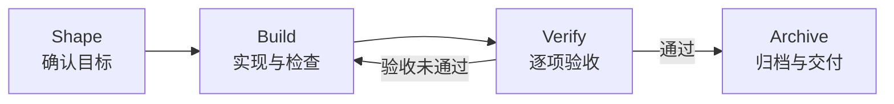

在 Native 工作流中，你只需在对话里提出需求目标，并在 Shape 阶段确认关键决策与验收项。Comet 会在后台自动管理工作区绑定、推进 Build 实现与 Verify 验收，并在全部通过且确认结果后执行归档。新建任务可在当前会话内直接验收，也可按需发起独立审查。

Native 面向云端强推理大模型设计。它省去了繁琐的中间模板文档，直接以清晰的目标边界、平台实测结果与逐项验收证据作为交付标准。

## 开始前准备

- Node.js 22.16 及以上的 22.x 版本，或 Node.js 24 及以上版本
- Git
- 任意一个[受支持的 AI 编码平台](/zh/platforms)

## 三步启动一次 Native 变更

<Steps>
  <Step title="安装并初始化 Comet">
    在项目根目录的终端运行一次初始化命令：

    ```bash
    npm install -g @rpamis/comet
    comet init --workflow native
    ```

    初始化会自动安装 Native 所需的 Skill 与 Rule 配置；在支持 Hook 的平台上还会一并注册统一 Router。项目配置默认保存在 `.comet/config.yaml`，生成的 Native 文档默认保存在 `docs/comet/`。

  </Step>

  <Step title="在 Agent 对话里提出需求">
    打开你的 Agent 客户端，在对话框中输入：

    ```text
    /comet 为用户资料页增加头像上传能力
    ```

    `/comet` 是 Agent 对话中的 Skill 入口（不是终端命令），会自动读取项目配置并进入 Native 工作流。后续创建任务、推进阶段与校验状态都由 Agent 在后台自动完成，你不需要手动输入 `comet native ...` 命令。

    创建任务时，你可以沿用当前工作区，也可以让 Comet 自动创建独立分支或 Git worktree；需要并行处理多个需求时，Comet 会借助独立 worktree 自动隔离代码。

  </Step>

  <Step title="确认关键决策与验收项，进入自动推进">
    Native 会先扫描仓库现有代码，只就影响可见行为、默认规则或兼容性的关键分歧向你提问。例如：

    ```text
    Comet: 已分析项目，检测到现有 src/components/Avatar.tsx。请确认：
    1. 上传文件大小限制（默认 2MB）？
    2. 允许的图片格式（默认 JPG/PNG/WebP）？
    ```

    你直接用自然语言答复（如“保持默认 2MB，支持 JPG 与 PNG”）并确认最终需求摘要即可。确认后，Comet 会把约定写入 `brief.md` 和目标 Specs，随后自动推进 **Build**（代码实现）与 **Verify**（逐项验收），全程无需手动切换阶段。

  </Step>
</Steps>

## Comet 在背后为你处理什么

- **准备并绑定工作区**：自动创建或复用分支与 worktree，恢复时回到正确目录；发现分支或目录不匹配时立即拦截写入，避免改错目录。
- **持续推进工作流**：Agent 负责查代码、写实现和跑测试，Runtime 负责状态记录、防过期保护和下一步指引，只在需要你做决定或遇到阻塞时暂停。
- **用真实证据核验完工标准**：Agent 通过平台工具执行构建与测试，Verify 对照你的原始请求和全部验收项逐条核查；发现未通过项时带着失败依据回到 Build 修复，同时复用仍有效的检查。
- **跨会话与跨设备恢复**：需求、目标 Specs 和恢复检查点保存在仓库文件中。窗口关闭、上下文压缩或换设备后，不需要重新交代背景就能继续。
- **按需注入上下文**：启用 Personal Memory 与 Project Knowledge 后，Comet 自动检索与当前任务相关的个人偏好和项目知识。

Native 的核心流程包含四个阶段：



## 中断后继续

重新打开项目会话后，直接在 Agent 对话中输入：

```text
/comet 继续
```

Agent 会在后台读取保存的任务状态、工作区绑定和下一步指引，从最近检查点继续推进。如果本地代码、分支或 worktree 与记录不一致，它会主动停下说明差异，不会私自切分支。

如果你想在终端里离线查看进度，随时可以运行只读命令 `comet status`：

```text
Default Workflow: native

Native Changes:
  ● avatar-upload [Build] (active)
    Target: 为用户资料页增加头像上传能力
    Next: Builder 提交候选后进入 Verify 逐项验收
```

如果想在浏览器里查看变更进度、验收明细与工作区状态，可以启动本地控制台：

```bash
comet dashboard   # 启动本地 Web 控制台
comet doctor      # 检查安装依赖、配置有效性与环境状态
```

## 变更完成后你会获得什么

任务完成后，除了最终实现的业务代码，项目中还会保留 `brief.md` 需求摘要、更新后的项目 Specs、状态文件以及 `verification.md` 验收报告。后续协作者或新的 Agent 会话可以直接基于这些文件继续演进，不依赖历史聊天记录。

进一步阅读：[Native 工作流](/zh/concepts/native-workflow)、[Supervisor Change](/zh/native/supervisor-change)、[归档与交付](/zh/native/archive-and-delivery)、[Native 产物与状态](/zh/native/artifacts-and-state) 以及 [Native 任务恢复](/zh/native/recovery-playbook)。
