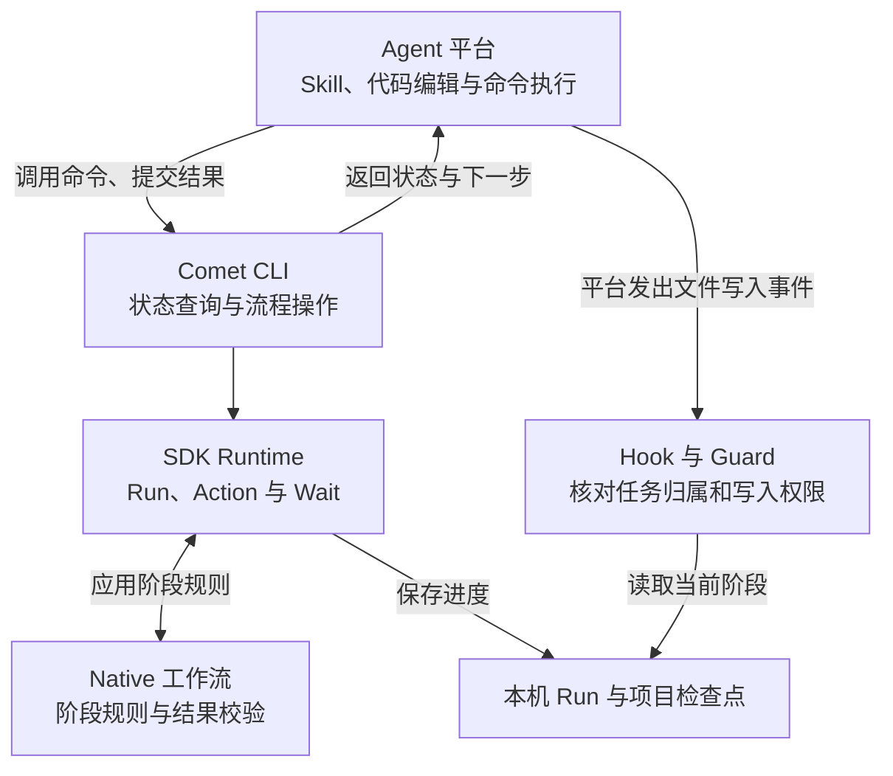

新建 Native change 时，Comet 会创建一个 **Run**，记录这次工作流的阶段、待办动作、执行结果和用户决定。Native 工作流定义 Shape、Build、Verify 和 Archive 的业务规则，SDK Runtime 按规则推进并保存 Run。Agent 在平台提供的会话和工具中编写代码、运行检查并判断验收结果。

## Native 工作流定义阶段规则

Native 工作流规定何时可以开始实现、提交验收结果和归档。Shape 确认将需求、范围和验收项作为后续工作的依据。Build 提交代码候选及其实际检查结果，Verify 对照同一候选逐项验收。待接受的验收结论与当前候选关联，确认后才进入 Archive。需要修改需求或修复实现时，Native 根据改动的内容决定回到哪个阶段。各阶段的准入条件见 [Native Loop](/zh/native/native-loop)。

## SDK Runtime 保存并推进 Run

**Action** 是 Runtime 记录的一项工作，例如准备 Shape 确认材料、接收 Builder 交接或执行归档。**Wait** 记录流程正在等待的决定，例如确认 Shape 或接受验收结论。Runtime 校验结果是否对应当前 Action，确认是否对应当前提案，然后把变化写入同一个 Run。若 Agent 尝试提交过期决定，Runtime 会要求它重新读取当前状态。

`comet native status <change-name> --json` 用于查看状态，`comet native next <change-name> --json` 用于推进流程。Runtime 可以连续执行已获批准的内部步骤，直到需要 Agent 执行工作、你作决定，或遇到阻塞。Skill 读取响应中的 `continuation`，据此继续或向你说明卡在哪里。接续操作见 [任务推进与中断恢复](/zh/native/continuation-and-checkpoints)。

## Agent 实现代码并提交验收证据

Builder 和 Verifier 通过 Agent 平台工具运行项目的构建、测试和静态检查。提交结果时，Agent 报告实际执行的命令、工作目录、结果以及未执行的检查。Verify 可以复用仍适用于当前代码和环境的检查结果，只补跑受改动影响或缺少证据的检查。Verifier 仍须对照全部验收项给出结论。

验收可以在当前会话完成。若本次 change 要求独立审查，Runtime 会在领取验收任务时核验执行者是否符合独立性要求。报告记录实际采用的审查方式。证据和修复规则见 [验证与修复](/zh/native/verification-and-repair)。

## Hook 和 Guard 检查写入

当已启用的 Hook 收到 Agent 平台提供的文件写入事件时，Guard 根据工作区选择、当前阶段和目标路径判断是否放行。例如，选中的 change 仍在 Shape 等待确认时，Guard 会拦截该 change 的实现写入。

如果你要在同一工作区处理无关改动，可以用 `comet native select --none` 取消选择。正式工作流材料和 Runtime 数据仍受保护。选回原 change 后，Guard 恢复应用它的阶段限制。适用范围见 [Native 的运行时保护与故障恢复](/zh/native/safety-and-recovery)，选择命令见 [状态与选择](/zh/cli/status)。

## 项目文档和本机 Run 支持接续

需求与验收材料保存在项目中。本机 Run 及执行记录保存在 Comet 用户数据目录中，主工作区和各 Git worktree 分开保存。`comet-state.yaml` 用于查看进度，并在关键节点保存恢复检查点。编辑该文件或 `verification.md` 无法改变 Run 的流程状态。

本机记录缺失时，Runtime 可以用有效检查点和配套项目材料恢复原 Run。若 Action 已派发但结果不明，Agent 需要先核对原执行结果，再决定如何接续。诊断时可运行 `comet native doctor <change-name>`。参见 [Native 产物与状态](/zh/native/artifacts-and-state)和 [SDK 失败恢复与未知结果](/zh/sdk/recovery)。

## Archive 应用 Specs 并完成 Run

验收结论获准接受后，Runtime 核对归档条件，将已确认的 Spec 变更应用到项目 Specs，移动 change 并记录归档结果。归档中断时，Runtime 核对原 Run 和已写入的文件，从已知进度继续。Git 提交、推送和 Pull Request 由 Agent 按你批准的交付范围处理。操作见 [归档与交付](/zh/native/archive-and-delivery)。

## Supervisor 协调并行任务

[Supervisor Change](/zh/native/supervisor-change) 在同一个父 Run 中协调子任务。每个子任务在自己的 Git worktree 中实现并验收，Runtime 按依赖顺序安排集成。子任务集成后，父 change 继续完成整体验收和归档。
