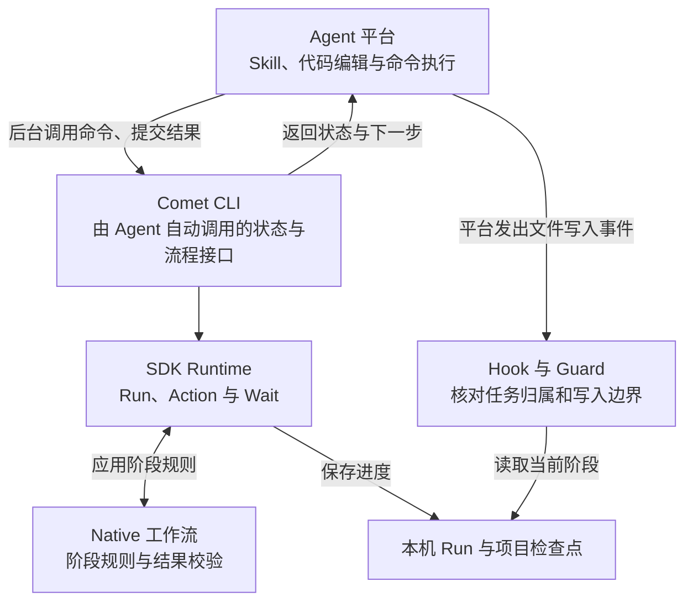

新建 Native change 时，Comet 会在后台创建一个 **Run**，记录这次任务的阶段、待办动作、执行结果和你的确认决定。Native 工作流定义 Shape、Build、Verify 和 Archive 的业务规则，SDK Runtime 按规则推进并保存 Run；Agent 在平台会话中编写代码、运行测试并完成验收。**日常使用中，你只需用自然语言与 Agent 对话，所有底层 CLI 调用都由 Agent 自动完成。**

## Native 工作流定义阶段规则

Native 工作流规定什么时候可以开始写代码、什么时候提交验收以及什么时候允许归档。Shape 确认后，需求、范围和验收项成为后续依据；Build 提交候选实现及其检查结果，Verify 对照同一候选和原始请求逐项验收；验收通过、你接受验收结果后，才进入 Archive。中途需要修代码或改需求时，Native 根据改动性质决定回到 Build 还是回到 Shape。详细流转见 [Native Loop](/zh/native/native-loop)。

## SDK Runtime 保存并推进 Run

- **Action**：Runtime 记录的一项具体工作，例如提交验收条目、接收 Builder 交接、执行验收或归档。
- **Wait**：流程正在等待你确认的决策点，例如确认 Shape 或接受验收结论。

Runtime 会校验回报是否匹配当前 Action、确认是否绑定当前方案与状态版本，再把更新写入同一个 Run；如果 Agent 试图提交过期决定，Runtime 会拒绝并要求重新读取最新状态。

在后台，Agent 通过 `comet native status` 只读查看状态，通过 `comet native next` 推进任务；Runtime 会自动依次执行已获批准的内部步骤，直到需要 Agent 执行任务、需要你作决定，或遇到阻塞。详细机制见 [任务推进与中断恢复](/zh/native/continuation-and-checkpoints)。

## Agent 实现代码并提交验收证据

Builder 和 Verifier 直接调用 Agent 平台工具运行构建、测试和静态检查，并在提交结果时如实报告执行的命令、工作目录、退出状态、日志引用及未运行的检查。Verify 可以复用仍适用于当前代码和环境的检查结果，只补跑受改动影响或缺少证据的检查，同时仍要对照全部验收项逐条给出结论。

验收默认在当前会话以只读角色完成；如果你要求独立审查，Runtime 会在领取验收任务时校验执行者必须是独立只读会话，报告也会注明实际采用的审查方式。细则见 [验证与修复](/zh/native/verification-and-repair)。

## Hook 和 Guard 检查写入

在支持并启用 Hook 的 Agent 平台上，每次文件写入都会先经过 Guard 检查。Guard 根据当前工作区选中的任务、所处阶段和目标路径判断是否放行——例如选中的 change 还在 Shape 等待确认时，Guard 会拦截对业务代码的写入。

如果你想在同一工作区临时做与 Comet 无关的修改，只需在对话里告诉 Agent 暂时退出当前任务选中（Agent 会在后台调用 `comet native select --none`）。取消选中后，普通代码写入会放行，工作流正式文件与 Runtime 数据依然受保护；回到原任务时再让 Agent 选回即可。详细规则见 [Native 的运行时保护与故障恢复](/zh/native/safety-and-recovery)。

## 项目文档和本机 Run 支持恢复

需求与验收材料保存在项目仓库中。本机完整 Run 存放在用户主目录的 Comet 数据目录（默认 `~/.comet`，可通过 `COMET_DATA_DIR` 配置），主工作区和每个 Git worktree 彼此隔离。`comet-state.yaml` 用于展示进度并在关键节点保存恢复检查点（`run_checkpoint`）；直接手工编辑该文件或 `verification.md` 无法改变 Run 的状态。

本机记录丢失或换设备后，Runtime 可以从有效检查点和仓库材料还原原 Run；如果某个 Action 已派发但结果不明，Agent 会先核对原平台执行与文件副作用再决定下一步。排障流程见 [Native 任务恢复](/zh/native/recovery-playbook) 与 [Native 产物与状态](/zh/native/artifacts-and-state)。

## Archive 应用 Specs 并完成 Run

你接受验收结论后，Runtime 依次校验归档条件、将确认的 Spec 变更合入项目正式 Specs、移动 change 目录并登记归档结果。归档中途中断时，Runtime 会核对原 Run 与事务记录，从已完成处继续而不重复写入。Git 提交、推送和 Pull Request 由 Agent 按你确认的交付范围处理，见 [归档与交付](/zh/native/archive-and-delivery)。

## Supervisor 协调并行任务

[Supervisor Change](/zh/native/supervisor-change) 在同一个父 Run 中编排大型需求的子任务。每个子任务在独立 Git worktree 中实现与验收，Runtime 按依赖顺序串行合入集成分支；全部合入后，父任务在集成 worktree 完成全局全量验收、交付与清理。
