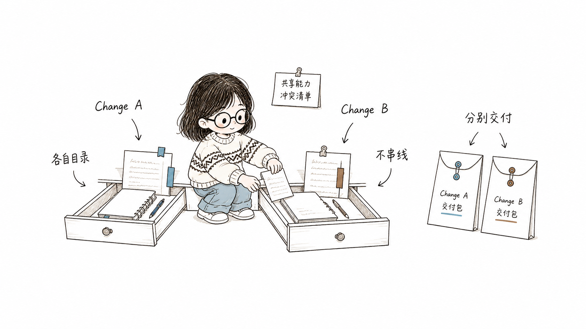

当手里同时有两个互不依赖的需求时，你不需要等第一个做完再开第二个，也不必把它们硬塞进同一个分支。整个并行规划、隔离开发、冲突处理与归档过程，都可以在对话里用自然语言指挥 Agent 完成，底层分支、worktree 和状态绑定由 Comet 自动管理。

本文用两个常见业务需求走一遍完整流程：

- **`session-retry-policy`**：登录连续输错 5 次后锁定账号 15 分钟，登录成功后清零计数，前后端状态保持一致；
- **`dashboard-export`**：运营看板支持按当前筛选条件导出 CSV，大数据量时转后台异步导出并展示进度与失败重试。

这两个需求互不依赖、可以各自独立上线，适合作为两个**独立的 Native Change** 并行推进。



## 先确认：独立 Change 还是 Supervisor Change

| 考量维度 | 多个独立 Native Change | Supervisor Change |
| --- | --- | --- |
| 交付关系 | 各自独立上线，互不等待 | 作为同一个整体统一交付 |
| 验收边界 | 每个 Change 各自完成 Verify 即可归档 | 子任务分别验收并合入集成分支，最后由父任务全量终审 |
| 依赖关系 | 无依赖，或仅依赖已发布的既有代码 | 子任务之间存在明确上下游依赖或跨模块集成 |
| 归档方式 | 各自独立执行 Archive 与 Git 交付 | 子任务不单独归档，由父任务统一归档交付 |

哪怕两个需求出自同一场评审会，只要它们能各自独立验收、独立上线，就优先拆成独立 Change。

## 两种并行启动方式

### 方式 A：先在同一分支规划两个 Shape，开工时自动切 worktree

如果你习惯先把两个需求都澄清完、确认好方案，再分头编码，可以直接在当前 Git 分支的对话里依次提出：

```text
/comet 调整登录重试策略：连续输错 5 次锁定 15 分钟，成功登录后清零。先在当前分支规划方案。
```

规划完第一个、准备接着规划第二个时，可以在确认第一个 Shape 时告诉 Agent“确认这个方案，但先不开始写代码”（Agent 会在后台自动附带 `--defer-build` 保存批准），然后再提出第二个需求：

```text
/comet 给数据看板增加按当前筛选条件异步导出 CSV 的功能，支持进度查询和失败重试。先在当前分支规划。
```

需要切回前一个继续补充时，直接说“切回 `session-retry-policy`”。等你决定正式开工、告诉 Agent“开始写 `session-retry-policy`”时，因为规划目录中还有另一个活跃 Change（`dashboard-export`），Runtime 会自动为它创建独立分支 `comet/session-retry-policy` 和 worktree `.worktrees/session-retry-policy`，把原 Run、正式材料和已通过的批准交接过去，并返回新的执行目录（`executionCwd`）。交接前需确保规划目录之外的已跟踪代码修改已提交，交接本身不会自动提交或推送。

### 方式 B：一开始就分别建独立 worktree

如果你打算立刻开两个窗口让两个 Agent 同时从 Shape 做到 Archive，直接在对话里告诉 Agent“用独立 worktree 创建这个需求”（或者当当前目录已有未提交改动/已有其他活跃任务时，在 Agent 弹出的隔离方式单选题里选 C `worktree`）。Runtime 会自动建好 `.worktrees/session-retry-policy` 和 `.worktrees/dashboard-export` 以及对应分支。

## 两个窗口并行开发，互不干扰

目录准备好后，直接开两个独立的 Agent 会话窗口分别推进：

```text
会话 A
  工作目录：.worktrees/session-retry-policy
  推进任务：session-retry-policy

会话 B
  工作目录：.worktrees/dashboard-export
  推进任务：dashboard-export
```

两个任务各自独立运行 Shape → Build → Verify → Archive，底层有四层保护防止串台：

1. **独立运行记录**：本机 SDK Run 存放在用户主目录的 Comet 数据目录中，按工作区严格隔离，会话 A 提交结果绝不会写到会话 B 的 Run 上。
2. **显式任务归属**：每个工作区的 `.comet/current-change.json` 记录当前选中的 change。如果在主目录想临时改一段与 Comet 无关的代码，告诉 Agent“先临时改个无关文件，退出当前任务选中”即可（后台调用 `select --none`，放行普通代码但继续保护工作流文件）；回到任务时再说继续即可。
3. **Hook Guard 防跨目录误写**：如果 `session-retry-policy` 已经交接到 `.worktrees/session-retry-policy`，却有人在原主目录继续修改它的代码，Hook Guard 会立即拦截并指出正确目录。
4. **保留主目录无关改动**：worktree 隔离只作用于对应 change，不会清理你在主仓库里留着的个人调试文件。

## 在错误目录或错误分支操作时如何处理

为了防止跨目录误操作，普通状态查询和诊断只检查当前所在工作区，**不会自动扫描本机所有 worktree**。

- 如果在 `.worktrees/dashboard-export` 里误推进 `session-retry-policy`，Runtime 会因为目录和分支绑定不匹配直接拦截，并提示预期的路径和分支。切回 `.worktrees/session-retry-policy` 继续即可，不要在错误目录新建同名任务。
- 如果在某个 worktree 里不小心切了别的分支，切回原分支就能恢复；确实要在当前分支接管同一个空闲 Run 时，告诉 Agent 在当前分支重绑即可（后台会在确认无运行中或结果未知动作后调用 `--rebind`）。

## 处理同一能力 Spec 的归档冲突

`session-retry-policy`（修改 `authentication`）和 `dashboard-export`（修改 `dashboard`）涉及不同能力，可以完全独立地一路归档。

但假设此时还有一个并行任务 `session-device-limit`（设备并发上限），它和 `session-retry-policy` **都修改了 `specs/authentication/spec.md`**。当其中一方进入 Archive 时，Native 会按以下流程保护正式规格不被覆盖：

### 1. 需求级自动判断与冲突拦截

在修改已有能力时，change 通过 `delta.yaml` 记录需求级变更操作（`add`、`modify`、`remove`、`rename`）及前置哈希：

- 如果两个任务修改的是 `authentication` 里**互不影响的独立需求条目**，Runtime 能基于基线快照安全合并；
- 如果两个任务修改了**同一个需求条目**或存在并发冲突，Archive 预检会暂停，列出冲突的并行 Change（如 `session-device-limit`）或具体冲突的需求 ID，等待你在对话中决定先后顺序。

### 2. 先归档一方确认顺序

你在对话中决定先归档 `session-retry-policy` 后：

1. Agent 在后台附带 `--serial-first session-retry-policy` 确认顺序（命令同时绑定状态版本号，状态一旦变化会拒绝旧指令）；
2. `session-retry-policy` 将改动合入项目正式的 `specs/authentication/spec.md`，完成目录归档。

### 3. 后归档一方同步新基线并重新验证

随后推进 `session-device-limit` 时，不能拿旧基线下跑过的测试直接归档，Agent 会按四步带你同步：

1. 拉取并重读已被更新的正式 `specs/authentication/spec.md`；
2. 结合自己的 `brief.md`，保留双方需求意图并更新当前 change 的目标 Spec（或 `delta.yaml`），执行 Runtime 给出的同步动作；
3. 按最新基线调整受影响的代码实现，通过平台工具补跑相关测试；
4. 重新通过 Verify 验收，再完成归档。

## 多任务下的中断恢复与跨设备切换

- **本机恢复指定任务**：进入对应 worktree 目录，在对话中直接说明任务名称（如“继续 `dashboard-export`”）。
- **新会话自然语言恢复**：当同一工作区存在多个活跃 change 且你只说“继续刚才的”时，后台只读恢复探针 `comet resume-probe` 会返回候选项让你明确选择，绝不会猜一个去改别的任务。
- **跨设备继续**：在旧设备停下推进，提交并推送各自分支上的代码、`.comet/config.yaml` 以及 change 目录下的 `comet-state.yaml`（内含 `run_checkpoint`）、`brief.md` 和目标 Specs。在新设备拉取后，回到对话让 Agent 诊断并从检查点恢复原 Run（详见 [Native 任务恢复](/zh/native/recovery-playbook#本机-run-丢失与跨设备恢复)）。

## 独立归档与 Git 交付

每个独立 Change 的归档与 Git 交付互不影响：你可以把 `session-retry-policy` 推送并提 PR，同时把 `dashboard-export` 留在本地分支暂不推送。

SDK 归档完成后（Run 状态为 `completed` 且业务状态为 `done`），再按各自确认的范围核对本地提交、merge、push 或 PR（详见 [归档与交付](/zh/native/archive-and-delivery)）。归档后的临时 worktree 如果已经干净且不再需要，经你确认后再用 Git 清理；存在未提交修改的目录始终保留。

<Accordion title="底层命令参考（日常由 Agent 自动执行，终端排障时可手动查看）">

```bash
# 共享分支规划两个 Shape 与切换归属
comet native new session-retry-policy --isolation current --task "..." --json
comet native new dashboard-export --isolation current --task "..." --json
comet native select session-retry-policy

# 直接创建独立 worktree
comet native new session-retry-policy --isolation worktree --target-branch main --task "..." --json

# 在目标 worktree 中只读查看指定任务的详细状态
comet native status dashboard-export --details --json
```

</Accordion>

延伸阅读：[多 Change 并行与冲突控制](/zh/native/multi-change-and-conflicts)、[Native 的运行时保护与故障恢复](/zh/native/safety-and-recovery) 与 [Native 任务恢复](/zh/native/recovery-playbook)。
