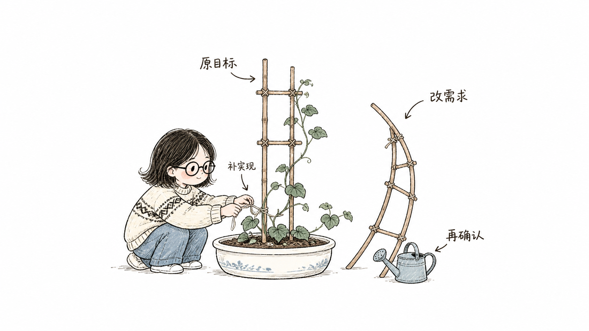

做开发几乎不可能一次定死所有细节。推进到一半时，最常见四种情况：

1. **代码没写对**：需求没变，但实现和已确认的验收项对不上；
2. **需求本身变了**：产品决定调整交互行为、阈值或边界条件；
3. **中途手动改了文件**：在 Build、Verify 或待归档阶段直接修改了文档或代码；
4. **冒出范围外新想法**：跟当前任务无关，可以独立上线。

日常遇到这些变化时，你只需在对话里直接告诉 Agent 发生了什么变动，不需要手动输入状态机命令——Agent 会在后台自动调用对应的修订与保护命令，既保留仍然有效的成果，又避免过期测试结论混进归档。本文以“用户登录会话管理（`session-timeout`）”为例，说明在不同阶段遇到变动时的处理方式。



## 先判断变动属于哪一类

判断标准很直接：**用户可见的系统行为或验收标准有没有变**。

| 变动类型 | 典型示例 | 你在对话里怎么做（由 Agent 在后台推进） |
| --- | --- | --- |
| **实现修订** | 已确认会话超时为 30 分钟，但代码误写成 60 分钟 | 告诉 Agent 按原需求修复实现，后台走 `--revise-implementation` 回到 Build。 |
| **需求变更** | 产品评审决定把会话超时从 30 分钟改为 2 小时，或追加“退出时踢掉其他设备” | 告诉 Agent 需求变了，后台走 `--revise-requirements` 回到 Shape，先看前后变化摘要再重新确认。 |
| **不影响行为的微调** | 在 Verify 或待归档阶段改了注释、排版或普通文档措辞 | 保留原 Run、阶段、批准和有效检查，直接继续，不需要重开 Build 或 Verify。 |
| **范围外新目标** | 快收尾时提出“再做一个管理员活跃会话监控后台” | 另建一个独立 Native Change，不扩大当前任务的验收边界。 |

## Shape 阶段：随时补充和调整

在 Shape 尚未确认前，还没开始写业务代码，你可以随时补充或推翻想法：

- Agent 会同步更新 `brief.md` 的目标、范围、决定和验收项，以及对应的目标 Spec（关联已有能力时维护 `delta.yaml`）；
- 如果新想法引出新的歧义，Agent 会围绕新缺口提问；
- 如果你决定撤销与某个已有能力的关联，直接告诉 Agent“取消和这个能力的关联”即可，Agent 会在后台通过 Runtime 撤销关联并重新准备 Shape，不要手工删 `capability-association.yaml`；
- 在你明确确认完整 Shape 前，流程不会提前进入 Build。

## Build 阶段：代码写到一半遇到需求变更

假如 Build 阶段写到一半，业务方追加了新要求：“用户主动退出登录后，该账号在其他设备上的全部会话也要立即失效”。这改变了用户可见行为，属于**需求变更**：

1. **在对话中说明改动**：直接告诉 Agent 新增或修改的行为要求。
2. **退回 Shape 更新文档**：Agent 暂停编码，在后台退回 Shape，更新 `brief.md`、目标 Spec 和验收项。
3. **保留已有代码**：工作区里已经写好的代码不会被清空，而是保留下来供下一轮继续修改。
4. **先看差异，再重新确认**：Agent 会先列出本次相比上次已批准方案的新增、删除、修改行为，以及哪些成果可保留、哪些需重做，再展示完整当前 Shape。你明确确认后，流程才重新进入 Build。

## Verify 阶段：区分“代码修一下”和“需求改了”

### 1. 代码未达标：走实现修订

假设第 1 轮 Verify 测出超时时间仍是 60 分钟，而确认好的验收项要求 30 分钟。需求本身没变，只是代码实现有缺陷：

- Verifier 提交 `fail` 后，未达失败上限时 Runtime 会自动把未通过项带回 Build；
- 如果是 Verify 通过后你审查代码发现还想优化细节，在对话里直接说“需求不变，再修一下实现细节”，Agent 会在后台调用 `--revise-implementation` 带你回到 Build：

```text
Verify 阶段要求修订实现
  → 保留已确认的 brief.md、目标 Spec 与全部验收项
  → 回到 Build 针对性修改代码并补跑受影响检查
  → Agent 在后台重新提交候选实现与检查结果
  → Verifier 核验全部验收项（可复用未受影响的有效检查）
```

### 2. 需求变了：走需求修订

如果产品在 Verify 阶段临时把超时时间从 30 分钟改成 2 小时，原验收结论已经失去前提。你在对话里说明新要求后，Agent 会在后台走 `--revise-requirements`：

1. 状态回到 Shape，保留当前工作区代码；
2. 旧的验收通过结论和归档准备自动失效，不能拿旧测试结果给新需求背书；
3. 更新 `brief.md`、目标 Specs 和验收项，展示变化摘要与完整当前 Shape；
4. 重新确认后回到 Build 修改实现并重新验收。

> `verification.md` 只是 Runtime 根据结构化结果生成的阅读视图，手工修改这份 Markdown 无法改变验收结论或绕过重新确认。

## Archive 归档前夕：仍可撤回修订

在验收已经通过、等待最终归档（归档写入尚未执行成功）之前，如果突然发现需求有变动，在对话里告诉 Agent 依然可以撤回修订：

- 之前的验收通过结论和归档确认随之作废；
- 工作区里写好的代码原样保留；
- 重新确认新 Shape、补齐实现并重新通过 Verify 后，再执行 Archive。

一旦归档写入已经完成，就不能再倒退回当前 change 修改需求，后续改动应新建下一个 change。

## 在 Verify 或待归档阶段手动改了文件会怎样

与“只要改一个字节就强行打回 Build、作废所有测试”的死板做法不同，Native 默认（`native.document_writes: allow`）采用**由 Agent 读取真实差异判断影响**的策略：

1. **读取真实变更**：Agent 查看 Git diff、改动文件和相关调用链，合并处理连续保存，不因为每保存一次就弹一次确认。
2. **按影响分类继续**：
   - **仅注释、排版或说明文字调整**（未改变代码行为和验收含义）：保留原 Run、当前阶段、已有批准和有效检查，直接继续推进。
   - **改动了代码实现、测试输入或运行环境**：沿当前流程补充受影响的平台检查，或退回实现修订提交新候选并重新验收。
   - **改动超出已确认的需求或验收标准**：回到 Shape，只针对受影响的决定重新确认完整方案。
3. **最新失败优先**：补跑检查如果出现新失败、超时或结果未知，一律以最新结果为准，绝不用历史通过覆盖新失败。

如果你的团队希望禁止非 Build 阶段的任何文档类编辑，可以在 `.comet/config.yaml` 中设置 `native.document_writes: revert` 恢复严格拦截。

## 超出当前边界的新想法：另建独立 Change

如果快收尾时想加一个“管理员活跃会话监控后台”，它和 `session-timeout` 可以分别上线，也没有共同的验收边界。直接拆成两个独立 Change 更干净：

```text
session-timeout          → 负责会话超时、滑动续期与失效清理
admin-session-dashboard  → 负责管理员后台检索与强制下线
```

两者可以在各自独立的 Git worktree 中并行推进；如果它们都改动了 `authentication` 规格，Archive 阶段会自动检测冲突并引导按顺序同步，详见 [并行推进多个独立 Native Change](/zh/native/scenarios/parallel-changes)。

## 后台如何防止旧确认覆盖新进度

当你确认修订实现或修订需求时，Agent 在后台提交的命令会自动附带并发保护参数（`--expected-state-version`、`--expected-action` 以及绑定当前等待项的 `--proposal-hash`）。只要期间状态已被其他会话推进、动作不匹配，或者指令来自旧聊天记录，Runtime 会直接拒绝写入并让 Agent 重新读取最新状态，防止误覆盖最新进度。

## 变动后的保留与失效一览

| 操作 | 保留的内容 | 失效或需要重做的部分 |
| --- | --- | --- |
| 实现修订 | 已确认的 Shape、`brief.md`、目标 Spec、工作区代码与未受影响的有效检查 | 旧候选的验收通过结论；需提交新候选并复验。 |
| 需求变更 | change 名称、工作区已有代码与历史审计记录 | 旧 Shape 批准、旧候选验收结论与归档批准；需重新确认完整 Shape。 |
| Verify/待归档期纯排版或注释修改 | 原 Run、阶段、批准与有效检查证据 | 无（Agent 确认未改变行为即可继续）。 |
| Verify/待归档期改了业务代码 | 已确认需求与工作区代码 | 受影响的检查结论；需补查或修订实现后重新验收。 |
| 拆出独立 Change | 原 Change 的全部状态、代码与进度 | 对原 Change 无影响。 |

<Accordion title="底层命令参考（日常由 Agent 自动执行，无需手动输入）">

```bash
# 撤销能力关联并返回 Shape
comet native spec disassociate <change-name> \
  --expected-state-version <n> --expected-action disassociate-capability

# 实现修订 / 需求修订（由 Agent 携带最新状态版本与提案摘要调用）
comet native next <change-name> --revise-implementation --summary "<说明>" \
  --proposal-hash <hash> --expected-state-version <n> --expected-action revise-implementation
comet native next <change-name> --revise-requirements --summary "<说明>" \
  --expected-state-version <n> --expected-action revise-requirements

# 终端只读查看最新状态与可用恢复动作
comet native status <change-name> --details --json
```

</Accordion>

延伸阅读：[哪些决定需要你确认](/zh/native/decision-ownership)、[验证与修复](/zh/native/verification-and-repair) 与 [Native 任务恢复](/zh/native/recovery-playbook)。
