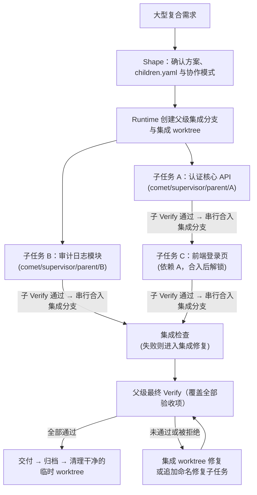

import { SupervisorVideo } from '/snippets/supervisor-video.jsx';

当一个需求横跨多个子系统，或者包含前后依赖的多个改造步骤（例如同时改造认证 Token 接口、前端登录页和审计日志）时，让单个 Agent 在一个超长会话里从头改到尾，很容易出现上下文塞满、漏改边界条件、或者改后面忘了前面。

**Supervisor Change** 是 Native 面向这类大型任务的并行编排架构：

1. **按可独立验证的结果拆分**：在 Shape 阶段把父需求拆成多个有依赖顺序的子任务（写入 `children.yaml`），每个子任务承接明确的验收项，跨模块端到端验收归父级统一负责。
2. **独立分支与 worktree 物理隔离**：父任务拥有专属集成分支和集成 worktree；每个就绪子任务拥有专属分支（`comet/supervisor/<parent>/<child>`）和专属 worktree，并发修改互不干扰。
3. **先通过子验收，再串行合入集成分支**：子任务在各自 worktree 通过 Verify 后，由 Runtime 按序合入集成分支并运行集成检查；集成失败时在集成 worktree 专项修复，不会影响项目主干。
4. **全量集成后执行全局终审**：所有子任务合入后，父任务在集成 worktree 对照原需求的全部验收项做最终 Verify，通过后再统一交付、归档并安全清理临时 worktree。



## 什么时候适合拆分，什么时候不该拆

Shape 阶段确认完范围和验收项后，Comet 会判断是否推荐升级为 Supervisor Change：

- **适合拆分**：能划出至少两个可以独立编写代码、独立验证结果的子任务（例如不同子系统的改动，或有清晰交接接口的分步迁移），依赖顺序清晰，且并行推进或分阶段交接有实际收益。满足条件时，Agent 会把 Supervisor Change 作为首选方案向你推荐。
- **保持单个 Change**：改动高度集中在同一核心文件或紧密耦合模块、拆开后反复冲突协调成本更高，或者你明确要求单个 Native Change。**需求文档长、验收条目多本身不会触发拆分。**

## 确认拆分方案与选择协作模式

Shape 最终确认前，Agent 会展示 `children.yaml` 中的子任务分工（各自的目标、依赖顺序 `depends_on`、对应的验收项范围 `covers` 以及父级保留的集成验收项），并让你在两种协作模式中二选一：

| 选项 | 协作模式 | 执行方式 | 并发上限 |
| --- | --- | --- | --- |
| **A** | **多会话 / Agent Teams（推荐）**（`multi-session`） | 当前会话充当协调者，负责派发并跟踪进度、处理集成和最终验收；按平台能力为就绪子任务启动独立会话或 Agent Teams 成员，平台不支持时自动改用 subagent。 | 默认 `2`，可在 `.comet/config.yaml` 中通过 `native.max_parallel_children` 调整（从下一轮派发生效）。 |
| **B** | **单会话顺序推进**（`single-session`） | 沿用相同的拆分范围、依赖顺序和验收要求，由当前会话按依赖顺序逐个完成子任务。 | 固定为 `1`。 |

注意事项：

- 你可以在一次回复中同时确认完整方案和协作模式（例如“确认方案，选 A”）。只回复“确认”但没选模式，或只选了模式但没确认方案，都不会直接启动 Build。
- 如果你在描述需求时已经明确说了“用多会话”或“用 Agent Teams”，Comet 会直接视为选择 A，不再重复发问。
- 选定后，Runtime 会把 `coordination_mode` 保存进 `comet-state.yaml`。后续中断恢复时直接沿用已保存的模式，不会再次询问。

## 按依赖分批调度与工作区隔离

完整 Shape 确认后，Runtime 会先建立父级集成分支与集成 worktree，再按 DAG 依赖关系分批派发子任务：

- **依赖未满足不抢跑**：只有 `depends_on` 中的前置子任务**全部完成集成**（`integrated`），下游子任务才会进入就绪队列。
- **并发容量有上限**：每轮最多派发 `max_parallel_children - 当前活跃子任务数` 个新子任务。
- **任务归属清晰**：每个就绪子任务在待办任务清单中都明确标明所属子任务名称、作用范围、专属 worktree 路径、集成分支当前基线提交以及该子任务专属的验收条目。

在多会话模式下，Hook Guard 会强制阻止父会话在 Build 阶段直接改业务源码；子任务执行者也只能在 Runtime 分配给它的 worktree 中写代码，完成后把结果交回主会话，由主会话保留原 Action、子会话标识和结果模板顺序提交，不能直接修改父任务状态或项目目标分支。

## 在不同平台中并发运行

### Codex：多独立会话

在 Codex 中选择多会话模式后，当前会话担任协调者，为每个就绪子任务开启独立会话并切入 Runtime 创建好的子 worktree（不要让 Codex 额外创建另一套 worktree）：

<SupervisorVideo
  src="/vedio/codex_compact.mp4"
  width={1230}
  height={858}
  label="Comet Supervisor Change 在 Codex 中通过多个独立会话执行子任务"
  fallback="你的浏览器不支持 HTML5 视频"
/>

### Claude Code：Agent Teams

在交互式 Claude Code 终端启用 Agent Teams 后，当前会话担任 Team Lead，为每个就绪子任务分配一名 Teammate，在各自指定的子 worktree 中并行开发：

```bash
export CLAUDE_CODE_EXPERIMENTAL_AGENT_TEAMS="1"
```

<SupervisorVideo
  src="/vedio/claude%20code_compact.mp4"
  width={1548}
  height={1080}
  label="Comet Supervisor Change 在 Claude Code 中通过 Agent Teams 执行子任务"
  fallback="你的浏览器不支持 HTML5 视频"
/>

如果平台不支持独立会话或 Agent Teams，或者恢复后原会话已丢失，Comet 会在 `multi-session` 下自动改用 subagent 继续，不会私自改回 `single-session`。

## 子任务验收、串行集成与集成修复

每个子任务都必须依次走完以下环节：

1. **子任务 Build**：在专属 worktree 实现功能、运行检查并提交候选代码提交。
2. **子任务 Verify**：对照该子任务承接的全部验收项逐条给出 `passed`、`failed` 或 `blocked`（总判定为 `pass`、`fail` 或 `blocked`，支持当前会话审查或独立会话审查）。未通过则在原 worktree 修复重交。
3. **校验并串行合入集成分支**：Runtime 核对分支路径、候选提交哈希和绑定通过的 Verifier 记录全部匹配后，按 Run 顺序逐个合入父级集成分支。子任务不单独归档，也不直接合入目标主干。
4. **集成检查与集成修复**：如果合入后的集成检查或扩展检查失败，流程不会退回主分支或打散子任务，而是在父级集成 worktree 生成集成修复任务。修复并提交新的集成提交后，Runtime 会用 Git 祖先关系校验（`git merge-base --is-ancestor`）确认新提交基于原失败合并提交演进，且工作区干净、检查无失败项，再解锁下游子任务。

## 父级全量终审、交付与安全清理

所有子任务都完成集成后，Runtime 自动在父级集成 worktree 发起**全局最终 Verify**，对照原需求的全部验收项（复用仍适用的子任务检查，并补足跨模块集成测试）：

- **全部通过**：进入交付、归档与清理流水线：
  1. **清理预检**：在父级交付修改目标分支之前，Runtime 会先对所有临时子 worktree 和集成 worktree 做清理预检，提前暴露未提交改动（dirty worktree）或异常状态。
  2. **交付与归档**：将验证通过的集成提交交付到目标分支，并完成 Spec 合并与目录归档。
  3. **安全清理**：只有确认归档已完成、目标分支精确指向已验证的集成提交、且所有本次创建的临时 worktree 均干净无人占用时，才删除对应的子 worktree、集成 worktree 和临时分支。只要发现未提交文件或进程占用，就会保留现场并报告阻塞原因，不会强制删除。
- **父级验收未通过或被拒绝**：不会重新打开已经合入的子任务。Runtime 会在集成 worktree 生成父级修复任务，提交新的候选代码提交后重新验收；如果需要拆分独立的修复补丁，也可以追加一个命名唯一、引用有效验收 ID 的修复子任务。如果问题涉及修改整体需求或拆分计划，Agent 会在后台发起需求修订，回到 Shape 重新确认。

## 中断恢复与跨检出迁移

Supervisor 的子任务依赖图、协作模式、任务领取和集成进度全部持久化。会话意外断开时，直接回到原工作区输入 `/comet 继续` 即可，Agent 会在后台读取完整状态并继续调度：

- 原多会话或 Agent Team 丢失时，Agent 会先向原平台核对子任务是否仍在运行，不会把会话断开当成子任务已完成。
- 如果需要把进行中的 Supervisor Child Build（含父检查点、多个分支、worktree 和未提交代码）整体迁到另一台设备或另一份本地检出，确认所有相关 Agent 已停止后，在终端运行迁移命令：
  ```bash
  comet native transfer export <change-name> --output <新建私有目录> --confirmed-stopped
  comet native transfer import --input <导出目录>
  ```
  完整校验规则和异常恢复步骤见 [Native 任务恢复](/zh/native/recovery-playbook#迁移进行中的-supervisor-子任务transfer)。

延伸阅读：[Native Loop：从实现到可信交付](/zh/native/native-loop)、[多 Change 并行与冲突控制](/zh/native/multi-change-and-conflicts) 与 [Native 配置](/zh/native/configuration)。
