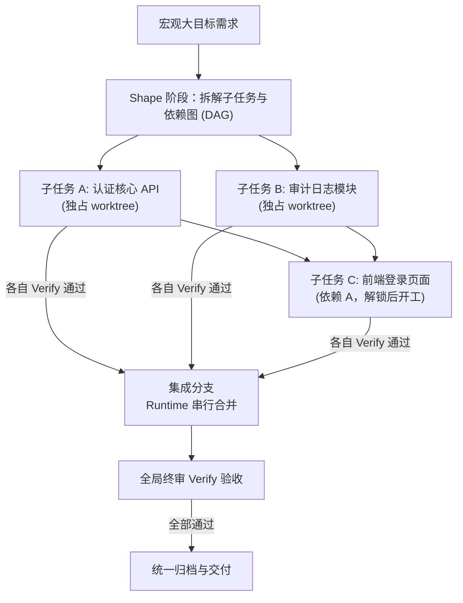

import { SupervisorVideo } from '/snippets/supervisor-video.jsx';

当你面对大型复杂的研发需求（例如“重构用户认证体系：包含底层 Token 颁发、前端登录页面与操作审计日志三个模块”）时，如果让单个 Agent 在一个长会话中从头改到尾，极易遭遇上下文爆满、改动遗漏或代码混乱。

**Supervisor Change 是 Native 工作流面向大型复杂需求的并行交付架构**：

1. **按验收项精准解耦**：将大目标拆解为拓扑有序的子任务（child），每个子任务只承接具体的验收项；
2. **工作区严格隔离**：每个子任务独占专属的 Git worktree，多个并发 Agent 互不干扰，避免并发修改冲突；
3. **先验收，再允许集成**：子任务代码通过独立 Verify 并验证通过后，才由 Runtime 依次合并入集成分支；
4. **统一全链路终审验收**：所有子任务全部合流后，主任务针对整体系统目标执行 100% 覆盖的最终全量验收。



## 核心工程保障

| 核心特性 | 实际工程价值 |
| --- | --- |
| 依据验收项拆解 | 每个子任务对应明确的测试用例，杜绝职责模糊的无效分工 |
| 依赖拓扑自动调度 | Runtime 仅激活前置条件已全量达标的子任务，下游任务不抢跑 |
| 工作区严格隔离 | 每个子任务独占专属的 Git worktree，消除多个 Agent 并行修改的冲突 |
| 防篡改凭证与鉴权 | 任务上下文、集成基线 Commit 与 `runId` 构成三元凭据，拦截重复或过期回调 |
| 全局回归验收 | 所有子任务集成后，针对系统完整目标实施全量回归测试，杜绝局部合格但整体跑不通 |

## 任务拆解触发条件

Comet 会在 Shape 阶段评估当前需求是否适合拆解。只有同时满足以下条件时，才会建议升级为 Supervisor Change：

- 整体目标能够自然解耦为两个及以上可独立编码、独立测试的子任务；
- 原始需求中的所有验收项均能被清晰分配给对应的子任务，不留死角；
- 各子任务之间的依赖关系（先做什么、后做什么）逻辑清晰；
- 并行推进确实能够缩短交付周期。

若所有改动都集中在同一个核心文件内，或者拆解带来的集成成本过高，Comet 会保持单个 Change 顺序推进。

## 拆解方案与协作模式选择

在 Shape 阶段定稿前，Comet 会向你展示子任务拆解矩阵与依赖流向图。确认方案时，可选择后续的推进模式：

| 协作模式 | 运行机制 | 适用环境 |
| --- | --- | --- |
| **A. 多会话协同推进（推荐）** | 主会话负责全局统筹调度，调度多个独立会话或 Agent Teams 并发开工 | 支持多会话的平台（如 Codex、Claude Code Agent Teams），不支持时自动降级采用 subagent |
| **B. 单会话顺序推进** | 在当前会话窗口内，严格依照依赖拓扑顺序，逐一完成各个子任务 | 资源受限或偏好在单一终端逐步排查的场景 |

选定模式后，Runtime 会将其固化在状态文件中，后续断点恢复时自动沿用。

## 独占绑定的工作区

方案获批后，Runtime 会自动为主任务建立专用的集成分支与集成 worktree，并为已就绪的子任务准备好隔离的独立 worktree。

每个分发的子任务均内嵌：
- 该子任务负责的验收 ID 集合与职责范围；
- 独占的工作区绝对路径；
- 当前集成分支的代码基线 Commit 哈希；
- 专属的 `runId` 防伪凭据；
- 明确的停机退出指标。

在多会话模式下，默认最多并发推进 2 个在途子任务（支持在 Dashboard 或通过 `native.max_parallel_children` 弹性调节）；单会话模式下始终按拓扑序串行推进。

## 主流平台并发实录

### 在 Codex 中通过多会话并发推进

在 Codex 中选定多会话后，当前主会话自动升格为总调度中枢（Supervisor）。它负责分发任务、轮询进度、调度代码集成与主持最终验收。各个子任务作为独立任务执行，互不干扰：

<SupervisorVideo
  src="/vedio/codex_compact.mp4"
  width={1230}
  height={858}
  label="Comet Supervisor Change 在 Codex 中通过多个独立会话执行子任务"
  fallback="你的浏览器不支持 HTML5 视频"
/>

### 在 Claude Code 中借助 Agent Teams 并行推进

在 Claude Code 终端中，可借助 Agent Teams 特性并发驱动不同子任务。在终端中激活：

```bash
export CLAUDE_CODE_EXPERIMENTAL_AGENT_TEAMS="1"
```

当前主会话充当 Team Lead，为就绪的子任务分配对应的 Teammate。Teammate 严格在指定的独立子工作区内编码，禁止越权修改主干分支：

<SupervisorVideo
  src="/vedio/claude%20code_compact.mp4"
  width={1548}
  height={1080}
  label="Comet Supervisor Change 在 Claude Code 中通过 Agent Teams 执行子任务"
  fallback="你的浏览器不支持 HTML5 视频"
/>

## 先验证，后集成

每个子任务必须严格走完完整生命周期：

```text
active（编码中） → verified（独立验收达标） → integrated（已入集成分支）
```

1. **子任务编码**：Builder 在子任务专属 worktree 中完成实现；
2. **子任务独立验收**：Verifier 核查该子任务对应的具体验收项与测试命令；
3. **凭证鉴权与合流**：验证全部通过后，Runtime 自动将该子任务的 Commit 干净合并入集成分支，并触发集成构建检查；
4. **解锁下游任务**：状态敲定为 `integrated` 后，依赖它的下游子任务才会正式进入就绪状态。

子任务不单独触发最终归档，亦无权擅自合并入项目主干分支。

## 全量集成后的全链路终审验收

所有子任务均达到 `integrated` 状态后，Runtime 立即在集成 worktree 中发起**全局最终 Verify 阶段**，执行全套端到端集成测试，核验整体目标的完整交付标准。

- **全量变绿**：获准进入 Archive 阶段，统一合并入主干或生成 PR；
- **若验收未通过**：Runtime 完整保留集成分支现场，不打散已完成的子任务；流程会自动追加一个专门的“修复子任务”，针对具体未通过的缺陷用例引导你确认修复范围，修复并复验通过后再行归档。

## 断点恢复与任务还原

全局子任务拓扑、就绪队列、集成进度均实时持久化在本地文件中。如果遇到会话截断或重启终端，直接在 Agent 中输入：

```text
/comet 继续
```

Comet 会立即从磁盘读出完整进度现场。若原先绑定的多会话或团队进程丢失，Comet 会自动重新扫描并平滑改用 subagent 继续执行，不丢失任何已完成的代码或执行证据。

延伸阅读：[Native Loop 核心闭环](/zh/native/native-loop)、[多 Change 并行与冲突控制](/zh/native/multi-change-and-conflicts) 以及 [断点恢复实操手册](/zh/native/recovery-playbook)。
