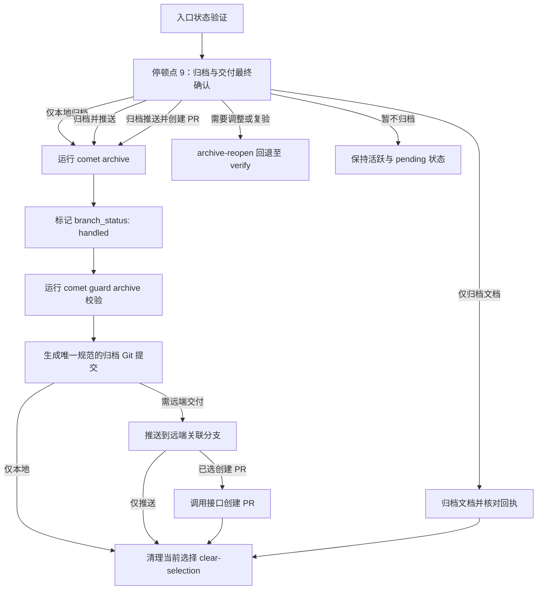

archive 阶段负责将已通过全量验证的变更平滑合并到 OpenSpec 主 Spec 中，为设计与计划文档打上归档印记，并将变更目录规范归拢到 archive 仓库。由于归档属于不可逆的收尾操作，Comet 会在执行前主动暂停，由你最终敲定归档与交付方式。

<Tip>
  日常开发只需调用 <code>/comet</code> 即可。当项目选用 Classic 时，系统底层会在 verify 验收全量通过后自动路由至 <code>/comet-archive</code>。
</Tip>

## 准入前置条件

进入归档前，系统严格核验以下前提：
- `phase: archive`；
- `verify_result: pass`；
- `branch_status: pending`；
- 若工作区基于 Git 管理，当前所在分支必须与变更绑定的 `bound_branch` 保持一致。

Verify 阶段仅负责出具测试通过凭证，分支交付状态 `branch_status` 会始终保持 `pending`，直至在归档阶段根据你的明确授权完成收尾。

## 阶段执行全流程



## 调用的核心能力

archive 阶段不额外加载冗余的大模型 Skill，所有的状态校验、目录归拢与远端操作均由 `comet state`、`comet guard`、`comet archive` 底层脚本及标准 Git 工具链完成。`comet archive` 内部会自动调度 OpenSpec 工具链将增量 Spec 合并进主 Spec。

## 停顿点 9：归档与交付最终确认

在正式落盘前，Comet 会清晰展示当前变更名称、验证报告结论、绑定的分支与工作区，以及即将执行的实际动作，供你定夺：

| 交付选项                        | 实际执行效果                                                                                  |
| ------------------------------- | --------------------------------------------------------------------------------------------- |
| **仅本地归档（不推送）**        | 完成 Spec 合并与目录归档，创建唯一的归档 Git 提交并停留在当前分支，不推送远端、不创建 PR       |
| **确认归档并立即推送**          | 完成归档、生成唯一归档提交，并一次性推送到远端关联分支                                         |
| **确认归档、推送并自动创建 PR** | 完成归档、推送到远端分支，并自动调用 API 发起针对目标主干的 Pull Request                       |
| **需要调整或重新验证**          | 触发 `archive-reopen` 回退到 verify 阶段重新核验                                               |
| **暂不归档**                    | 暂不执行归档动作，保持当前变更的活跃状态（`phase: archive` 与 `branch_status: pending`）       |

选定交付方式后，系统会先保存交付记录，再确认进入执行：

```bash
comet state delivery <change-name> --file <交付选择.json>
comet state transition <change-name> archive-confirm
```

`archive_confirmation` 属于系统自动维护的核心状态，禁止手动篡改。

## 执行归档

```bash
comet archive "<change-name>"
```

该命令具备完善的断点检查点机制，会自动完成增量 Spec 合并、搬迁 change 目录、复核主 Spec 一致性、为 Design Doc 和 Plan 打上归档标记，并在归档目录的 `.comet.yaml` 中固化 `archived: true`。

若在正式执行前希望先排查潜在冲突，可以随时运行只读预览：

```bash
comet archive "<change-name>" --dry-run
```

## 将最终状态打包为唯一的归档提交

归档完成后，系统在生成 Git Commit 前会先运行安全检查：

```bash
comet state set <change-name> branch_status handled
comet guard <change-name> archive
```

阶段守卫放行后，系统仅精准暂存归属于当前变更的文件路径：
- 原活跃变更路径与实际归档搬迁路径；
- 本次增量 Spec 合并后的主 Spec 文档；
- 带有归档标记的 Design Doc 与实施计划；
- 最终归档目录下的 `.comet.yaml`。

随后生成排版规范的独立归档提交：

```bash
git add -- <逐项核验后的归档路径...>
git diff --cached --stat
git commit -m "chore: archive <change-name>"
```

禁止使用 `git add -A`，杜绝混入你在工作区中尚未提交的其他无关文件。

## 远端交付与收尾

归档提交生成后，Comet 严格遵照你预先敲定的交付方式执行：
- 仅保留在本地分支；或
- 推送当前分支一次；或
- 推送分支并自动创建 PR。

完成交付后，系统运行校验命令核对远端状态：

```bash
comet state delivery <change-name> --verify
```

核验确认为 `verification.status: complete` 后，运行收尾清理：

```bash
comet state clear-selection
```

至此，该变更交付完成，本地工作区不残留任何临时未提交文件。

## 下一步

- [open 阶段](/zh/phases/open) — 开启下一个全新变更
- [决策停顿点速查](/zh/concepts/decision-points) — 回顾五阶段所有关键人工确认节点
- [comet archive 脚本](/zh/scripts/comet-archive) — 深入探究归档命令的参数与机制
- [状态管理](/zh/concepts/state-management) — 掌握归档元数据的持久化规范
