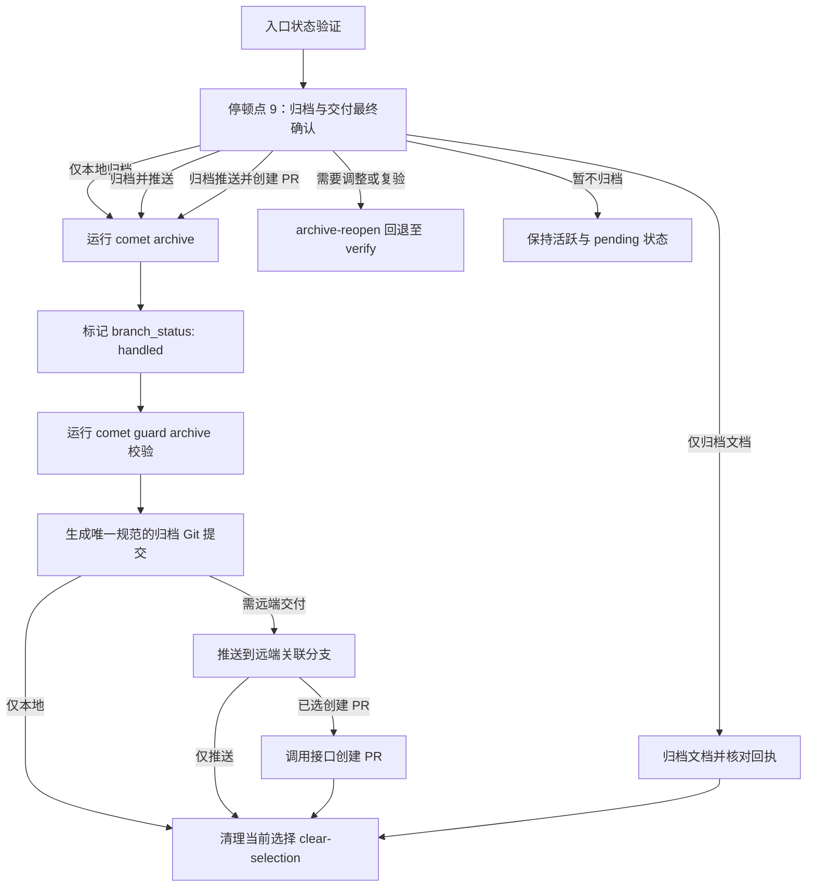

archive 阶段负责将已通过全量验证的变更合并到 OpenSpec 主 Spec 中，为设计与计划文档打上归档标记，并将变更目录移入 archive 目录。由于归档属于不可逆的收尾操作，Comet 会在执行前暂停，由你在对话中决定归档与交付方式。

<Tip>
  日常开发只需在对话中输入 <code>/comet</code> 即可。当项目选用 Classic 时，系统会在 verify 验收全部通过后自动进入 <code>/comet-archive</code>；下文涉及的 <code>comet state</code>、<code>comet guard</code> 和 <code>comet archive</code> 均由 Agent 在后台自动调用，不需要你手动敲命令。
</Tip>

## 准入前置条件

进入归档前，系统严格核验以下前提：
- `phase: archive`；
- `verify_result: pass`；
- `branch_status: pending`；
- 若工作区基于 Git 管理，当前所在分支必须与变更绑定的 `bound_branch` 保持一致。

Verify 阶段只负责生成测试通过凭证，分支交付状态 `branch_status` 会始终保持 `pending`，直至在归档阶段经你归档批准完成收尾。

## 阶段执行全流程



## 调用的核心能力

archive 阶段不额外加载冗余的大模型 Skill，所有的状态校验、目录归拢与远端操作均由 `comet state`、`comet guard`、`comet archive` 底层脚本及标准 Git 工具链完成。`comet archive` 内部会自动调度 OpenSpec 工具链将增量 Spec 合并进主 Spec。

## 停顿点 9：归档与交付最终确认

在正式写入归档前，Comet 会向你展示当前变更名称、验证报告结论、绑定的分支与工作区，以及即将执行的实际动作，供你选择：

| 交付选项 | 实际执行效果 |
| --- | --- |
| **仅本地归档（不推送）** | 完成 Spec 合并与目录归档，在当前分支创建唯一归档 Git 提交，不推送远端、不创建 PR。 |
| **确认归档并立即推送** | 完成归档、生成唯一归档提交，并推送到远端关联分支。 |
| **确认归档、推送并自动创建 PR** | 完成归档并推送到远端分支，随后自动发起针对目标主干的 Pull Request。 |
| **需要调整或重新验证** | 触发 `archive-reopen` 回退到 verify 阶段重新核验。 |
| **暂不归档** | 暂不执行归档动作，保持当前变更活跃（`phase: archive` 与 `branch_status: pending`）。 |

你在对话中选定交付方式后，Agent 会在后台先保存交付记录、记录归档确认（`archive_confirmation` 由系统自动维护，禁止手改），再正式推进归档。

## 后台执行归档与生成唯一提交

确认之后，Agent 会在后台依次完成四个受保护步骤：

1. **执行归档与合并主 Spec**：调用 `comet archive`（自带断点检查点机制），合并增量 Spec、搬迁 change 目录、复核主 Spec 一致性、为 Design Doc 和 Plan 写入归档标记，并在归档目录的 `.comet.yaml` 中标记 `archived: true`。
2. **更新交付状态并通过守卫校验**：将 `branch_status` 更新为 `handled`，并通过 `comet guard <change-name> archive` 校验全部归档文件完整。
3. **只暂存本次归档相关文件并提交**：Agent 只逐项暂存原活跃变更路径、归档目录路径、合并后的主 Spec、带归档标记的 Design Doc 与 Plan，以及最终 `.comet.yaml`，生成独立的归档提交（禁用 `git add -A`，避免混入你工作区中其他未提交文件）。
4. **按所选方式完成远端交付与收尾**：仅留本地、推送分支，或推送并创建 PR；随后校验远端交付完成（`verification.status: complete`）并清理当前工作区的任务选中，不残留临时未提交文件。

<Accordion title="底层原理与终端排障命令（日常由 Agent 自动执行，无需手敲）">

如果想在正式归档前于终端只读预览变更影响，可运行：

```bash
comet archive "<change-name>" --dry-run
```

以下是 `/comet-archive` 在后台依次执行的完整状态与归档步骤，仅用于理解机制或手动排障参考：

```bash
# 1. 保存交付选择并确认归档
comet state delivery <change-name> --file <交付选择.json>
comet state transition <change-name> archive-confirm

# 2. 执行 Spec 合并、目录搬迁与文档归档标记
comet archive "<change-name>"

# 3. 标记分支交付状态并通过 archive 阶段守卫校验
comet state set <change-name> branch_status handled
comet guard <change-name> archive

# 4. 只暂存归属当前变更的文件并创建唯一归档提交
git add -- <逐项核验后的归档路径...>
git diff --cached --stat
git commit -m "chore: archive <change-name>"

# 5. 如已选择远端交付，推送分支并按需创建 PR（仅本地归档时跳过本步）
git push -u origin <bound-branch>
# 若选择了“确认归档、推送并自动创建 PR”，在此执行创建 PR（如 gh pr create）

# 6. 核对远端交付结果；仅在 --verify 返回 verification.status: complete 后才执行 clear-selection
comet state delivery <change-name> --verify
comet state clear-selection
```

</Accordion>

## 下一步

- [open 阶段](/zh/phases/open) — 开启下一个全新变更
- [决策停顿点速查](/zh/concepts/decision-points) — 回顾五阶段所有关键人工确认节点
- [comet archive 脚本](/zh/scripts/comet-archive) — 深入探究归档命令的参数与机制
- [状态管理](/zh/concepts/state-management) — 掌握归档元数据的持久化规范
