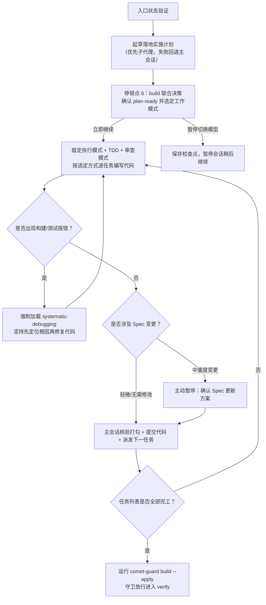

build 阶段首先起草具体的实施计划，随后交由你联合选定执行方式、TDD 测试策略与代码审查模式。选定后，系统会按照任务计划逐项编写代码、执行自动化测试并规范提交，同时严谨记录 Spec 增量变动与调试证据。

<Tip>
  日常开发直接输入 <code>/comet</code> 即可。当项目选用 Classic 时，系统会自动读取状态机，并在 design 阶段完结后自动流转至 <code>/comet-build</code>。
</Tip>

## 本阶段如何触发

`/comet-build` 通常由内部调度引擎自动流转唤起。

### 默认：通过 /comet 自动流转

design 阶段守卫检查放行后（推进至 `phase: build`），系统会自动链式调用 `/comet-build`。在对话中断后重新输入 `/comet` 时，若检测到任务正处于 build 阶段或已有设计文档但尚未完工，系统也会精准路由到此：hotfix 走 `/comet-hotfix`、tweak 走 `/comet-tweak`、完整全流程走 `/comet-build`。详见 [自动推进机制](/zh/concepts/auto-transition)。

### 手动触发场景

- 当全局关闭了自动推进（`auto_transition: false`）时，design 完成后系统会打印提示，需手动输入 `/comet-build` 触发；
- 单独调试或接续某个处于 `phase: build` 的既有变更；
- verify 验收失败后触发 `verify-fail` 回滚，需要重新进入 build 阶段修复缺陷。

---

## 阶段执行全流程

build 阶段包含两个重要的决策停顿点（全局编号 6 与 7，详见 [决策停顿点全景速查](/zh/concepts/decision-points)）。



<p align="center">
  
</p>

<p align="center">build 阶段将计划细化为任务卡片，逐张编码、排错、核验打勾并留下提交证据</p>

### 第一步：起草落地实施计划

Comet 会优先**派发后台子代理**调用 `writing-plans` 工具起草计划（避免占用主会话上下文），若子代理启动受限则平滑回退至主会话编写。计划文档头（frontmatter）必须严格包含：

```yaml
---
change: <change-name>
design-doc: docs/superpowers/specs/...-design.md
base-ref: <git rev-parse HEAD> # 编码前的基准 commit，verify 据此客观核算改动规模
---
```

### 停顿点 6：build 联合决策

计划起草完毕后，系统主动**暂停等待你做全局决策**：

| 选项名称           | 实际后续动作                                                                                        |
| ------------------ | --------------------------------------------------------------------------------------------------- |
| **A：立即继续执行** | 留在当前会话，在同一次决策面板中一次性选定执行方式、TDD 策略与审查模式                                |
| **B：暂停切换模型** | 记录 `build_pause: plan-ready` 并停止会话；切换到更强力的模型后直接输入 `/comet` 继续，计划完好保留 |

<Tip>
  选项 B 专为<strong>“高阶模型做规划、高性价比模型做实现”</strong>而设计。恢复时系统会精准识别 plan-ready 状态，<strong>不重复生成计划</strong>，直接唤起后续工作模式选择。
</Tip>

#### 一次性敲定三项核心工作参数

选定继续后，在同一决策面板中一次性敲定以下三项参数（工作区隔离模式在 open 阶段已由停顿点 3 固化，此处不再重复询问）：

1. **执行方式（build_mode）**：
   - `subagent-driven-development`：主会话专注调度，后台启动只读子代理逐项编码，由 `review_mode` 驱动审查（推荐用于复杂度高、包含 3 个以上任务的变更）；
   - `executing-plans`：轻量模式，直接在当前主会话中按序编码（推荐用于 1–2 个任务的小型改动）；
   - `direct`：直接实现模式（仅限 hotfix / tweak 默认使用；full 流程需开启覆盖参数）。
2. **TDD 测试策略（tdd_mode）**：
   - `tdd`：严格遵循红绿重构流程，每个任务先写失败测试（涉及核心业务逻辑时强烈推荐）；
   - `direct`：直接实现业务代码，不强制先写失败用例，但仍需补充关联测试与回归证据。
3. **审查严格度（review_mode）**：
   - `off`：免除自动化审查（适用于文案、文档等低风险调整）；
   - `standard`：默认推荐，低风险任务快速放行，高风险任务即时审查；
   - `thorough`：对每个子任务均启动独立审查（适用于架构重构与安全核心模块）。

### 第二步：按选定模式逐任务执行

选定模式后，系统严格按约定分派执行：

| 关键维度     | `executing-plans` 模式                                                              | `subagent-driven-development` 模式                                                    |
| ------------ | ----------------------------------------------------------------------------------- | ------------------------------------------------------------------------------------- |
| **谁写代码** | 当前主会话直接按序编写                                                               | 主会话**只负责协调与核查**，后台隔离子代理编写代码（禁止主会话越俎代庖）             |
| **推进节奏** | 顺序完成，逐项打勾                                                                   | 每项任务派发专属子代理，核验达标后自动触发下一任务，**无需中途频繁打扰你**            |
| **审查机制** | standard 模式在 build 阶段不作全量审查；thorough 模式每 3 个任务做一次分段审查       | 根据 review_mode 即时派发任务级审查员与独立修复 Agent                                 |
| **模型调度** | 主会话统一执行                                                                       | **每次派发子任务均需明确指定匹配的模型档位**                                          |
| **进度可视** | 在对话流中直接呈现                                                                   | 同步更新 `.comet/subagent-progress.md` 检查点                                     |

<Tip>
  在 <code>subagent-driven-development</code> 模式下，子任务核验通过后会<strong>立即自动启动下一个子任务</strong>。只有在审查重修达到上限（BLOCKED）、遭遇明确技术分歧、或平台缺少后台调度能力时才会主动暂停。
</Tip>

### 第三步：强制规范的异常调试机制

如果在执行过程中遭遇**进程崩溃、测试报错、构建失败或逻辑异常**，Comet **强制启动规范排错机制**（`systematic-debugging`）：

1. **先查明根本原因**：完整通读报错日志、排查最近代码改动并跟踪数据流。**在根因彻底查明前，禁止尝试性修改代码。**
2. 若确认为业务代码缺陷，先补充一个最小化的失败测试精准复现 Bug，随后再修正源码。
3. 修复完毕后，必须运行相关测试用例与项目构建命令，确认相关测试和构建均通过。

#### 多重独立报错的并发排查策略

若遇到多项报错，系统会先行评估各错误的独立性：
- **串行排查**：报错数量 ≤ 2，或各错误之间存在依赖、共享状态、涉及同一组代码文件时，按序逐一排查；
- **并行排查**：当 **≥ 3 个报错来自互不相干的独立问题域**（属于不同的测试文件、不同的底层模块）时，系统可调起并行子代理同时排查。

<Warning>
  <strong>并行策略仅用于排查根因，不用于修改代码。</strong>实际的代码修改必须始终串行执行，避免多个 Agent 同时修改同一批文件造成代码冲突。
</Warning>

### 第四步：Spec 规格增量更新

在编码过程中若发现需要修正 Spec 规格，按改动规模分类处理：

| 变更规模 | 触发条件                       | 处理机制                                                                   |
| -------- | ------------------------------ | -------------------------------------------------------------------------- |
| **轻微** | 补充遗漏的测试用例或边界条件   | 直接修订增量 Spec 与 `design.md`，并在 `tasks.md` 中追加任务               |
| **中度** | 涉及公共接口变动或底层数据流调整 | **主动暂停等待你确认**，重新唤起头脑风暴更新 Design Doc 与增量 Spec        |
| **重大** | 引入全新的业务 capability      | **主动暂停建议拆分**，通过标准入口开启全新的独立 change                    |
| **超量** | 新增任务数超过初始任务列表的 50% | **触发停顿点 7**：由你选择拆分为新变更，还是扩大当前变更的范围             |

### 第五步：任务核验打勾与规范提交

每个子任务落地后，必须经过验证：按约定实现 → 执行审查（如开启）→ **主会话严格核验打勾** → 规范提交 Git。系统通过定向命令校验勾选有效性：

```bash
node "$COMET_STATE" task-checkoff "$PLAN_FILE" "$PLAN_TASK_TEXT"
```

### 阶段退出：推进至 verify

所有子任务均打勾且构建通过后，执行守卫命令：

```bash
node "$COMET_GUARD" <change-name> build --apply
```

状态机正式跃迁至 `phase: verify`，并将 `verify_result` 标记为 `pending`。

## 调用的核心 Skill 一览

| Skill 标识                    | 承担职责               | 触发条件                                                      |
| ----------------------------- | ---------------------- | ------------------------------------------------------------- |
| `writing-plans`               | 细化实施计划           | 编码第一步，优先由子代理执行                                  |
| `subagent-driven-development` | 子代理多阶段驱动实现   | 选用 `subagent-driven-development` 模式时                     |
| `executing-plans`             | 轻量按序实现           | 选用 `executing-plans` 模式时                                 |
| `systematic-debugging`        | 严谨根因排错           | 遭遇测试报错、构建失败或崩溃时强制触发                        |
| `dispatching-parallel-agents` | 多故障并发排查         | 出现 ≥ 3 个独立问题域报错时触发（仅用于排查）                  |
| `brainstorming`               | 中重度 Spec 变更重对齐 | 发现接口或组件架构产生重大偏差时触发                          |

## 阶段退出门槛（守卫核验）

- `tasks.md` 中所有任务项已全部勾选；
- 业务代码已规范提交 Git；
- **显式运行**并通过了项目构建与测试命令（如 `npm run build`、`npm test` 或编译命令）；
- 工作区环境与绑定的 Git 分支完全吻合；
- 执行模式、TDD 策略与审查模式均已合法选定。

## 变更讲解页（Walkthrough）

当 build 阶段顺利完结时，Comet 默认会在本地生成 `walkthrough.html` 变更讲解页面，以直观的形式按功能模块梳理修改前后的行为变化、关键代码 Diff 与设计意图。后续的 verify 阶段会在该页面实时同步测试结果。该页面供开发者方便通读，若不需要可随时在配置中关闭。

## 下一步

- [verify 阶段](/zh/phases/verify) — build 完成后进入严谨的质量验收
- [代码审查机制](/zh/concepts/review-mode) — 深入理解多档审查模式的执行边界
- [状态管理](/zh/concepts/state-management) — 掌握各执行字段在状态机中的定义
- [决策停顿点速查](/zh/concepts/decision-points) — 掌握 build 阶段的关键决策项
