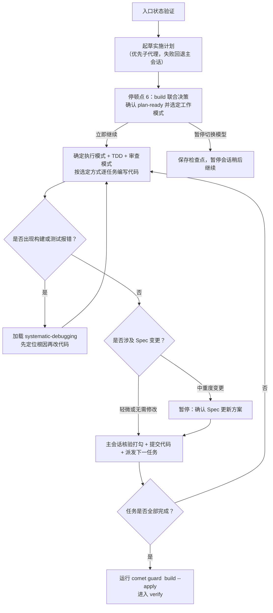

build 阶段先起草实施计划，再和你一起确定执行方式、TDD 策略和代码审查模式。确定后，系统按计划逐项写代码、跑自动化测试并提交，同时记录 Spec 变更和调试证据。

<Tip>
  日常开发直接输入 <code>/comet</code> 即可。项目用 Classic 时，系统会读取状态，在 design 阶段结束后自动进入 <code>/comet-build</code>。
</Tip>

## 进入方式

通常由工作流自动进入 build 阶段（由 `/comet` 自动调用 `/comet-build`）。

### 默认：从 /comet 自动进入

design 阶段的检查通过后（`phase` 推进到 `build`），系统会自动进入 `/comet-build`。会话中断后重新输入 `/comet` 时，如果任务正处于 build 阶段，或已有设计文档但还没完成，系统会进入对应流程：hotfix 走 `/comet-hotfix`，tweak 走 `/comet-tweak`，完整流程走 `/comet-build`。详见 [自动推进机制](/zh/concepts/auto-transition)。

### 需要手动进入的情况

- 关闭了自动推进（`auto_transition: false`）时，design 完成后系统会打印提示，需要手动输入 `/comet-build`；
- 单独调试，或继续某个处于 `phase: build` 的已有变更；
- verify 失败后触发 `verify-fail` 回退，需要回到 build 修问题。

---

## 执行流程

build 阶段有两个需要你决定的停顿点（全局编号 6 和 7，详见 [决策停顿点总览](/zh/concepts/decision-points)）。



<p align="center">
  
</p>

<p align="center">build 阶段把计划拆成任务卡片，逐张编码、排错、核验打勾并留下提交记录</p>

### 第一步：起草实施计划

Comet 优先让**后台子代理**调用 `writing-plans` 起草计划（避免占用主会话上下文）；子代理无法启动时改由主会话编写。计划的文档头（frontmatter）必须包含：

```yaml
---
change: <change-name>
design-doc: docs/superpowers/specs/...-design.md
base-ref: <git rev-parse HEAD> # 编码前的基准 commit，verify 据此核算改动规模
---
```

### 停顿点 6：build 联合决策

计划起草完后，系统**停下来等你决定**：

| 选项名称           | 后续动作                                                                                        |
| ------------------ | --------------------------------------------------------------------------------------------------- |
| **A：立即继续执行** | 留在当前会话，在同一次决策面板中选定执行方式、TDD 策略与审查模式                                |
| **B：暂停切换模型** | 记录 `build_pause: plan-ready` 并结束会话；切换到更强的模型后输入 `/comet` 继续，计划原样保留 |

<Tip>
  选项 B 专为<strong>“高阶模型做规划、高性价比模型做实现”</strong>而设计。恢复时系统会精准识别 plan-ready 状态，<strong>不重复生成计划</strong>，直接进入后续工作模式选择。
</Tip>

#### 一次性敲定三项核心工作参数

选定继续后，在同一决策面板里确定下面三项（工作区隔离方式在 open 阶段的停顿点 3 已经确定，这里不再问）：

1. **执行方式（build_mode）**：
   - `subagent-driven-development`：主会话负责调度，后台启动隔离子代理逐项编码，由 `review_mode` 决定审查（适合复杂、有 3 个以上任务的变更）；
   - `executing-plans`：轻量模式，直接在当前主会话中按顺序编码（适合 1–2 个任务的小改动）；
   - `direct`：直接实现（hotfix / tweak 默认使用；full 流程需要开启覆盖参数）。
2. **TDD 测试策略（tdd_mode）**：
   - `tdd`：每个任务均按“先写失败测试、再实现代码”的顺序推进（涉及核心业务逻辑时推荐）；
   - `direct`：直接写业务代码，不强制先写失败用例，但仍要补相关测试和回归证据。
3. **审查严格度（review_mode）**：
   - `off`：不做自动审查（适合文案、文档等低风险改动）；
   - `standard`：默认。低风险任务直接放行，高风险任务即时审查；
   - `thorough`：每个子任务都单独审查（适合架构重构和安全相关模块）。

### 第二步：按选定模式逐任务执行

| 关键点       | `executing-plans` 模式                                                              | `subagent-driven-development` 模式                                                    |
| ------------ | ----------------------------------------------------------------------------------- | ------------------------------------------------------------------------------------- |
| **谁写代码** | 在当前主会话中按顺序实现                                                             | 主会话**只负责协调和核查**，由后台隔离子代理写代码                                    |
| **推进节奏** | 顺序完成，逐项打勾                                                                   | 每项任务派一个子代理，核验通过后自动开始下一项，**不会频繁打断你**                    |
| **审查机制** | standard 模式在 build 阶段不做全量审查；thorough 模式每 3 个任务做一次分段审查       | 按 `review_mode` 即时派任务级审查和独立修复 Agent                                     |
| **模型选择** | 主会话统一执行                                                                       | **每次派子任务都要指定合适的模型**                                                    |
| **进度查看** | 直接在对话中显示                                                                     | 同步写入 `.comet/subagent-progress.md` 检查点                                     |

<Tip>
  在 <code>subagent-driven-development</code> 模式下，子任务核验通过后会<strong>立即开始下一个子任务</strong>。只有审查重修达到上限（BLOCKED）、出现明确的技术分歧，或平台无法在后台调度时，才会暂停。
</Tip>

### 第三步：异常调试流程

执行中遇到**进程崩溃、测试报错、构建失败或逻辑异常**时，Comet **加载 `systematic-debugging`**：

1. **先查根本原因**：读报错日志、看最近的代码改动、跟踪数据流。**根因没查清之前，不要试着改代码。**
2. 确认是业务代码的问题后，先补一个最小化的失败测试复现问题，再改源码。
3. 改完后运行相关测试和构建命令，确认都通过。

#### 多个独立报错的并行排查

遇到多项报错时，系统先判断它们是否独立：
- **串行排查**：报错不超过 2 个，或各报错之间有依赖、共享状态、涉及同一批文件时，逐个排查；
- **并行排查**：**3 个及以上报错来自互不相关的问题**（不同的测试文件、不同的模块）时，可以启动并行子代理同时排查。

<Warning>
  <strong>并行只用于查根因，不用于改代码。</strong>实际修改必须串行，避免多个 Agent 同时改同一批文件产生冲突。
</Warning>

### 第四步：Spec 的增量更新

编码时发现需要改 Spec，按改动规模处理：

| 规模 | 触发条件                       | 处理方式                                                                   |
| -------- | ------------------------------ | -------------------------------------------------------------------------- |
| **轻微** | 补上遗漏的测试用例或边界条件   | 直接修订增量 Spec 和 `design.md`，并在 `tasks.md` 中追加任务               |
| **中度** | 涉及公共接口变动或底层数据流调整 | **停下来等你确认**，重新开始讨论，更新 Design Doc 和增量 Spec              |
| **重大** | 引入全新的业务 capability      | **停下来建议拆分**，通过标准入口新建一个独立的 change                      |
| **超量** | 新增任务数超过初始任务列表的 50% | **触发停顿点 7**：由你决定拆成新变更，还是扩大当前变更的范围               |

### 第五步：核验打勾与提交

每个子任务完成后都要验证：按约定实现 → 执行代码审查（如已启用）→ **主会话核验后打勾** → 提交到 Git。任务勾选校验由 Agent 在后台自动执行，无需手动操作。

### 阶段结束：进入 verify

所有子任务都打勾且构建通过后，Agent 会在后台运行阶段检查并推进状态机，将状态更新为 `phase: verify`，同时把 `verify_result` 标记为 `pending`。

<Accordion title="Agent 后台调用命令参考">

```bash
# 校验单个任务的勾选是否有效
comet state task-checkoff "$PLAN_FILE" "$PLAN_TASK_TEXT"

# 全部任务完成后运行阶段守卫并推进至 verify
comet guard <change-name> build --apply
```

</Accordion>

## 调用的核心 Skill

| Skill | 作用 | 触发条件 |
| ----------------------------- | ---------------------- | ------------------------------------------------------------- |
| `writing-plans`               | 细化实施计划           | 编码第一步，优先由子代理执行                                  |
| `subagent-driven-development` | 由子代理分阶段实现     | 选用 `subagent-driven-development` 模式时                     |
| `executing-plans`             | 在主会话按顺序实现     | 选用 `executing-plans` 模式时                                 |
| `systematic-debugging`        | 定位根因               | 测试报错、构建失败或崩溃时触发                                |
| `dispatching-parallel-agents` | 并发排查多个故障       | 出现 3 个及以上互不相关的问题时触发（只用于排查）             |
| `brainstorming`               | 较大 Spec 变更时重新确认 | 发现接口或组件架构有重大偏差时触发                          |

## 阶段完成条件

- `tasks.md` 中的任务全部勾选；
- 业务代码已提交到 Git；
- **实际运行**并通过了项目的构建和测试命令（如 `npm run build`、`npm test` 或编译命令）；
- 工作区与绑定的 Git 分支一致；
- 执行方式、TDD 策略和审查模式都已选定。

## 变更讲解页

build 阶段完成后，Comet 默认在本地生成 `walkthrough.html`，按功能模块说明改动前后的行为变化、关键代码 Diff 和设计意图。verify 阶段会在这个页面上同步测试结果。页面供你通读，不需要时可以在配置里关掉。

## 下一步

- [verify 阶段](/zh/phases/verify) — build 完成后进入验收
- [代码审查机制](/zh/concepts/review-mode) — 不同审查严格度的区别
- [状态管理](/zh/concepts/state-management) — 状态机里各字段的含义
- [决策停顿点总览](/zh/concepts/decision-points) — build 阶段需要你决定的节点
