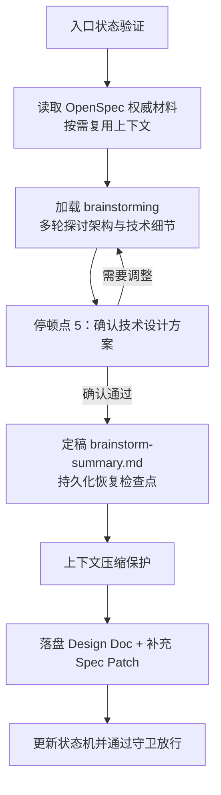

design 阶段的核心任务是完成**深度的技术架构设计**。系统会直接读取 open 阶段沉淀的 OpenSpec 权威材料，并调起 Superpowers `brainstorming` 工具，与你展开多轮深入的方案研讨，最终定稿正式的 Design Doc。在此期间，Comet 会围绕技术选型、潜在风险与测试策略与你充分探讨，在方案获得你的明确确认后才会起草正式文档。

<Tip>
  日常开发只需输入 <code>/comet</code>。当项目选用 Classic 时，系统底层会自动读取进度，在 open
  阶段完成后自动无缝流转至 <code>/comet-design</code>。
</Tip>

<Note>
  `<classic-change-dir>` 是当前 Classic change 的目录。先确保其中的 `.comet/handoff/` 目录存在，再保存讨论摘要；恢复时读取同一文件。未确认内容标为候选，保存摘要不会批准设计或推进到 Build。不要把摘要直接放在 change 根目录；路径被拒绝时按提示改到检查点目录，源码写入仍受阶段限制。
</Note>

## 本阶段如何触发

`/comet-design` 通常由内部调度引擎自动唤起。

### 默认：通过 /comet 自动流转

open 阶段验收放行后（通过 `comet-guard <name> open --apply` 更新至 `phase: design`），系统会自动链式调用 `/comet-design`，无需手动敲入下一阶段命令。在对话中断后重新输入 `/comet` 时，若检测到任务正处于 design 阶段或缺少 Design Doc，也会自动回到本阶段。详见 [自动推进机制](/zh/concepts/auto-transition)。

### 手动触发场景

- 当全局关闭了自动推进（`auto_transition: false`）时，open 阶段完成后系统会暂停并打印提示，需手动输入 `/comet-design` 触发；
- 独立调试某个任务，或希望为既有变更重新推敲技术方案时；
- 轻量预设（hotfix / tweak）在执行中检测到重大架构变更，退回到 design 阶段补充完整设计时。

---

## 阶段执行全流程

design 阶段的核心是一段**基于真实上下文的高质量头脑风暴**。讨论直接基于最新的权威需求展开，确保方案紧扣业务目标。

### 第一步：读取权威材料并展开头脑风暴

Agent 深入通读 proposal、design、tasks 以及增量 Specs，基于现实代码约束推敲候选技术方案。

系统调起 Superpowers `brainstorming` 工具展开深度研讨，绝不走马观花：

- 深入探讨**具体实现路径、技术选型权衡、潜在边界缺陷与自动化测试策略**；
- 若业务边界或非目标仍有模糊之处，**继续向你提问求证**；
- **严禁仅做一轮简单问答就草草落盘文档**，必须完整经历“需求澄清 → 对比 2–3 个候选方案 → 权衡利弊 → 敲定方向”的推敲过程；
- 在讨论过程中，系统会**增量维护** `<classic-change-dir>/.comet/handoff/brainstorm-summary.md` 快照，将已达成的技术共识沉淀为物理断点。

<Warning>
  Comet 严禁在 Design Doc 中撰写<strong>第二份重复的需求规格</strong>
  。若发现原规格缺少边界用例，只能以 <strong>Spec Patch</strong> 的形式向 OpenSpec
  增量补充。若涉及核心业务范围的重大转向，必须退回 open 阶段重新对齐。
</Warning>

### 停顿点 5：确认技术设计方案

在技术方案讨论清晰后，Comet 会主动暂停并**等待你拍板确认**。在收到你的明确指令前，系统绝不会擅自落盘 Design Doc，也绝不允许进入编码阶段。呈现给你的方案摘要包含：

- 敲定的核心技术方案；
- 关键架构权衡与已知风险规避策略；
- 自动化测试与质量保障规划；
- 若涉及 Spec Patch，清晰列出拟补充的增量测试场景。

若确认无误，流程继续推进；若你认为方案仍有瑕疵，系统会基于你的反馈继续推敲，直至达成共识。

### 第二步：定稿检查点并落盘 Design Doc

在方案获得确认后，系统将最终结论固化至 `<classic-change-dir>/.comet/handoff/brainstorm-summary.md`，作为长上下文压缩后的恢复检查点。

随后，Agent 在主会话中正式落盘完整的技术架构文档：

- 规范保存在 `docs/superpowers/specs/YYYY-MM-DD-<topic>-design.md`；
- 若存在 Spec Patch，同步修正对应的 `specs/*/spec.md`。

### 第三步：状态机更新与阶段放行

Agent 记录方案落盘路径，运行阶段守卫校验。校验通过后，工作流正式解锁进入 build 阶段。

---

## 调用的核心 Skill

| Skill 标识              | 承担职责                             | 触发时机                               |
| ----------------------- | ------------------------------------ | -------------------------------------- |
| `brainstorming`         | 深度技术设计（架构、风险、测试规划） | 方案研讨阶段，立即启动，不可跳过       |
| `brainstorming`（复用） | 中途发生中大规模 Spec 变更时重新对齐 | 编码阶段发现底层接口或数据流剧烈变动时 |

## 产物结构一览

| 产物名称           | 物理存放位置                                                | 核心作用                     |
| ------------------ | ----------------------------------------------------------- | ---------------------------- |
| **Design Doc**     | `docs/superpowers/specs/YYYY-MM-DD-<topic>-design.md`       | 最终定稿的权威技术设计文档   |
| **交接汇总视图**   | `.comet/handoff/design-context.md`（按需生成）              | 便于人类集中通读的上下文材料 |
| **脑暴恢复检查点** | `<classic-change-dir>/.comet/handoff/brainstorm-summary.md` | 上下文压缩后的物理恢复断点   |

## 阶段退出门槛

方案已经过人工确认，Design Doc 与业务需求保持高度一致，必要的增量测试场景已补充完毕，且状态机已准确记录文档路径。

## 异常中断后的恢复机制

若在设计阶段会话意外中断，重新调用 `/comet` 时，系统会优先读取 `<classic-change-dir>/.comet/handoff/brainstorm-summary.md` 唤醒讨论记忆，并以最新的物理文件为准继续推进，绝不会让你重复回答已经达成共识的问题。

## 下一步

- [build 阶段](/zh/phases/build) — design 完成后进入任务拆解与编码实施
- [上下文交接与原文复用](/zh/concepts/context-compression) — 深入理解权威材料流转机制
- [工作流中间产物](/zh/concepts/intermediate-artifacts) — 全面掌握各类过程文件的生命周期
- [决策停顿点全景速查](/zh/concepts/decision-points) — 掌握设计阶段的人工确认准则
