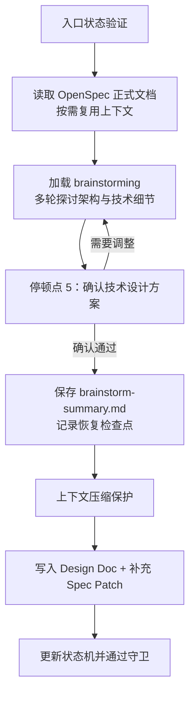

design 阶段的任务是确定技术方案。Comet 读取 open 阶段产出的 OpenSpec 正式文档，调用 Superpowers 的 `brainstorming` 工具，和你讨论多轮后定稿 Design Doc。讨论围绕技术选型、风险和测试策略进行，方案经你确认后才开始写文档。

<Tip>
  日常开发只需输入 <code>/comet</code>。项目用 Classic 时，系统会读取进度，在 open
  阶段完成后自动进入 <code>/comet-design</code>。
</Tip>

<Note>
  `<classic-change-dir>` 是当前 Classic change 的目录。先确认其中存在 `.comet/handoff/` 目录，再保存讨论摘要；恢复时读取同一个文件。还没确认的内容标为候选，保存摘要不等于批准设计或推进到 Build。不要把摘要放在 change 根目录；路径被拒绝时按提示改到检查点目录，源码写入仍受阶段限制。
</Note>

## 什么时候进入这个阶段

`/comet-design` 一般由系统自动进入。

### 默认：从 /comet 自动进入

open 阶段的检查通过后（`comet guard <name> open --apply` 把 `phase` 更新为 `design`），系统会自动进入 `/comet-design`，不需要你手动输入下一阶段的命令。会话中断后重新输入 `/comet` 时，如果任务正处于 design 阶段或还缺 Design Doc，也会回到这里。详见 [自动推进机制](/zh/concepts/auto-transition)。

### 需要手动进入的情况

- 关闭了自动推进（`auto_transition: false`）时，open 阶段完成后系统会暂停并提示，需要手动输入 `/comet-design`；
- 单独调试某个任务，或想给已有变更重新考虑方案时；
- hotfix 或 tweak 预设执行中发现架构层面的改动，需要回到 design 补完整设计时。

---

## 执行流程

design 阶段是一次**围绕真实上下文的技术讨论**。讨论基于最新的需求文档，确保方案符合业务目标。

### 第一步：读取文档并开始讨论

Agent 通读 proposal、design、tasks 和增量 Specs，结合现有代码的约束提出候选方案。

Comet 调用 Superpowers 的 `brainstorming` 工具讨论方案：

- 讨论**具体实现方式、技术选型取舍、潜在边界问题和自动化测试策略**；
- 业务边界或非目标仍不清楚时，**继续向你提问**；
- **写 Design Doc 之前**必须澄清需求、比较 2–3 个候选方案、权衡利弊并确认方向；
- 讨论过程中会**持续更新** `<classic-change-dir>/.comet/handoff/brainstorm-summary.md`，把已达成的结论保存下来，作为中断后的恢复依据。

<Warning>
  Design Doc 里不要再写<strong>一份重复的需求规格</strong>
  。发现原规格缺少边界用例时，用 <strong>Spec Patch</strong> 向 OpenSpec 增量补充。涉及核心业务范围的大幅调整时，必须退回 open 阶段重新确认。
</Warning>

### 停顿点 5：确认技术设计方案

方案讨论清楚后，Comet 会停下**等你确认**。在你明确同意之前，系统不会写 Design Doc，也不会进入编码。给你的方案摘要包括：

- 确定的技术方案；
- 关键的架构取舍和已知风险的应对方式；
- 自动化测试和质量保障计划；
- 如果涉及 Spec Patch，列出准备补充的增量测试场景。

确认后继续；你认为方案还有问题，系统会按你的反馈继续讨论，直到达成一致。

### 第二步：保存 Design Doc

方案确认后，系统把最终结论写入 `<classic-change-dir>/.comet/handoff/brainstorm-summary.md`，作为上下文压缩后的恢复检查点。

随后 Agent 在主会话中写出完整的技术设计文档：

- 存放在 `docs/superpowers/specs/YYYY-MM-DD-<topic>-design.md`；
- 如果有 Spec Patch，同时更新对应的 `specs/*/spec.md`。

### 第三步：更新状态并进入下一阶段

Agent 记录 Design Doc 的路径，运行阶段检查。检查通过后，进入 build 阶段。

---

## 用到的 Skill

| Skill | 作用 | 触发时机 |
| ----------------------- | ------------------------------------ | -------------------------------------- |
| `brainstorming`         | 技术设计（架构、风险、测试计划） | 方案讨论阶段，立即开始，不可跳过 |
| `brainstorming`（复用） | 中途发生较大 Spec 变更时重新确认 | 编码时发现底层接口或数据结构大幅变动 |

## 产物

| 产物 | 位置 | 作用 |
| ------------------ | ----------------------------------------------------------- | ---------------------------- |
| **Design Doc**     | `docs/superpowers/specs/YYYY-MM-DD-<topic>-design.md`       | 最终的技术设计文档 |
| **交接汇总视图**   | `.comet/handoff/design-context.md`（按需生成）              | 方便集中阅读的上下文材料 |
| **脑暴恢复检查点** | `<classic-change-dir>/.comet/handoff/brainstorm-summary.md` | 上下文压缩后的恢复依据 |

## 什么时候算完成

方案已经你确认，Design Doc 与需求一致，需要的增量测试场景已补充，状态机里记录了文档路径。

## 中断后怎么恢复

design 阶段会话中断后，重新输入 `/comet`，系统会先读取 `<classic-change-dir>/.comet/handoff/brainstorm-summary.md` 恢复讨论内容，以最新文件为准继续，不会让你重复回答已经确认过的问题。

## 下一步

- [build 阶段](/zh/phases/build) — design 完成后拆解任务并开始编码
- [上下文交接与原文复用](/zh/concepts/context-compression) — 正式文档如何传递
- [工作流中间产物](/zh/concepts/intermediate-artifacts) — 各类过程文件的作用
- [决策停顿点总览](/zh/concepts/decision-points) — 设计阶段需要你确认的节点
