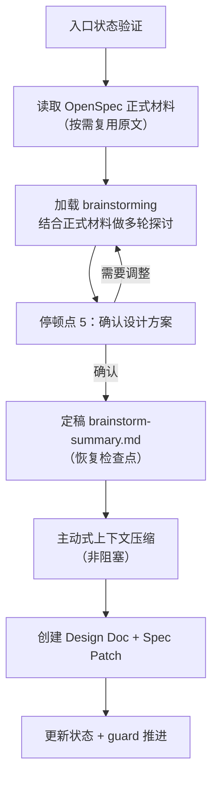

design 阶段做**深度技术设计**。它先读取 open 阶段的 OpenSpec 正式材料，再使用 Superpowers `brainstorming`，带你做多轮方案探讨，最后产出 Design Doc。你会经历一段**多轮的头脑风暴**。Comet 会反复和你探讨实现方案、权衡、风险，确认方案后才会写文档。

<Tip>
  正常使用时只要运行 <code>/comet</code>。 配置选择 Classic 后，内部 <code>/comet-classic</code>{' '}
  会读取状态，并在 open 完成后自动调用 <code>/comet-design</code>。 本文介绍的是内部阶段
  Skill。只有你想<strong>手动控制</strong>
  阶段时，才需要直接输入。详见<a href="#本阶段如何触发">本阶段如何触发</a>。
</Tip>

## 本阶段如何触发

`/comet-design` 通常由 `/comet-classic` 自动衔接。

### 默认：用 /comet 自动衔接

open 阶段退出后（`comet-guard <name> open --apply` 推进 `phase: design`），`/comet-classic` 会自动衔接调用 `/comet-design`。你不需要在 open 完成后手动输入下一个阶段命令。下一次调用 `/comet-classic` 时，如果检测到 `phase: design` 或有 change 但缺 Design Doc，也会路由到 design。详见[自动推进机制](/zh/concepts/auto-transition)。

### 手动：什么时候才需要直接 /comet-design

- 关闭了自动衔接（`auto_transition: false`）时，open 完成后 `/comet-classic` 会停下并打印 HINT。你需要手动调用 `/comet-design`。
- 只想单独跑 design（恢复一个已有 change 但缺 Design Doc，或想重新做技术设计）。
- hotfix/tweak 命中质变升级信号，回退到 design 补完整设计。

**正常使用统一入口 `/comet`。只有手动控制阶段时才直接调用阶段命令。**

---

## 你会经历什么

design 阶段的核心是一段**基于真实上下文的 brainstorming**。brainstorming 直接读取 open 阶段的**正式材料**，设计依据来自当前需求和项目文件。



### Step 0：入口状态验证

```bash
node "$COMET_STATE" check <name> design
```

复用当前 Runtime 响应中的正式来源，缺少上下文时再按需读取，不重建文件 hash。

### Step 1a：读取正式材料

Agent 读取当前 proposal、design、tasks 和 delta Specs，形成候选技术方案。修改 Spec 的具体范围应先取得你的同意。

来源稳定后，按当前 Runtime 的指引提交设计提案并等待确认；已有未决定的提案继续原决定，不重复创建。日常流程不运行旧版 handoff 打包步骤，也不以手写摘要代替正式来源。需要集中阅读时，见 [comet handoff](/zh/scripts/comet-handoff)。

### Step 1b：执行 brainstorming（带真实上下文）

加载 Superpowers `brainstorming`，以正式材料为上下文做深度技术设计。Comet **不会**因为“上下文冗余”就跳过 brainstorming 的澄清流程。它会：

- 探讨**实现方案、技术风险、测试策略、边界条件**
- 如果目标/范围/非目标/验收场景/关键约束还不清楚，**继续提问**
- **不得只做一轮 Q&A 就创建 Design Doc**。要走完澄清 → 2-3 个候选方案 → 逐步确认的完整流程
- 设计过程中会**增量更新** `brainstorm-summary.md`（恢复检查点，不是 Design Doc），把确认的事实、约束、候选方案、权衡、Spec Patch 候选记下来，未确认项标“待确认”或“候选”

<Warning>
  Comet 不能在 Design Doc 里写<strong>第二份需求 spec</strong>。如果 delta spec 缺验收场景，只能写{' '}
  <strong>Spec Patch</strong>（回写到 OpenSpec delta
  spec），仅限补充验收场景、修正模糊措辞、加边界条件。结构或范围的实质性变更必须回到 brainstorming
  重新确认。
</Warning>

<Note>
  如果 <code>brainstorming</code> skill 不可用，Comet 会停下提示你安装/启用 Superpowers，
  <strong>不会</strong>用普通对话代替。
</Note>

### 停顿点 5：确认设计方案

brainstorming 产出方案后，Comet 暂停**等你明确确认**。确认前不会创建 Design Doc、不会写 `design_doc`、不会跑 design guard、不会进 `/comet-build`。它展示的摘要包括：

- 采用的技术方案
- 关键取舍与风险
- 测试策略
- 如有 Spec Patch，列出将回写的 delta spec 变更

你确认后就继续。
如果你要调整，就回到 1b 继续探讨，直到你确认。

### Step 1d：定稿 brainstorm-summary.md

确认后、创建 Design Doc 前，Comet 把已确认的方案写入 `brainstorm-summary.md`，结构是：确认的技术方案 / 关键取舍与风险 / 测试策略 / Spec Patch。这是**上下文压缩后的恢复检查点**。

### Step 1e：保留可恢复的上下文

长会话发生平台上下文压缩时，读取原任务、已记录的设计决定、`brainstorm-summary.md` 和当前正式材料恢复。不要为恢复重复已确认的决定，或重建旧版 hash 交接包。

### Step 2：创建 Design Doc

在主会话用完整 brainstorming 上下文创建 Design Doc，带最小 frontmatter：

```yaml
---
comet_change: <change-name>
role: technical-design
canonical_spec: openspec
---
```

写在 `docs/superpowers/specs/YYYY-MM-DD-<topic>-design.md`。如果有 Spec Patch，编辑对应 `specs/*/spec.md`。

### Step 3：提交设计并推进

Agent 按当前 Runtime 返回的命令提交已确认的设计和正式材料引用，再进入 Build。需求或批准范围发生变化时先处理相应决定，不用重算 handoff hash，也不手工修改 Run 状态。

---

## 调用的 skill

| Skill                   | 用途                                 | 何时调用                             |
| ----------------------- | ------------------------------------ | ------------------------------------ |
| `brainstorming`         | 深度技术设计（方案、风险、测试策略） | Step 1b，立即执行，不可跳过          |
| `brainstorming`（再次） | 中等规模 spec 更新时重新设计         | build 阶段发现接口/组件/数据流变化时 |

design 阶段不调用 OpenSpec skill。OpenSpec 产物已在 open 阶段创建。

## 产物

| 产物                  | 位置                                                  | 说明                            |
| --------------------- | ----------------------------------------------------- | ------------------------------- |
| Design Doc            | `docs/superpowers/specs/YYYY-MM-DD-<topic>-design.md` | 最终技术设计文档                |
| handoff 交接包        | `.comet/handoff/design-context.md`（按需生成）        | OpenSpec→Superpowers 交接上下文 |
| brainstorm-summary.md | `.comet/handoff/brainstorm-summary.md`                | 上下文压缩恢复检查点            |

## 退出条件

设计方案已确认，Design Doc 与当前需求一致，必要的 Spec Patch 已获同意，原 Runtime 已记录设计结果和后续动作。文档按实际任务组织，不以固定标题、内容 hash 或旧派生包作为完成依据。

## 何时进入

正常情况下由 `/comet-classic` 在 open 完成后自动衔接进入（见[本阶段如何触发](#本阶段如何触发)）。手动场景：hotfix/tweak 命中质变升级信号需要补完整设计，或恢复时发现已有 change 但缺 Design Doc。

<Warning>
  full workflow 不应跳过 design。hotfix 和 tweak 可以跳过，但一旦范围变质，就应升级回 full。
</Warning>

## 恢复

恢复时先读取原任务和已有决定。`brainstorm-summary.md` 帮助回顾讨论，正式要求仍以当前源文件为准；待确认的提案继续原决定，已经接受的结果不重复提交。

## 下一步

- [build 阶段](/zh/phases/build) — design 完成后进入计划与执行
- [上下文交接与原文复用](/zh/concepts/context-compression) — 正式来源、可读视图与兼容设置
- [工作流中间产物](/zh/concepts/intermediate-artifacts) — brainstorm-summary 等产物
- [五阶段停顿点和用户选择点](/zh/concepts/decision-points) — design 的停顿点
