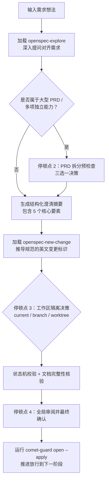

open 阶段的核心任务是将你的原始想法转化为可落地的开发变更：深入探索需求、厘清业务边界、产出规范的 proposal / design / tasks 文档，并初始化状态机。在此期间，你会经历一段**引导式对齐对话**：Comet 会围绕目标针对性提问，在确保双方理解完全一致后再落盘文档。

<Tip>
  日常开发直接输入 <code>/comet</code> 即可。当项目配置为 Classic 时，系统会自动通过 <code>/comet-classic</code> 路由根据物理文件状态智能调用 <code>/comet-open</code>。本文详细介绍该阶段的底层运作机制。
</Tip>

## 本阶段如何触发

`/comet-open` 通常由统一入口 `/comet` 自动路由唤起。系统底层会实时检索当前活跃变更列表与磁盘文件，计算最优路由走向。

### 默认：通过 /comet 智能识别

系统每次被调用时均直接扫描真实文件状态（完全不依赖脆弱的聊天历史），并按以下规则路由至 open 阶段：

| 触发条件                                                     | 系统的实际响应                              |
| ------------------------------------------------------------ | ------------------------------------------- |
| 路由判定为 `full` 且当前项目中无任何活跃变更                 | 自动调用 `/comet-open` 开启全新变更          |
| 路由判定为 `full`，但已有活跃变更且输入中未指明目标          | 暂停并询问：是继续未完变更，还是创建新变更  |
| 活跃变更的 `.comet.yaml` 状态机缺失                          | 自动唤起 `/comet-open` 补齐状态文件并接管   |
| 置信度不足、存在多个待恢复变更，或存在模式冲突               | 暂停请示，等待人工明确确认                  |

在日常开发中，输入 `/comet` 并附带需求描述即可。系统在 open 阶段顺利完结后会自动无缝流转至 design 阶段，详见 [自动推进机制](/zh/concepts/auto-transition)。

### 手动触发场景

- 当全局关闭了自动推进（`auto_transition: false`）时，上一阶段完工后会暂停，等待你手动输入下一阶段命令；
- 在独立调试或希望在阶段之间插入严格的人工方案走查时。

### 创建变更时的环境隔离选择

在正式生成规格文档和状态机之前，Comet 会提示你明确工作区隔离方式：

- `current`：直接在当前 Git 分支上串行开发；
- `branch`：自动创建专属的 Git 分支，仍在当前目录开发；
- `worktree`：创建或复用独立的 Git worktree，非常适合多任务并行或当前目录已有未提交改动的场景。

若本地已有分支完全匹配的既有 worktree，系统会自动复用；若分支存在但目录缺失，会在恢复时自动重建。按照命令行向导提示选择即可，切勿手动随意搬移目录。

---

## 阶段执行全流程

open 阶段通过**针对性对话 + 关键决策点**循序渐进生成文档，全程严格使用你所选定的语言进行交互与文档撰写。



<p align="center">
  
</p>

<p align="center">open 阶段将模糊的想法提炼为三份扎实可执行的 OpenSpec 规格产物</p>

### 第一步：需求探索与范围澄清

Comet 唤起 `openspec-explore` 核心工具，**围绕你的核心目标展开针对性探讨**，直至能够梳理出一份内容完整的**澄清摘要**。系统严禁把敷衍的一问一答当作对齐完成，必须把以下五个维度彻底理清：

| 澄清摘要必备的五个部分 | 核心确认事项                                |
| ---------------------- | ------------------------------------------- |
| **核心目标**           | 真正要解决的业务痛点与最终期望达成的产品效果 |
| **明确的非目标**       | 明确划定本次绝不涉及、暂不做的事情           |
| **边界范围**           | 牵涉或排除的具体模块、用户角色、平台环境与数据实体 |
| **关键技术未知项**     | 前置假设、潜在技术风险与外部依赖            |
| **验收场景草案**       | 核心主干成功路径 + 关键边界异常场景         |

### 停顿点 2：PRD 拆分预检查（条件触发）

若输入是一份**规模庞大的 PRD、完整版本路线图**，或澄清摘要中显式包含了**多项互不依赖的独立能力**，Comet 会主动暂停，呈上一份**建议的拆分方案清单**（包含各子任务的建议标识、目标边界、依赖先后次序与核心验收用例），并提供三项选择：

| 备选方案                      | 实际效果                                                        |
| ----------------------------- | --------------------------------------------------------------- |
| **创建多个 OpenSpec changes** | 按照拆分方案生成多个相互独立的子变更（分别通过对应流程推进）   |
| **保持为一个 change 继续**    | 放弃拆分，以单一大任务继续执行，并在文档中记录不拆分的理由      |
| **调整拆分方案后再确认**      | 根据你的反馈重新规划拆分子项，刷新方案后再次呈现供你定夺        |

<Tip>
  在确认拆分后，系统<strong>绝不会</strong>擅自一口气把所有子任务全部推向实现阶段。它会停下来询问你想优先推进哪一个，仅流转你选定的那一项，其余子任务保持就绪状态，后续随时可无缝唤醒。
</Tip>

### 停顿点 3：工作区隔离决策

在正式生成规格文档与状态机之前，系统会提示你选定工作区隔离模式（该决定必须在 open 阶段敲定，严禁拖延至编码阶段）：

| 隔离模式   | 详细机制与适用场景                           |
| ---------- | -------------------------------------------- |
| `current`  | 直接在当前分支开发，紧密绑定当前 Git 分支    |
| `branch`   | 在本地仓库中拉出全新的独立分支，并确认分支名 |
| `worktree` | 创建完全独立的物理工作区，适合多任务并行开发 |

选定后参数将写入 `isolation`，并把对应的 Git 分支记录为 `bound_branch`，后续各阶段守卫将严格阻断意外的分支偏离。hotfix 与 tweak 预设默认采用 `current`。

在需求与命名均很清晰时，系统会自动推导规范的 **kebab-case 英文标识**（如 `avatar-upload`）并直接呈现；只有在存在分歧或名称与既有变更冲突时才会单独提问。

### 第二步：规范生成规格文档

加载 `openspec-new-change`。在标准全流程中，**默认严禁使用一键式全量生成**（`openspec-propose`），必须严格按照 proposal → design → tasks 的科学次序依次生成：

1. 刷新状态机：`openspec status --change "<name>" --json`；
2. 拉取生成指令：`openspec instructions proposal|design|tasks --change "<name>" --json`；
3. 解析依赖关系、套用标准模板与项目规则（绝不生搬硬套冗余信息），规范写入指定输出路径；
4. 每生成一份文档均执行一次校验。

<Warning>
  若在生成过程中检测到指令异常或输出路径失效，Comet 会<strong>立即停止并明确报错</strong>，绝不擅自回退为硬编码的临时文件结构。
</Warning>

### 第三步：状态验证与内容完整性自检

```bash
node "$COMET_STATE" check <name> open
```

系统会逐一复核三份核心文件在磁盘上是否真实存在且内容扎实：proposal（背景与边界）、design（架构与选型）、tasks（可执行任务列表）。任何一项缺失或空白，流程都会坚决拒绝放行。

### 停顿点 4：全局审阅并最终确认

系统将三份文档的核心骨架整理后清晰呈现给你：

| 选项                   | 实际效果                                   |
| ---------------------- | ------------------------------------------ |
| **确认无误，进入下一阶段** | 规格符合预期，守卫放行进入后续阶段         |
| **需要进一步调整**     | 根据你的反馈修订对应文件，再次呈现供你审阅 |

### 阶段退出：放行推进

```bash
node "$COMET_GUARD" <change-name> open --apply
```

必须带上 `--apply` 参数以更新状态机。full 完整流程将推进至 `phase: design`；hotfix 与 tweak 预设则直接跳转至 `phase: build`。

## 调用的核心 Skill

| Skill 标识            | 承担职责               | 触发条件                   |
| --------------------- | ---------------------- | -------------------------- |
| `openspec-explore`    | 探索问题边界、对齐需求 | 第一步，立即启动，不可跳过 |
| `openspec-new-change` | 初始化变更骨架         | 第二步，规范创建，不可跳过 |

## 产物结构树

产物保存在 `<classic-root>/changes/<name>/` 目录下：

<Tree>
  <Tree.Folder name="<classic-root>/changes/<name>/" defaultOpen>
    <Tree.File name=".openspec.yaml" />
    <Tree.File name=".comet.yaml" />
    <Tree.File name="proposal.md" />
    <Tree.File name="design.md" />
    <Tree.File name="tasks.md" />
    <Tree.Folder name="specs/<capability>/">
      <Tree.File name="spec.md" />
    </Tree.Folder>
  </Tree.Folder>
</Tree>

## 幂等性与安全重试

open 阶段的所有操作均具备严格的幂等性保护。若流程中途中断，重新输入 `/comet` 时，系统会自动识别已完成的步骤并直接跳过，准确从第一个未完成处接续，绝不会搞乱仓库状态。

## 常见疑问解答

<AccordionGroup>
  <Accordion title=".comet.yaml 文件缺失怎么办？">
    切勿直接通过原始外部命令绕过。这会导致变更脱离状态机管理。只需在对话中重新调用 `/comet`，系统会自动接管该目录并补齐状态。
  </Accordion>

  <Accordion title="变更标识（change name）有什么命名规则？">
    必须为标准的 kebab-case 格式（小写英文、数字与中划线组合）。系统会自动从需求中提炼出合规英文名称，遇到重名冲突时会提示你微调。
  </Accordion>

  <Accordion title="大型 PRD 必须强制拆分吗？">
    不强制。系统提供拆分预检查供你权衡。你完全可以选择保持为一个完整的 change 继续推进，只需在文档中简要注明不拆分的理由即可。
  </Accordion>
</AccordionGroup>

## 下一步

- [design 阶段](/zh/phases/design) — open 完成后深入展开技术架构设计
- [决策停顿点速查](/zh/concepts/decision-points) — 掌握各阶段需要人工确认的决策项
- [大型 PRD 拆分指南](/zh/guides/prd-splitting) — 学习复杂需求拆解的最佳实践
- [自动推进机制](/zh/concepts/auto-transition) — 了解阶段间的无缝衔接逻辑
