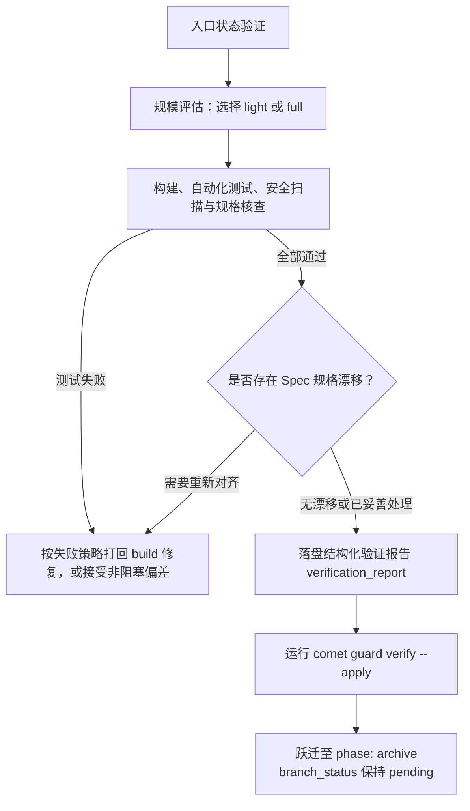

verify 阶段的核心任务是确认代码实现与 Design Doc、OpenSpec 需求规格以及任务清单完全吻合，并将完整的测试证据持久化为一份清晰可查的验证报告。本阶段专注于**质量核验与证据留存**，不涉及 Git 分支的合并、推送或清理操作。

<Tip>
  日常开发直接输入 <code>/comet</code> 即可。当项目选用 Classic 时，系统底层会自动读取进度，在 build 阶段全部达标后自动流转至 <code>/comet-verify</code>。
</Tip>

## 准入前置条件

进入本阶段前，系统会校验以下必要前提：
- build 阶段已宣告完成；
- `tasks.md` 中的所有任务已逐项核验打勾；
- `isolation` 隔离模式与 `bound_branch` 绑定的分支与当前工作区完全吻合；
- full 全流程变更已明确选定了执行方式、TDD 策略与代码审查模式。

## 阶段执行全流程



## 验证严格度分级

Comet 会综合子任务数量、增量 Spec 规模以及改动代码文件数，匹配 `light` 或 `full` 验证模式：

- **Light（轻量验证）**：覆盖任务完成度核查、代码改动归属、自动化构建、关联单元测试、基础安全扫描，以及根据配置执行的代码审查；
- **Full（全量深度验证）**：在 Light 的基础上，深入核验原始 proposal、OpenSpec 架构设计、Design Doc 吻合度、全量业务验收用例覆盖，以及排查 Spec 漂移。

Full 全量验证会调用 `openspec-verify-change` 深入检查规格覆盖度。自动化代码审查严格按 `review_mode` 约定执行，而最终的远端分支交付始终交由 Archive 阶段处理。

## 调用的核心 Skill 一览

| Skill 标识                       | 承担职责                     | 触发时机                                                         |
| -------------------------------- | ---------------------------- | ---------------------------------------------------------------- |
| `verification-before-completion` | 宣布完成前的证据链核查       | 在 light / full 模式判定前必须加载，不可跳过                     |
| `requesting-code-review`         | 轻量级代码审查               | light 验证模式下，当 `review_mode` 为 standard 或 thorough 时执行 |
| `openspec-verify-change`         | OpenSpec 规格覆盖深度检查    | full 全量验证模式下，全面核查 proposal、设计与验收用例的覆盖情况 |

若检测到 Spec 漂移需要重新推敲架构，verify 阶段不会直接调起脑暴：它会触发 `verify-fail` 将任务规范退回至 build 阶段，由 build 重新唤起研讨。

## 失败处理策略

- 对于构建报错、测试失败或常规安全漏洞，系统会触发 `verify-fail` 自动退回 build 阶段修复；
- 对于 WARNING 或 SUGGESTION 级别的非致命提示，仅在真正存在范围或行为权衡时才提示你确认是重修还是接受，若接受必须在报告中清晰记录理由；
- **CRITICAL 与 IMPORTANT 级别的严重缺陷不允许豁免**；
- 在 verify 阶段推进期间，分支交付状态 `branch_status` 始终保持为 `pending`。

## 保存验证证据与阶段放行

各项测试通过后，将生成的验证报告路径写入状态机：

```bash
comet state set <change-name> verification_report docs/superpowers/reports/YYYY-MM-DD-<name>-verify.md
```

切勿在 Verify 阶段提前写入 `branch_status: handled`，也不要手动将状态篡改为 `verify_result: pass`。

随后运行阶段守卫：

```bash
comet guard <change-name> verify --apply
```

守卫在确认磁盘上真实存在该验证报告后，放行推进至 `phase: archive`，同时固化 `verify_result: pass` 与验收时间戳 `verified_at`。`branch_status` 继续保持 `pending`，留待归档阶段在获得你的明确授权后再行处理。

## 应对 Spec 规格漂移

当全量验证发现增量 Spec 与最初的 Design Doc 存在逻辑分歧时，你可以选择：

- 在 Design Doc 末尾追加“Implementation Divergence（实现偏差说明）”，记录合理的实现调整；
- 触发 `verify-fail` 退回 build 阶段，重新对齐设计与代码实现；
- 接受非阻塞的技术偏差，在归档时以主 Spec 为最终权威准绳。

## 下一步

- [archive 阶段](/zh/phases/archive) — 验收通过后正式进入交付与版本归档
- [决策停顿点速查](/zh/concepts/decision-points) — 掌握 verify 阶段的关键裁决项
- [代码审查机制](/zh/concepts/review-mode) — 了解审查在验证阶段的协同逻辑
- [状态管理](/zh/concepts/state-management) — 掌握验收字段在状态机中的定义
