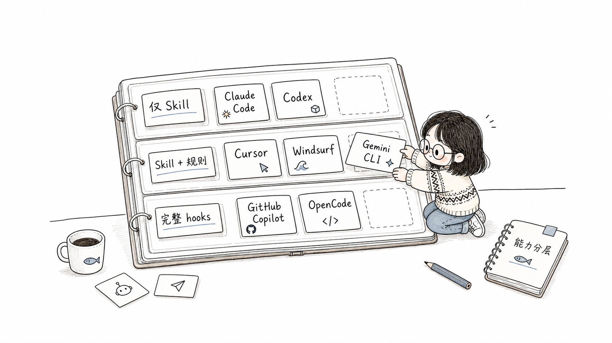

Comet 会自动将 Skill、Rule 与 Hook 部署到目标 AI 编码平台的指定目录。在执行 `comet init` 时，你可以根据日常开发环境自由勾选一个或多个平台。Comet 目前支持 39 个主流 AI 编码平台。

## 全部平台一览

下表汇总了所有受支持的平台、平台标识（用于命令行参数 `--platform <id>`）、项目级与全局 Skill 目录，以及各平台的功能支持情况。

### 完整支持（Skill + 规则 + Hook）

| 平台                         | 平台 id          | 项目目录     | 全局目录     | 规则格式         | Hooks            | 说明                                                                                                                                                       |
| ---------------------------- | ---------------- | ------------ | ------------ | ---------------- | ---------------- | ---------------------------------------------------------------------------------------------------------------------------------------------------------- |
| Claude Code                  | `claude`         | `.claude`    | `.claude`    | `md`             | ✅ `claude-code` | 官方标准参考平台，支持 PreToolUse hooks                                                                                                                    |
| Codex                        | `codex`          | `.agents`    | `.agents`    | `md`             | ✅ `claude-code` | Skill 使用 `.agents/skills`；专属配置、规则与 Hook 保留在 `.codex`                                                                                          |
| Amazon Q Developer           | `amazon-q`       | `.amazonq`   | `.amazonq`   | `md`             | ✅ `claude-code` | 复用 claude-code hook 格式                                                                                                                                 |
| Devin Desktop（原 Windsurf） | `windsurf`       | `.devin`     | `.devin`     | `md`             | ✅ `windsurf`    | 写入 `pre_write_code` hooks；旧项目自动识别并兼容 `.windsurf`                                                                                              |
| GitHub Copilot               | `github-copilot` | `.github`    | `.github`    | `copilot`        | ✅ `copilot`     | 规则写入 `.github/instructions/*.instructions.md`                                                                                                          |
| Gemini CLI                   | `gemini`         | `.gemini`    | `.gemini`    | 无（GEMINI.md）  | ✅ `gemini`      | 唯一无独立规则目录但支持 Hook 的平台                                                                                                                       |
| Qwen Code                    | `qwen`           | `.qwen`      | `.qwen`      | `md`             | ✅ `qwen`        |                                                                                                                                                            |
| Qoder                        | `qoder`          | `.qoder`     | `.qoder`     | `md`             | ✅ `qoder`       | 与 qwen 共享 PreToolUse 处理逻辑                                                                                                                           |
| Kiro                         | `kiro`           | `.kiro`      | `.kiro`      | `md`（steering） | ✅ `kiro`        | 规则保存在 `.kiro/steering/`，Hook 采用独立的 `.kiro.hook` 文件                                                                                             |
| Grok                         | `grok`           | `.grok`      | `.grok`      | `md`             | ✅ `claude-code` | Skill 保存在 `.grok/skills/`，规则保存在 `.grok/rules/`，Hook 写入 `.grok/hooks/comet.json`；OpenSpec 产物按 Codex 规范生成并镜像到 `.grok`               |
| Oh My Pi                     | `oh-my-pi`       | `.omp`       | `.omp/agent` | `mdc`            | ✅ `omp`         | Skill 保存在 `.omp/skills/`，规则使用 always-apply MDC 格式，Hook 使用 `.omp/hooks/pre/comet-hook-router.ts` 扩展模块                                     |
| CodeBuddy                    | `codebuddy`      | `.codebuddy` | `.codebuddy` | `md`             | ✅ `codebuddy`   | 规则写入 `.codebuddy/rules/`；PreToolUse hook 自动合并到 `settings.json`，保留用户既有配置                                                             |
| DeepSeek Harness             | `dsh`            | `.dsh`       | `.dsh`       | `dsh`            | ✅ `dsh`         | 采用 Claude 兼容的 OpenSpec 集成；规则写入托管的 `AGENTS.md` 代码块，Hook 配置写入 `hooks.json`                                                           |
| Trae                         | `trae`           | `.trae`      | `.trae`      | `md`             | ✅ `trae`        | Hook 写入 `.trae/hooks.json`，使用带有版本标识的 `PreToolUse` 分组                                                                                         |
| Trae CN                      | `trae-cn`        | `.trae-cn`   | `.trae-cn`   | `md`             | ✅ `trae`        | Skill 使用 `.trae-cn`；项目级 Hook 写入 `.trae/hooks.json`，全局 Hook 写入 `.trae-cn/hooks.json`                                                           |
| ZCode                        | `zcode`          | `.zcode`     | `.zcode`     | `md`             | ✅ `zcode`       | 基于 OpenCode；0.4.2 起 Hook 写入 `.zcode/config.json` 的 `PreToolUse` process hook，安装时开启 `hooks.enabled`，全局 Hook 写入 `~/.zcode/cli/config.json` |

### Skill + Hook（不支持规则）

| 平台      | 平台 id     | 项目目录     | 全局目录     | Hooks          | 说明                                                                   |
| --------- | ----------- | ------------ | ------------ | -------------- | ---------------------------------------------------------------------- |
| WorkBuddy | `workbuddy` | `.workbuddy` | `.workbuddy` | ✅ `codebuddy` | 将 PreToolUse hook 合并至 `.workbuddy/settings.json`，保留用户既有配置 |

### Skill + 规则（不支持 Hook）

| 平台      | 平台 id    | 项目目录    | 全局目录             | 规则格式 | 说明                                                         |
| --------- | ---------- | ----------- | -------------------- | -------- | ------------------------------------------------------------ |
| Cursor    | `cursor`   | `.cursor`   | `.cursor`            | `mdc`    | 采用 Cursor MDC 专有 frontmatter 格式                        |
| OpenCode  | `opencode` | `.opencode` | `~/.config/opencode` | `md`     | 支持 OpenCode 风格斜杠命令，全局目录与项目目录独立           |
| Cline     | `cline`    | `.cline`    | `.cline`             | `md`     | 规则保存在项目根目录下的 `.clinerules/`，而非 `.cline/` 内部 |
| RooCode   | `roocode`  | `.roo`      | `.roo`               | `md`     |                                                              |
| Continue  | `continue` | `.continue` | `.continue`          | `md`     |                                                              |
| Kilo Code | `kilocode` | `.kilocode` | `.kilocode`          | `md`     |                                                              |
| Auggie    | `auggie`   | `.augment`  | `.augment`           | `md`     | 适配 Augment CLI                                             |
| Lingma    | `lingma`   | `.lingma`   | `.lingma`            | `md`     |                                                              |
| MimoCode  | `mimocode` | `.mimocode` | `~/.config/mimocode` | `md`     | 基于 OpenCode，支持斜杠命令并镜像同步 OpenSpec 产物          |

### 仅支持 Skill（无规则、无 Hook）

| 平台            | 平台 id        | 项目目录       | 全局目录                | 说明                                                                           |
| --------------- | -------------- | -------------- | ----------------------- | ------------------------------------------------------------------------------ |
| MiniMax Code    | `minimax-code` | `.minimax`     | `.minimax`              | Skill 部署在 `.minimax/skills/`；项目说明通过 `AGENTS.md` 注入；无需独立 Rules 或 Hooks。 |
| Kimi Code       | `kimicode`     | `.kimi-code`   | `.kimi-code`            | OpenSpec 工具标识为 `kimi`                                                     |
| Junie           | `junie`        | `.junie`       | 无全局目录              |                                                                                |
| CoStrict        | `costrict`     | `.cospec`      | 无全局目录              | 实际目录名与平台标识不同                                                       |
| Crush           | `crush`        | `.crush`       | 无全局目录              |                                                                                |
| Factory Droid   | `factory`      | `.factory`     | 无全局目录              |                                                                                |
| iFlow           | `iflow`        | `.iflow`       | 无全局目录              |                                                                                |
| Prime Agent     | `prime-agent`  | `.prime/agent` | `~/.prime/agent`        | Skill 统一安装在项目与全局目录下的 `skills/` 子目录中                          |
| Pi              | `pi`           | `.pi`          | `~/.pi/agent`           | 全局目录位于二级子目录                                                         |
| Antigravity     | `antigravity`  | `.agents`      | `~/.gemini/antigravity` | 项目级与全局目录结构相互独立，支持 CodeGraph                               |
| Antigravity 2.0 | `antigravity2` | `.agents`      | `~/.gemini/config`      | 与 Antigravity 共享项目级 `.agents/`，全局配置保存在 `~/.gemini/config`        |
| Bob Shell       | `bob`          | `.bob`         | 无全局目录              |                                                                                |
| ForgeCode       | `forgecode`    | `.forge`       | 无全局目录              | 实际目录名与平台标识不同                                                       |

<p align="center">
  
</p>

<p align="center">各平台支持度按 Skill、规则、Hook 逐层梯次展开</p>

## 平台特性与格式对照

### 规则格式对照

Comet 支持以下四种规则格式：

| 格式      | 适配平台                                           |
| --------- | -------------------------------------------------- |
| `md`      | 绝大多数支持规则注入的平台                         |
| `mdc`     | Cursor 和 Oh My Pi；其中 Oh My Pi 采用 always-apply MDC 规范 |
| `copilot` | 仅适配 GitHub Copilot                              |
| `dsh`     | 仅适配 DeepSeek Harness；写入托管的 `AGENTS.md` 代码块 |

### Hook 格式对照

目前列表中支持 Hook 的 17 个平台分别使用以下 12 种 hook 格式：

| Hook 格式     | 写入配置文件                     | 适配平台                           |
| ------------- | -------------------------------- | ---------------------------------- |
| `claude-code` | `settings.local.json`            | Claude Code、Codex、Amazon Q、Grok |
| `qwen`        | `settings.json`                  | Qwen Code                          |
| `qoder`       | `settings.json`                  | Qoder                              |
| `codebuddy`   | `settings.json`                  | CodeBuddy、WorkBuddy               |
| `gemini`      | `settings.json`                  | Gemini CLI                         |
| `windsurf`    | `hooks.json`                     | Devin Desktop（原 Windsurf）       |
| `copilot`     | `hooks/<id>.json`                | GitHub Copilot                     |
| `kiro`        | `hooks/<id>.kiro.hook`           | Kiro                               |
| `omp`         | `hooks/pre/comet-hook-router.ts` | Oh My Pi                           |
| `dsh`         | `hooks.json`                     | DeepSeek Harness                   |
| `trae`        | `hooks.json`                     | Trae、Trae CN                      |
| `zcode`       | `config.json`                    | ZCode                              |

### DeepSeek Harness 的 Hook 激活方式

DSH 的工作流守卫机制依赖官方 Hook bridge 加载 Comet 配置。项目级安装或版本更新后，请通过项目 patch 启动 DSH：

```bash
dsh --patch .dsh/cordis.patch.yml
```

全局安装会自动为既有的 profile 配置 bridge，重启 DSH 即可生效。若后续创建了新的 profile，只需再次运行 `comet update --scope global`。升级过程会自动迁移 Comet 管理的历史 patch，并完整保留其他已有配置。

你可以运行 `comet doctor` 检查 bridge 配置状态与激活提示。注意：配置文件存在仅表示文件已就绪，并不代表当前运行中的 Agent 已经加载了 Hook；按提示正确启动后，工作流守卫将生效并拦截非法的 `write` 与 `edit` 操作（在 Windows PowerShell 环境下拦截同样有效）。

### OpenCode 系列平台

OpenCode、ZCode 与 MimoCode 均基于 OpenCode 运行时构建，支持统一的斜杠命令语法与 OpenSpec 产物同步镜像：

| 平台     | 同步行为                                              |
| -------- | ----------------------------------------------------- |
| OpenCode | 原生完整支持                                          |
| ZCode    | 自动将 `.opencode/{skills,commands}` 镜像迁移至 `.zcode/` |
| MimoCode | 自动将 OpenSpec 产物镜像同步至 `.mimocode/`           |

## 特殊安装路径说明

以下平台的全局安装目录与项目级目录并不一致：

| 平台            | 项目级目录  | 全局目录                |
| --------------- | ----------- | ----------------------- |
| Codex Skill     | `.agents`   | `~/.agents`             |
| OpenCode        | `.opencode` | `~/.config/opencode`    |
| MimoCode        | `.mimocode` | `~/.config/mimocode`    |
| Antigravity     | `.agents`   | `~/.gemini/antigravity` |
| Antigravity 2.0 | `.agents`   | `~/.gemini/config`      |
| Pi              | `.pi`       | `~/.pi/agent`           |

其他平台的全局安装均沿用与项目同名的配置目录（例如 Claude Code 全局路径为 `~/.claude`，CodeBuddy 全局路径为 `~/.codebuddy`，WorkBuddy 全局路径为 `~/.workbuddy`）。部分平台（如 Junie、CoStrict、Crush、Factory Droid、iFlow、Bob Shell、ForgeCode）目前暂不支持全局安装模式。

<Note>
  WorkBuddy 的项目级 Skill 位于 <code>.workbuddy/skills/</code>，用户级 Skill 位于 <code>~/.workbuddy/skills/</code>。阻断式 Hook 仅写入项目级的 <code>.workbuddy/settings.json</code>；全局安装不会引入全局阻断 Hook，因此无需在项目之外做额外的 Hook 配置。
</Note>

<Note>
  Codex 的 Skill 识别根目录与主配置根目录是分离的：项目级与全局 Skill 均使用 <code>.agents/skills</code>，而 Codex 专有的配置、规则、Hook 与插件缓存仍保留在 <code>.codex</code>。升级或卸载时，Comet 会自动迁移旧版本管理的 <code>.codex/skills</code>，并完整保留其他自定义 Skill。从 0.4.0-beta.5 起，Codex 的阶段守卫 Hook 已规范迁移至官方支持的 <code>.codex/hooks.json</code>。Grok 同样采用 claude-code hook 格式，但写入 <code>.grok/hooks/comet.json</code>，并针对性适配了 Grok 原生的 <code>write</code> / <code>search_replace</code> 工具。
</Note>

<Note>
  Antigravity 与 Antigravity 2.0 共享项目级的 <code>.agents/</code> Skill 目录，因此 <code>comet init</code> 在自动探测时会同时勾选两者。若你只需为其中一个平台安装，在交互式安装流程中（不使用 <code>--yes</code> 参数）手动取消勾选另一个即可。
</Note>

<Tip>
  运行 `comet init` 时会自动探测当前项目中已存在的各平台配置目录并完成预选。你也可以直接加上 `--yes` 参数跳过交互，一键自动安装到所有检测到的平台。
</Tip>

## 选择项目级还是全局安装

| 安装范围 | 适用场景                         | 核心优势                       |
| -------- | -------------------------------- | ------------------------------ |
| project  | 团队协作、仓库统一规范、需提交 Git | 配置保存在当前项目内，便于团队成员同步 |
| global   | 个人常用开发机、跨多项目共享     | 配置保存在用户根目录下，切换项目时无需逐项目重新初始化 |

<Tip>若不确定该选哪种，建议优先使用项目级安装：团队成员无需额外配置，即可获得完全一致的工作流配置。</Tip>

## 安装模式：复制 vs 符号链接

在运行 `comet init` 或 `comet update` 并选定平台后，安装向导会询问你希望采用的**安装模式**（install mode）：

| 模式                    | 具体运作机制                                                                             | 适用场景                                               |
| ----------------------- | ---------------------------------------------------------------------------------------- | ------------------------------------------------------ |
| **Copy**（文件复制，默认）  | 将各个平台所需的 Skill、规则与脚本**独立复制**一份到对应目录                               | 传统稳妥方式、需要不同平台彻底隔离、或需要将配置提交到 Git 仓库 |
| **Symlink**（符号链接） | 在各平台的现有 `skills/` 目录中建立软链接，统一共享项目中的 `.comet/skills/` 中央存储目录 | 多平台并行开发、希望节省磁盘空间、想一次性更新所有平台 |

### 符号链接（Symlink）模式的工作原理

选用 Symlink 模式后，Comet 不再向每个平台重复复制文件，而是在各个平台已有的 `skills/` 目录中创建软链接，统一指向项目内的 `.comet/skills/` 核心目录：

```text
.comet/skills/          ← 核心中央存储（仅此一份）
├── comet-open/
├── comet-design/
└── ...
.claude/skills/comet-*  →  .comet/skills/comet-*   （指向中央存储的软链接）
.cursor/skills/comet-*  →  .comet/skills/comet-*   （指向中央存储的软链接）
.agents/skills/comet-*  →  .comet/skills/comet-*   （指向中央存储的软链接）
```

后续运行 `comet update` 时，只需更新中央存储目录，所有关联平台的配置便会立即同步生效。

<Warning>
  符号链接依赖底层操作系统的文件系统权限。在部分 Windows 环境或云盘同步目录下，可能需要管理员权限或存在链接兼容问题。如果遇到链接创建失败，切回 **Copy** 复制模式即可。
</Warning>

<Note>
  若目标平台原本就存在 `skills/` 目录，Comet 会完整保留该目录及其中既有的第三方 Skill，仅针对 Comet 负责的文件创建或刷新软链接。
</Note>

<Note>
  两种模式对 Comet 的运行时逻辑完全透明，区别仅在于磁盘文件的存放形式。若需要将配置直接提交到 Git 仓库共享给其他人，建议选用 Copy 模式；Symlink 模式在不同机器上通常需要分别运行一次 <code>comet init</code>。
</Note>

## 通用 skills 注册表平台

部分新兴 AI 编码平台采用通用的 `skills` 命令行工具管理扩展。对于这类平台（如 OpenClaw、Hermes 等），你可以直接使用一条通用命令安装 Comet skill 包：

```bash
npx skills add rpamis/comet
```

该命令会直接从公共注册表拉取 Comet skill 并部署到当前平台的预设位置，无需在全局预装 Comet CLI。这种方式可与常规的 `comet init` 共同使用。

## Hook 与自动化脚本集成

对于支持 Hook 的平台，Comet 会以安全合并的方式注册守卫逻辑，并保留你已配置的其他插件、环境变量或个人设置。

如果配置文件原本就是合法 JSON，Comet 会在保留原有内容的基础上做增量注入；若检测到既有文件存在语法损坏，安装程序会明确报错终止，绝不会擅自覆写损坏你的原始文件。

## 安装后验证（可选）

```bash
comet doctor
```

如果平台目录、Skill 文件、运行脚本或 Hook 配置存在缺失，`comet doctor` 会给出清晰的定位与修复建议。后续若想升级平台组件，只需执行：

```bash
comet update
```
