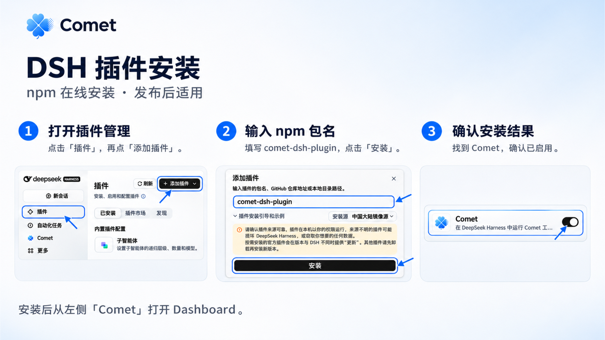
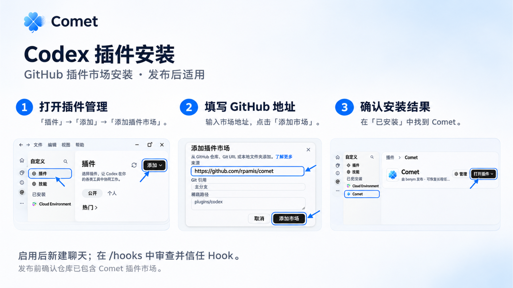

在 DeepSeek Harness（DSH）和 Codex 桌面客户端中，可以通过插件一键接入 Comet。安装插件后，客户端会自动准备匹配版本的 CLI 工具，在侧边栏提供独立的 Dashboard 入口，并在新会话中交付流程规则与约束。

其他无桌面插件机制的平台（如 Cursor、Claude Code 等）或无头服务器环境，继续使用常规的 [CLI 安装与更新](/zh/guides/install-and-update)。

## 前置要求

- Node.js 22.16 及以上的 22.x 版本，或 Node.js 24 及以上版本
- npm 或 npx
- Git
- 已安装并运行的 DSH 或 Codex 桌面客户端

<Note>
  在线安装依赖 npm 插件包或 GitHub 插件市场。若当前网络环境无法访问外部源，可先通过终端运行 `npm install -g @rpamis/comet` 全局安装 CLI，并在项目中使用 `comet init` 初始化。
</Note>

## DSH 插件安装

DSH 通过官方支持的 npm 插件包分发 Comet 插件。

### 安装步骤

1. 打开 DSH 桌面客户端，点击左侧导航栏底部的 **插件**。
2. 在插件页面右上角点击 **添加插件**。
3. 在包名输入框中填入 `comet-dsh-plugin`，确认插件来源后点击 **安装**。
4. 安装完成后，切换到 **已安装** 标签页，确认 Comet 插件状态为已启用。
5. 进入任意项目会话，左侧导航栏会出现 **Comet** 入口，点击即可打开 Dashboard。如果入口未立即出现，完全退出并重启 DSH 即可。

<Frame caption="DSH 插件安装：添加插件、输入 npm 包名，并确认 Comet 已启用。">
  
</Frame>

### 运行机制

- 插件会随依赖自动安装匹配版本的 Comet CLI。
- 新建会话或重启 DSH 后，内置终端和系统终端均可直接调用 `comet` 命令。
- 插件停用时仅关闭桌面端接入入口，不会删除项目已有的规则、Spec 文档或持久化记忆。

## Codex 插件安装

Codex 通过 GitHub 插件市场添加并管理外部扩展。

### 安装步骤

1. 打开 Codex 桌面客户端，点击左侧的 **插件** 菜单。
2. 点击 **添加** 按钮，在下拉菜单中选择 **添加插件市场**。
3. 在 **来源** 输入框中填入 Comet 仓库地址：`https://github.com/rpamis/comet`，点击 **添加市场**。
4. 在新载入的 Comet 市场中找到 Comet 插件，点击 **安装** 并确保插件已启用。
5. 在 **已安装** 列表中确认 Comet 处于开启状态。
6. 新建一个聊天会话，在会话中输入 `/hooks` 打开 Hook 管理界面，审阅并勾选信任 Comet Hook。

<Frame caption="Codex 插件安装：添加 GitHub 插件市场，并检查已安装的 Comet。">
  
</Frame>

### 运行机制与 Hook 信任

- 插件启用后会自动检查本地 Node.js 与 npm 环境，准备配套 CLI 工具。
- 会话左侧会出现 **Comet Dashboard** 面板入口，便于随时查看任务进度与中间产物。
- **Hook 信任**：Codex 严格隔离第三方扩展的拦截能力。安装插件后，必须手动在 `/hooks` 中完成信任确认。未信任前，会话不会自动注入工作流规则和约束。

## 安装后验证

完成插件安装后，建议通过以下三项操作核验环境：

1. **工作流调用**：在聊天窗口中输入 `/comet`，Agent 会正确识别工作流入口并返回当前 change 状态。
2. **Dashboard 面板**：点击客户端左侧导航栏的 Comet 图标，确认能够正常查看项目状态、任务列表、个人记忆与项目知识。
3. **环境健康检查**：在终端中运行健康检查命令：

```bash
comet doctor
```

`doctor` 会逐项检查 Skill 状态、Hook 配置、工作目录与本地数据结构，所有检查项均为绿灯即表示安装就绪。

## 插件安装与 CLI 全局安装对比

根据开发环境与协作场景选择适合的安装方式：

| 对比维度 | 桌面端插件安装 | CLI 全局安装 (`npm i -g @rpamis/comet`) |
| --- | --- | --- |
| 适用场景 | DSH、Codex 桌面客户端日常使用 | 任意终端、CI/CD 流水线、无头服务器、其他编辑器 |
| Dashboard 入口 | 深度集成在客户端侧边栏，一键展开面板 | 运行 `comet dashboard` 在外部浏览器中打开 |
| 依赖与 CLI 管理 | 插件随自身生命周期自动准备匹配的 CLI | 需通过 npm 或 pnpm 手动全局安装与更新 |
| Hook 接入方式 | 客户端图形化引导审阅与信任 | 由项目初始化或全局配置管理 |
| 核心规则与数据 | 完全一致，均读写本地 `.comet/` 目录与用户主目录 | 完全一致，均读写本地 `.comet/` 目录与用户主目录 |

## 常见问题

<AccordionGroup>
  <Accordion title="安装插件后侧栏没有出现 Comet Dashboard 入口怎么办">
    首先在客户端的 **已安装** 列表中确认 Comet 插件已启用。部分客户端初次注入侧栏扩展视图需要重新载入主窗口，完全退出客户端并重新启动即可正常显示。
  </Accordion>

  <Accordion title="Codex 中提示流程规则未生效或未按 Comet 阶段执行怎么办">
    在 Codex 聊天框中输入 `/hooks`，确认 Comet Hook 处于启用且信任状态。由于安全沙箱限制，平台要求用户显式授权信任，未勾选信任时平台会忽略扩展注入的流程规则。
  </Accordion>

  <Accordion title="受网络限制无法下载 npm 包或添加 GitHub 市场怎么办">
    可以先为系统终端配置 npm 镜像源（如 `npm config set registry https://registry.npmmirror.com`），或通过常规 CLI 命令全局安装：

```bash
npm install -g @rpamis/comet
```

    安装完成后在项目根目录执行 `comet init` 即可完成工作流初始化。
  </Accordion>

  <Accordion title="停用或更新插件会影响已有项目的任务进度和记忆吗">
    不会。Comet 的所有核心数据（Spec 文档、change 状态、个人记忆与项目知识）均持久化保存在项目本地的 `.comet/` 目录和用户目录中。停用或更新插件仅影响客户端内的图形化接入入口，不会删除任何已有数据。
  </Accordion>
</AccordionGroup>

## 相关页面

- [Dashboard 概览](/zh/dashboard/overview)：了解可视化看板的功能与操作。
- [Native 模式快速上手](/zh/native/quickstart)：开启以任务与验证为核心的开发流程。
- [CLI 安装与更新](/zh/guides/install-and-update)：查看命令行安装、更新与卸载方法。
- [个人记忆](/zh/plugins/personal-memory)：管理跨会话的个人协作偏好。
- [项目知识](/zh/plugins/project-rules)：维护仓库级工程经验与架构约定。
