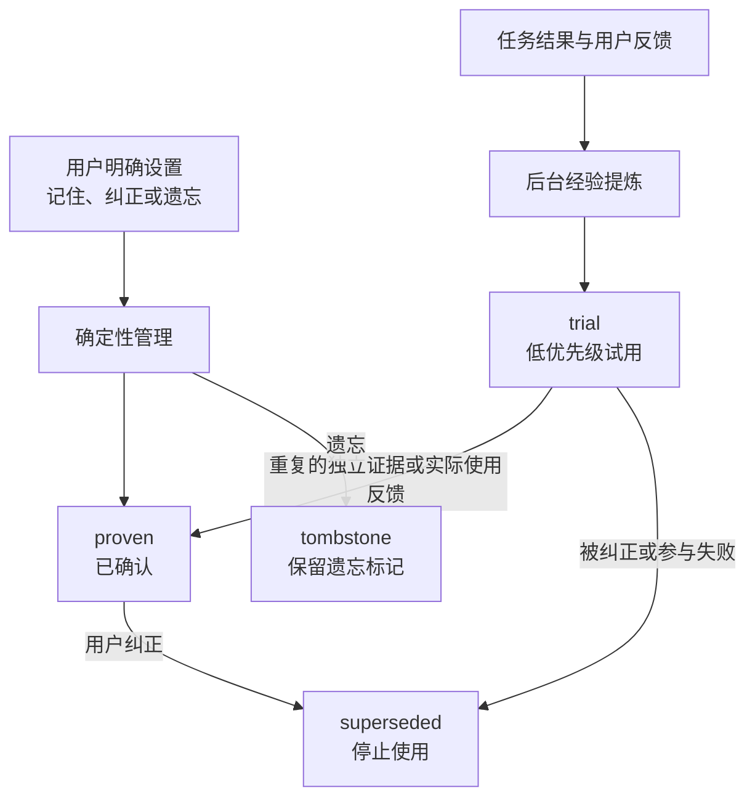

在传统的 Agent 编程对话中，每次新建会话或触发长会话上下文压缩后，Agent 都不会保留此前的偏好：你需要重复说明“默认用中文回答”、“写完代码先跑单测”、“不要动 mock 文件”这类要求。

**Personal Memory（个人记忆）让 Comet 跨会话、跨任务保存你的偏好**。你在对话中明确提出的语言风格、验证习惯和交付要求，会保存为有据可查的长期上下文，在后续相关任务中自动生效，无需每次重复说明。

<Tip>
  **开箱即用，无需额外配置**
  Comet 初始化后个人记忆**默认原生启用**，无需单独安装第三方插件或配置外部向量数据库。所有记忆默认保存在本机，归你个人所有。
</Tip>

## 适合保存的内容

并非所有对话内容都需要成为长期记忆。Comet 按照以下标准区分一次性指令与长期偏好：

| 你表达的内容 | Comet 的处理方式 | 判定依据 |
| --- | --- | --- |
| “以后默认用中文回答” | 保存为全局个人记忆 | 跨任务、跨项目长期稳定的表达习惯 |
| “在这个仓库里先运行最小相关测试” | 保存为项目范围的个人协作策略 | 你在当前特定代码库中的工作偏好 |
| “这次先不要提交代码” | 仅作用于当前请求 | 一次性授权或临时指令，不应扩展为长期默认行为 |
| “`domains` 模块不能直接访问文件系统” | 交给项目知识或仓库 Rule 承载 | 这是团队共享的工程架构约束，而非个人习惯 |

这一分类用于保护数据的所有权与隐私：属于你的个人偏好不会泄漏给其他协作人员；团队共享的技术规范则需要项目代码证据或明确的共享操作。

## 产品定位与可追溯治理

[Claude Code Auto Memory](https://code.claude.com/docs/en/memory) 记录构建命令与调试经验；Cursor 的 [Memories 机制](https://docs.cursor.com/en/context/memories) 支持从会话提炼项目范围记忆；[GitHub Copilot Memory](https://docs.github.com/en/copilot/concepts/agents/copilot-memory) 区分仓库级事实与用户偏好。

与单纯将历史文本直接追加到 Prompt 的方案相比，Comet 个人记忆提供**可追溯的管理机制**：

- **所有权明确**：每条记忆归当前用户所有；
- **作用域灵活**：支持全局生效（所有项目）或仅限定在指定项目中；
- **权威分级**：明确区分“用户人工设置”与“系统后台推断”；
- **全生命周期可控**：支持试用（trial）、确认（proven）、校准（correct）、遗忘（forget）与回滚（rollback）。你可以清晰查看每条记忆的来源、触发原因（`whyApplied`）与使用效果。

## 三类个人记忆

<p align="center">
  
</p>

### 1. Core Profile：稳定的核心画像

Core Profile 保存跨任务长期有效的通用背景与习惯：

- 语言与表达习惯（如“默认使用自然中文交流，不使用直译腔”）；
- 开发者角色与技术背景（如“熟练使用 TypeScript 与 Rust”）；
- 输出格式与证据偏好（如“修改代码后附带运行结果摘要”）；
- 稳定的沟通边界。

核心画像不依赖具体文件或工程阶段。任务开始时，关键画像直接注入基础上下文，占用少量 Token。

### 2. Collaboration Policy：有条件的协作策略

Collaboration Policy 描述你在特定条件或特定阶段希望 Agent 采用的工作方式：

- 在某个项目中修改代码后优先执行单测；
- 修改特定目录前核对生成文件的同步范围；
- Review 代码时按严重程度列出缺陷；
- 归档前核对工作区未提交改动与远端状态。

协作策略支持限定项目、文件路径、操作类型或工作流阶段，避免在无关任务中错误触发。

### 3. Personal Episode：可复盘的个人经历

Personal Episode 紧凑记录一次具体的排错、纠错或验证经历：

- 当时的任务背景与具体目标；
- 采取的关键动作与核心修复手法；
- 实际运行结果与验证证据；
- 可归纳为通用策略的经验。

经历记录主要用于后台分析与长程经验提炼。它只保存必要的证据引用，绝不保存冗余会话、全部工具日志或模型思考过程。

## 记忆如何形成



### 方式一：用户明确设置

当你在对话中明确说“记住……”、“以后都这样”，或者直接纠正、要求遗忘某条习惯时，Comet 立即按明确规则写入。这种明确指令直接进入 `proven`（已确认）状态，并在下一次相关任务中即时生效。

如果带有“这次”、“先临时”等限定词，Comet 仅作用于当前任务，不会写入长期存储。

### 方式二：从任务结果中自主提炼

Comet 后台学习机制可从多次开发结果中提炼稳定规律。系统自主推断的内容首先进入 `trial`（低优先级试用）状态：

- 项目级推断需在同一项目的不同 change 中反复出现；全局推断需来自多个不同项目的共同证据；
- 试用内容在后续任务中表现良好并得到重复验证后，才会晋升为 `proven` 长期记忆；
- 若内容被你否定、主动纠正或导致后续验证失败，会立即被废弃或转入 `superseded`（已替代）状态。

## 任务匹配与上下文注入

任务启动时，**Context Director（上下文调度器）**会根据当前项目、涉及路径、执行阶段（如 Shape / Build / Verify）动态筛选记忆：

- 关键的核心画像与直接命中的高置信度策略优先进入上下文；
- 其他候选内容进入轻量级 Context Manifest（上下文清单），仅包含摘要、触发理由与稳定 ID；
- 当 Agent 需要完整经验时，再按 ID 按需展开，避免一次性注入大量无关历史内容消耗 Token；
- 阶段流转（如从 Build 进入 Verify）时，系统会自动刷新匹配的偏好。

每条被选中的记忆都带有 **`whyApplied`** 标记。你可以在详情中清晰看到它是根据哪个项目、哪条路径或哪个操作被选中的。

## 与项目知识的分工

个人记忆与项目知识分工明确，互不混淆：

| 内容 | 个人记忆 | 项目知识 |
| --- | --- | --- |
| “我习惯默认用中文沟通” | 全局个人偏好 | 不适用 |
| “在这个仓库我习惯先跑最小单元测试” | 项目级个人偏好 | 不适用 |
| “认证模块由三个底层包共同组成” | 不适用 | Project Model（项目模型） |
| “修改 Provider 接口必须同步契约测试” | 不适用 | Project Policy（项目策略） |
| 一次成功的特殊排错经历 | Personal Episode | 有项目证据时可升级为团队排错经验 |

个人习惯绝不会自动私自提升为团队共享知识。如需共享，须由用户明确发起。

## 管理记忆：Dashboard 与 CLI

### 推荐：在 Dashboard 中可视化管理

日常推荐通过本地 Web 控制台直观维护个人记忆：

```bash
comet dashboard
```

打开浏览器进入 **个人记忆** 页面：

- **卡片式分类查看**：按核心画像、协作策略与经历分类排列，支持全局与项目范围搜索；
- **一键编辑与纠错**：点击任一记忆卡片即可在线修改正文、切换生效范围、纠正偏差或直接点击“遗忘”；
- **查看调用率与依据**：查看最近 7 天各条记忆的命中频次、耗时以及具体的 `whyApplied` 触发理由。

<Accordion title="通过 CLI 命令行管理（进阶与 CI/CD 用法）">
在脚本或终端环境中，可使用 `comet memory` 子命令进行完整管理：

```bash
# 查看记忆状态与列表
comet memory status .
comet memory list .

# 模拟当前任务的记忆召回
comet memory retrieve . --task "实现新的 CLI 命令"

# 明确新增一条全局记忆
comet memory remember . --text "默认用中文回答" --scope global

# 纠正或遗忘指定记忆
comet memory correct . --id <记忆标识> --text "改为简洁的中文回答"
comet memory forget . --id <记忆标识>
comet memory rollback . --id <记忆标识>

# 跨设备 Git 同步
comet memory remote . --set <你的记忆仓库 Git 地址>
comet memory sync .

# 临时暂停与恢复
comet memory pause . --project <项目key> --learning   # 暂停自动学习
comet memory pause . --resume                         # 恢复
```

- `forget` 默认保留回滚能力；使用 `--permanent` 可彻底清除并保留防重学标记；
- **跨设备同步**：通过 Git 专用仓库在多台工作机之间拉取和推送记忆。
</Accordion>

## 权限与隐私安全边界

- **用户指令第一**：当前你在对话中给出的最新要求始终拥有最高权威，可以随时推翻既有记忆；
- **最小化存储**：不抓取完整聊天流水、不记录代码完整 diff、不保存 Token 级推理日志；
- **绝不擅自越权**：个人记忆绝不会私自替你执行 Git 提交、远端推送、代码删除或发布操作；
- **故障静默隔离**：若记忆读取失败或暂停，Native 和 Classic 工作流仍正常执行，绝不阻断正常编码。

延伸阅读：[个人记忆原理：从用户信号到任务上下文](/zh/plugins/personal-memory-principles)、[项目知识](/zh/plugins/project-rules) 以及 [Comet Dashboard](/zh/dashboard/overview)。
