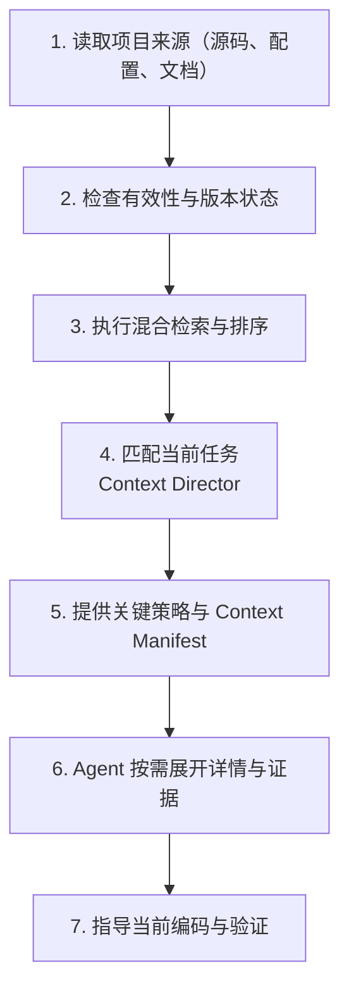

在大型代码库中，Agent 需要消耗 Token 查找目录结构、模块依赖和编码约定。缺少这些信息时，Agent 可能漏掉配套改动，或再次遇到团队已解决的问题。

**Project Knowledge（项目知识）让 Comet 保存有据可查的项目架构事实与工程约束**。在日常执行需求、代码审查与归档时，Comet 会自动提炼可复用的项目规律，并在后续任务中召回相关内容，帮助 Agent 找到相关入口、补全影响范围并沿用已有的验证方式。

<Tip>
  **默认启用，与仓库 Rule 并存**
  Comet 初始化后项目知识**默认原生启用**，无需额外配置或安装插件。仓库中的 `AGENTS.md`、`CLAUDE.md` 等 Rule 依然是你的顶层明确指令，项目知识则为 Agent 提供有证据支撑的架构理解与故障处理经验。
</Tip>

## 与 Rule 和项目 Wiki 的边界

### 1. 仓库 Rule 仍是顶层显式指令

项目知识不替代既有的 Rule 文件。你可以继续使用平台支持的规则载体编写团队硬性约束，例如 Codex 的 `AGENTS.md`、Claude Code 的 `CLAUDE.md` 或 Cursor 的 `.cursor/rules`。

Comet 绝不会私自篡改你的 Rule 文件。当 Rule 被引入作为知识依据时，原始 Rule 始终具备最高的仲裁优先级。

### 2. 按任务逐步积累，不生成冗余 Wiki

项目知识不会扫描整个仓库并生成完整 Wiki。代码库中随处可见的通用实现细节，Agent 直接读源码即可获得，无须存入知识库增加检索噪声。

项目知识只保存**对后续任务有真实决策帮助**的高价值信息：模块职责边界、跨包依赖关系、已批准的技术选型、已被测试验证的特定排错方案。

## 核心能力一览

| 核心能力 | 提供的上下文支撑 | 对开发的实际价值 |
| --- | --- | --- |
| 项目定位 | 目录职责、模块边界与工作区结构 | 缩小源码搜索半径，更快锁定修改入口 |
| 影响范围分析 | 模块依赖、注册点关系与配置生成关联 | 提前补齐配套的测试用例、配置文件与文档改动 |
| 设计决策理解 | 团队已采纳的技术决策与设计模式 | 避免 Agent 提出与现有架构相悖的方案 |
| 流程复用 | 经过验证的构建、测试与部署命令 | 沿用团队既有的工作方式，减少探索试错 |
| 故障排查经验 | 历史缺陷的根因、修复方案与复验命令 | 减少同类 Bug 重复出现与重复排查 |

## 两类项目知识

<p align="center">
  
</p>

### 1. Project Model：项目模型（静态架构事实）

Project Model 描述能从代码库客观证据中核对的拓扑与事实：

| 类型 | 含义 | 真实示例 |
| --- | --- | --- |
| `topology` | 目录结构、工作区划分与模块职责 | CLI 入口位于 `app/`，领域核心逻辑位于 `domains/` |
| `fact` | 当前项目的客观技术事实 | Runtime 生成物必须通过 `npm run build:assets` 统一同步 |
| `dependency` | 模块、子包与组件之间的调用关系 | Dashboard 通过 Plugin Host 读取插件状态 |

### 2. Project Policy：项目策略（工程做法与决策）

Project Policy 记录在日常开发和任务验收中提炼出的工程规范与经验：

| 类型 | 含义 | 真实示例 |
| --- | --- | --- |
| `decision` | 已确认的技术或产品决策 | Native 与 Classic 保持独立状态机，互不干扰 |
| `pattern` | 团队推崇的稳定设计模式 | 新增平台能力必须从统一 registry 派生 |
| `procedure` | 可重复执行的固定操作步骤 | 修改 Runtime 核心协议后，必须重新生成并核对测试资产 |
| `constraint` | 必须严格遵守的代码红线 | domain 领域层严禁直接硬编码平台特定路径 |
| `failure-resolution` | 经过测试复验的缺陷解决方案 | 遇到前端资源过期报错时，先重新构建再运行端到端测试 |

<Info>
  **带自动验证的策略（enforced）**：当一条策略关联了具体的测试或校验命令且已成功执行时，会进入 `enforced` 状态。在 Native 流程中，这些命令会自动纳入 Verify 验收环节，由自动化检查执行该规范。
</Info>

## 项目记忆：Agent 直接记录的高置信度经验

项目记忆（Project Memory）是项目知识体系中的文件层轻量经验记录。在一次任务完成并通过验收后，Agent 可直接通过命令将验证过的排错或开发技巧记入本机缓存：

```bash
comet knowledge remember . --title "构建前需先清理缓存" --text "修改协议字段后，需先执行 pnpm clean 再编译，否则产物哈希不一致" --type procedure --paths "packages/core"
```

- `--type` 支持 `fact`、`decision`、`pattern`、`procedure`、`constraint`、`failure-resolution`，默认为 `pattern`；
- 标题相同时更新原记录，不创建重复记录；
- 经验保存在本地缓存的 `MEMORY.md` 索引与独立 Markdown 文件中，不污染 Git 工作区；
- 任务执行时，上下文清单会优先提供相关的经验摘要，Agent 按需展开阅读完整正文。

## 上下文匹配与提供流程



1. **候选过滤**：根据当前项目、编辑文件路径、当前阶段（如 Build 或 Verify）与操作动作筛选记忆；
2. **轻量清单注入**：默认以 Context Manifest 摘要注入，避免大量文本占用上下文；
3. **来源时效性检查**：当底层关联的源码、配置发生变动或被删除时，旧结论立即标记为失效或 `superseded`（已替代），不向 Agent 提供已失效的结论。

## 管理与排查入口

### 推荐：在 Dashboard 中直观管理

启动本地 Web 控制台：

```bash
comet dashboard
```

进入 **项目知识** 模块：

- **卡片式分类浏览**：分门别类查看项目模型（架构拓扑）与项目策略（决策规范），清晰核对适用路径与来源证据；
- **交互式检索模拟**：在输入框中填入一段任务目标（如“修改用户登录认证”），面板即刻回显匹配命中的知识条目、打分排序与具体的 `whyApplied` 触发理由，方便调试规则；
- **在线编辑与索引重建**：直接在线编辑内容、废弃过期记录或一键重建本地全文索引。

<Accordion title="通过 CLI 命令行管理（进阶与 CI/CD 用法）">
你可以在终端或 CI 脚本中通过 `comet knowledge` 命令进行排查与维护：

```bash
# 查看项目知识状态
comet knowledge status .

# 模拟检索：查看修改指定模块时会命中哪些知识
comet knowledge query . --task "修改身份验证模块" --path src/auth --phase build --operation edit

# 列出所有已确认的稳定策略
comet knowledge list . --state proven

# 手动新增一条经验
comet knowledge remember . --title "统一使用 pnpm 运行单测" --text "由于 monorepo 软链接机制，必须通过 pnpm test 执行" --type constraint

# 纠正、遗忘与一键重建索引
comet knowledge correct . --id <记录标识> --text "更新后的说明"
comet knowledge forget . --id <记录标识>
comet knowledge rebuild .
```
</Accordion>

## 产品与权限安全边界

- **源码与测试优先**：当前代码库中的实际源码、配置和自动化测试结果始终拥有最高裁决权；
- **平台规则兼容**：继续支持各 Agent 平台原生的 Rule 文件与加载行为；
- **绝不越权**：项目知识仅为 Agent 提供理解参考，绝不自动替开发者执行 Commit、Push 或发布；
- **隔离与停用**：可在 Dashboard 插件中心一键停用项目知识；停用后停止检索注入，不影响 Native 或 Classic 的基础开发工作流。

延伸阅读：[项目知识原理：从项目证据到任务上下文](/zh/plugins/project-knowledge-principles)、[个人记忆](/zh/plugins/personal-memory) 以及 [Dashboard 概览](/zh/dashboard/overview)。
