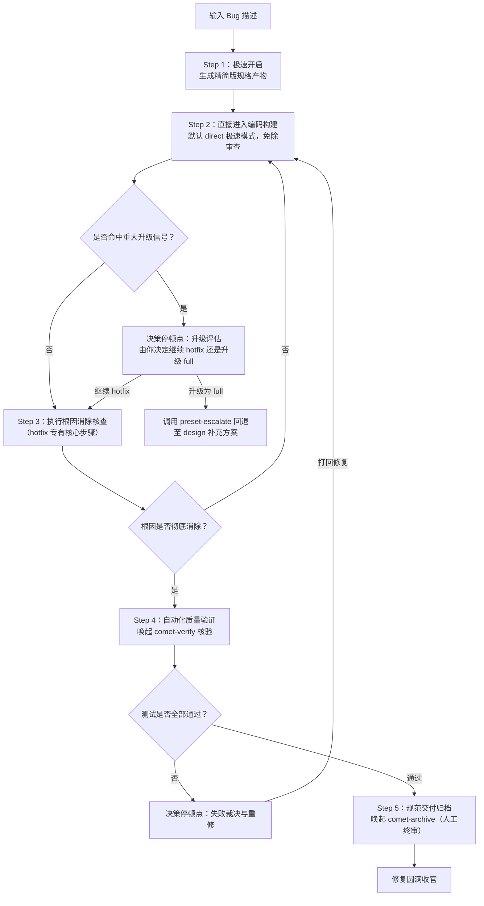

hotfix 是 Comet 内置的轻量开发预设，专为**修复目标明确的缺陷**量身定制。它巧妙省去了耗时的深度架构设计与复杂计划拆解，按照 `open → build → verify → archive` 四个精简步骤极速推进，同时依然完整保留了 OpenSpec 状态机跟踪、**根因消除核查**、自动化测试验证与版本规范归档。

hotfix 简化前期设计文档，保留代码质量检查、根因定位、验证和交付步骤。

tweak 与 hotfix 同属于轻量预设家族，共享平滑升级机制、连续流转协议与不可逾越的人工确认红线。两者的定位差异请查阅 [tweak 预设](/zh/presets/tweak)。

<p align="center">
  
</p>

<p align="center">hotfix 快在前期沟通成本极低，但根因核查、严密验证与版本归档依然一丝不苟</p>

<Tip>
  日常使用只需在对话中输入 <code>/comet</code>。当项目选用 Classic 时，系统底层会自动识别修复现有缺陷或回归异常的意图，并自动分流至 <code>/comet-hotfix</code>。
</Tip>

## 如何触发 hotfix

在绝大多数场景下，你无需手动输入特定命令。在对话中输入 `/comet` 之后，系统会在第 0 步自动进行意图预检：

| 你的需求描述                                                                                    | 系统的自动路由走向                                        |
| ----------------------------------------------------------------------------------------------- | --------------------------------------------------------- |
| 修复现有异常、回归缺陷或已知错误，且满足轻量修复条件（不新增业务能力、无需全局架构重构）        | 自动路由至 `/comet-hotfix`                                 |
| 目标明确的中轻量调整，需通过标准指令执行，不需要繁复的设计计划                                   | 自动路由至 `/comet-tweak`（详见 [tweak 预设](/zh/presets/tweak)） |
| 未命中上述轻量模式，涉及新业务或跨模块大改                                                      | 自动进入标准全流程 `/comet-classic`                       |

在日常断点恢复时，同样只需输入 `/comet`。系统会自动读取状态机，并在检测到处于 hotfix 的 build 阶段时自动接续。

---

## 最佳适用场景

采用 hotfix 模式通常需要满足以下三个前提：

- 纯粹针对已有功能的缺陷修复，**绝不引入全新的业务能力（capability）**；
- 不改变对外公开 API 接口契约，不涉及底层数据库 Schema 重大调整；
- 预估改动范围清晰收敛。

若修复中途遇到跨模块重构、必须变更表结构、引入新的对外接口或涉及产品层面的重大方案讨论，系统会自动提示你升级为完整全流程。

## 与 full 完整流程及 tweak 预设的对比

| 核心维度      | hotfix 预设                                | full 全流程                      | tweak 预设                                     |
| ------------- | ------------------------------------------ | -------------------------------- | ----------------------------------------------- |
| **核心目标**  | 快速修 Bug                                 | 新增业务功能、深层重构、复杂需求 | 调整现有行为、微调文案或优化配置                |
| **推进链路**  | open → build → verify → archive            | open → design → build → verify → archive | open → build → verify → archive                 |
| **方案设计**  | 免除独立设计文档                           | 必须完成头脑风暴方案推敲         | 免除独立设计文档                                |
| **设计文档**  | 无须产出 Design Doc                        | 必须落盘 Design Doc              | 无须产出 Design Doc                             |
| **增量 Spec** | **极少涉及**（仅在修复改变了既有验收用例时） | 按需求深度拆解增量文档           | **正式产物**（需要增量 Spec 不构成升级理由）    |
| **编码方式**  | 极速顺序执行（`build_mode: direct`）       | 需根据任务规模选定               | 原生指令批量执行（`build_mode: direct`）        |

---

## 阶段执行全流程



### 第一步：极速开启（精简 open）

调用 `openspec-new-change`（**跳过冗长的探索对话**），直接生成精简规格：
- `proposal.md`：问题现象描述 + 根因初步分析 + 预期修复目标；
- `design.md`：极简的单一修复策略；
- `tasks.md`：清晰直接的修复子任务清单；
- `delta spec`：通常无需生成。

守卫对 hotfix 豁免对复杂设计文档的要求，完成基础校验后直接跨过 design 阶段，昂首迈入 build。

### 第二步：直接进入编码实现（精简 build）

采用 `build_mode: direct` 极速模式，跳过头脑风暴与计划编写，严格遵循：

1. **先精准复现，再动手修改代码**：改动前必须先复现 Bug 并记录失败现象。若能编写自动化测试，强制要求先新增一个必挂的回归测试用例；若受环境限制无法编写自动化用例，必须在文档中详实记录手动复现的步骤与真实表现。
2. 读入任务清单，逐项修改源码、格式化代码、运行测试用例。
3. 编码完毕后，显式运行项目的自动化构建与测试命令。

<Warning>
  如果在修复代码过程中出现编译报错、测试失败或异常崩溃，系统<strong>强制触发规范排错机制</strong>（<code>systematic-debugging</code>）。必须先查明根因，再修改代码。
</Warning>

### 第三步：根因消除核查（hotfix 专属核心防线）

**这是 hotfix 流程中独有的核心护栏**：在阶段守卫放行之前，系统必须核查：
1. 对照 `proposal.md` 中的根因分析；
2. 在代码库中检索并验证致病代码是否已被物理连根拔除；
3. 若发现根因依然存在隐患，直接退回 Step 2 继续修改。

若在根因核查时发现该缺陷实属**深层系统架构缺陷**，系统会判定命中质变信号，主动暂停并由你定夺是否升级。

### 第四步：自动化质量验收（精简 verify）

复用标准验证引擎：
- 无增量 Spec 的小范围 Bug 修复走 `light` 轻量验证链路；
- 涉及增量用例变更时自动匹配 `full` 深度验证。

### 第五步：规范归档交付（精简 archive）

测试全绿后复用标准归档工具，由你最终确认远端交付方式（仅本地提交 / 推送远端 / 创建 PR），并将变更规范归档入库。

---

## 升级判定机制

为了防止“将大手术误当成小缝补”，hotfix 设立了清晰的升级防护：

### 1. 重大架构变动信号（命中任意一项即刻暂停）

- 涉及跨子系统、跨底层模块的协同修改；
- 需要引入全新的业务功能或公开模块；
- 变更涉及数据库 Schema 调整或数据迁移脚本；
- 改变了公开 API 或命令行契约；
- 根因排查证实必须从全局架构层面重构。

### 2. 文件改动数量阈值

当修复涉及的文件数量超过提示阈值（例如超过 4 个文件）时，系统会主动暂停提示你注意改动范围，由你裁决是否继续。

### 3. 人工升级决策通道

一旦触发升级提示，Comet 会**暂停等待你做出抉择**：
- **A：继续 hotfix**：确认改动风险完全收敛可控，继续快速通道；
- **B：升级为 full 全流程**：系统通过正规原子指令执行升级：

```bash
node "$COMET_STATE" transition <name> preset-escalate
```

系统会平滑退回至 design 阶段补充正式的设计文档，你可以继续使用已有的代码改动和测试。

## 连续推进与不可逾越的决策点

hotfix 默认采用**一次性自动化流转**，在顺畅执行时不主动弹出无效打扰。但以下关键节点**毫无例外必须暂停等待你明确确认**：
1. 命中重大架构升级信号或改动超出阈值时；
2. 测试验收未通过需要裁决处理策略时；
3. 最终归档与远端分支交付确认时。

## 下一步

- [tweak 预设](/zh/presets/tweak) — 了解面向中轻量内容与行为调整的轻量预设
- [自动推进机制](/zh/concepts/auto-transition) — 深入掌握预设的自动流转与升级通道
- [决策停顿点速查](/zh/concepts/decision-points) — 掌握 hotfix 阶段的关键确认项
- [verify 阶段详解](/zh/phases/verify) — 了解轻量修复如何复用质量验收
