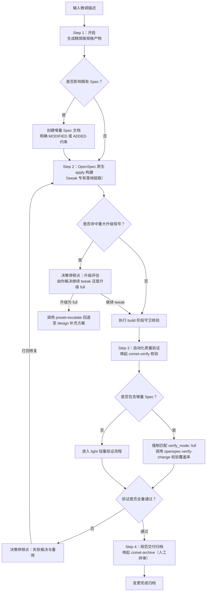

tweak 是 Comet 中复用 OpenSpec 原生构建流程的轻量预设。它遵循 `open → build → verify → archive` 四个步骤，省去独立的方案设计与计划拆解，把 **增量 Spec（delta spec）直接作为正式规格产物**，并通过 OpenSpec 原生的 apply action 执行。

  

tweak 使用增量 Spec 记录改动，并通过原生 apply 指令执行

配置调整、Prompt 优化与小幅行为微调均可优先使用 tweak，前提是改动边界能够收敛为单个任务，且无需复杂的多模块架构推敲。

<Tip>
  日常使用直接输入 <code>/comet</code> 即可。当项目选用 Classic 时，系统底层会自动识别无需完整设计的轻中量修改，并自动流转至 <code>/comet-tweak</code>。
</Tip>

## 如何触发 tweak

多数情况下无需手动输入特定命令。在对话中输入 `/comet` 后，系统会自动进行意图预检：

| 你的需求描述                                                                                    | 系统的自动路由走向                                           |
| ----------------------------------------------------------------------------------------------- | ------------------------------------------------------------ |
| 可收敛为单一变更的轻量/中等改动，需通过规范指令执行，且无需复杂的架构设计文档                   | 自动路由至 `/comet-tweak`                                    |
| 修复现有异常或缺陷，且不引入新能力                                                              | 自动路由至 `/comet-hotfix`（详见 [hotfix 预设](/zh/presets/hotfix)） |
| 未命中上述轻量模式，涉及核心业务或跨模块大改                                                    | 自动进入标准全流程 `/comet-classic`                         |

日常断点恢复时，同样只需输入 `/comet`，系统会自动继续未完任务。

---

## 适用场景

采用 tweak 预设通常需要满足以下条件：

- 变更范围可明确收敛为**单个独立的 change**；
- 改动清晰直观，无需撰写庞大的 Design Doc 也能充分澄清方案；
- 不涉及跨子系统、跨深层次架构的复杂协调；
- 预估任务规模可控。

常见典型场景包括：
- **配置文件调整**：调整系统参数、修改过滤规则，需明确记录修改动机，但无需繁重设计；
- **文档或 Prompt 调优**：优化提示词或技术文档，需要基于测试用例验收，但完整流程成本高于所需；
- **小幅业务行为微调**：调整既有逻辑参数或判断分支，涉及若干文件但未发生架构质变；
- **涉及增量 Spec 的修改**：修改既有 Spec 的验收用例，增量 Spec 即为核心契约产物。

## 与 full 完整流程及 hotfix 预设的对比

| 核心维度      | tweak 预设                                                     | full 全流程                      | hotfix 预设               |
| ------------- | -------------------------------------------------------------- | -------------------------------- | ------------------------- |
| **核心目标**  | 调整行为、优化配置或文案                                       | 新增业务功能、深层架构重构       | 快速修 Bug                |
| **推进链路**  | open → build → verify → archive                                | open → design → build → verify → archive | open → build → verify → archive |
| **构建方式**  | **OpenSpec 原生 apply 驱动**（`openspec-apply-change`，专属路径） | 细化 plans 计划并按选定模式执行   | 顺序执行              |
| **增量 Spec** | **正式规格产物**（需要它本身不构成升级理由）                 | 按需求深度拆解增量文档           | 极少涉及                  |
| **根因核查**  | 无须执行                                                       | 无须执行                         | **必须执行**（缺陷专有）  |
| **Commit 前缀** | `tweak:`                                                     | 遵从项目规范                     | `fix:`                    |
| **文件数阈值**| 超过 6 个时提示                                                | —                                | 超过 4 个时提示           |

<Note>
  <strong>两者对增量 Spec 的定位不同</strong>：hotfix 视增量 Spec 为罕见例外，tweak 视其为标准正式产物。<strong>需求涉及增量 Spec 本身不构成升级为 full 的理由</strong>。若改动天然需要调整验收用例，使用 tweak。
</Note>

---

## 阶段执行全流程

### 第一步：开启（精简 open）

调用 `openspec-new-change`（**跳过冗长对话探索**），直接生成精简规格：
- `proposal.md`：变更动机、核心目标与边界；
- `design.md`：简短实现说明；
- `tasks.md`：任务清单；
- `delta spec`：**可选且常见**。若变更涉及既有用例调整，作为正式产物生成。

系统完成基础校验后，直接跳过 design 阶段，进入 build。

### 第二步：OpenSpec 原生 apply 构建（tweak 专属链路）

**这是 tweak 与 hotfix 最显著的差异点**。tweak 无需手动编写琐碎任务，而是通过 OpenSpec 原生的 `openspec-apply-change` 指令批量驱动实现：

1. 确认 Schema 规范与任务规格；
2. 拉取底层 apply 执行指令与关联上下文；
3. 严格对照上下文文件，逐个落地任务，始终保持改动收敛；
4. 每项任务完成后执行代码格式化、回归测试并提交 Git；
5. 全量任务完成后，显式运行项目构建与测试命令，通过守卫放行。

<Warning>
  该 apply 链路<strong>仅限 tweak 使用</strong>。完整全流程变更不允许套用此链路，必须完成设计文档后才可编码。
</Warning>

### 第三步：自动化质量验收（按 Spec 分流）

- **若包含增量 Spec**：**强制开启 full 全量深度验证**，调用 `openspec-verify-change` 严格校验代码与用例的吻合度；
- **若无增量 Spec**：走标准的 light 轻量验证链路。

### 第四步：规范交付归档（精简 archive）

验收全部通过后复用标准归档流程，由你最终确认远端交付方式（仅本地提交 / 推送远端 / 创建 PR），若涉及增量 Spec，系统会自动将其语义化合并进主 Spec 中。

---

## 升级判定机制

tweak 沿用与 hotfix 完全一致的三层升级防护，关键区别在于：
1. **质变信号**：当需求需要拆解为多个子变更时，tweak 会主动建议升级；
2. **改动文件阈值**：由于微调可能涉及较多配置文件的同步更新，tweak 的提示阈值放宽至 **6 个文件**。超过该阈值时，Comet 会暂停并等待你决定如何继续。

## 下一步

- [hotfix 预设](/zh/presets/hotfix) — 了解缺陷修复专用的轻量预设
- [自动推进机制](/zh/concepts/auto-transition) — 掌握预设流转与升级通道
- [决策停顿点速查](/zh/concepts/decision-points) — 掌握 tweak 阶段的关键确认项
- [verify 阶段详解](/zh/phases/verify) — 了解质量验收分流机制
