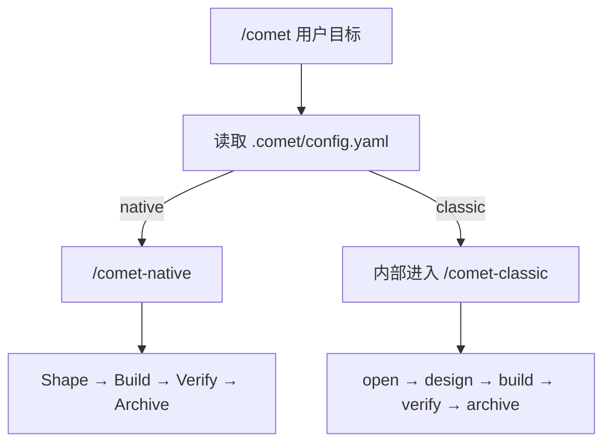

本文带你用最短路径快速上手：安装 CLI、以默认 Native 模式初始化项目，并在 Agent 中输入 `/comet` 开启你的第一个变更。

## 前置要求

- Node.js 22.16 及以上的 22.x 版本，或 Node.js 24 及以上版本
- npm 或 npx
- Git
- 一个受支持的 AI 编码平台，例如 Claude Code、Codex、Cursor、Gemini CLI、OpenCode 或 ZCode

## 1. 安装 CLI

```bash
npm install -g @rpamis/comet
```

```bash
# 验证安装
comet --version
```

终端输出版本号（如 `@rpamis/comet v0.5.0`）即表示安装成功。

## 2. 初始化项目（默认 Native）

进入你的项目根目录并运行：

```bash
cd your-project
comet init
```

按命令行向导提示选择即可。初始化完成后，项目根目录会生成 `.comet/config.yaml`。你可以运行诊断命令确认环境就绪：

```bash
comet doctor
```

各项检查均显示绿色勾选（无 `✗` 失败项）即表示环境配置完整。

<Accordion title="其他初始化情况">
  新项目默认推荐使用 Native，上述标准命令已能满足绝大多数日常开发需求。若有特定需求，可参考以下可选参数：

  如果你的项目已有明确的 Classic 历史记录，`comet init` 会自动保持 Classic，请勿手动改回 Native。需要显式指定工作流或 Native 产物目录（如 `docs`）时，可以使用 `--workflow`、`--root`、`--scope` 等参数：

  ```bash
  # 初始化 Native，并将产物存放在 docs 目录
  comet init --workflow native --root docs

  # 初始化 Classic
  comet init --workflow classic

  # 同时初始化 Native 与 Classic
  comet init --workflow both

  # 全局安装 Native
  comet init --scope global --workflow native

  # 全局同时安装 Native 与 Classic
  comet init --scope global --workflow both
  ```

  注意：只有 Classic 会安装并配置 OpenSpec、Superpowers 与 CodeGraph。无论是 Native、Classic 还是 both，项目级安装都会部署一份 Comet 流程规则；支持 Hook 的平台仅安装一个统一路由入口（Router），后续根据当前活跃的 change 将写操作分发给对应阶段的守卫（Guard）。

  global 全局安装会配置所选工作流的全局默认值；尚未初始化的项目首次明确调用 `/comet` 时，系统会自动将全局默认值固化到该项目的 `.comet/config.yaml` 中，变更产物始终保存在项目内部。已经激活的项目不会因为后续全局默认值的变更而被意外改写。

  全部参数与配置合并规则请参考 [comet init](/zh/cli/init)；两套工作流的深度取舍请参考 [Native 还是 Classic](/zh/native/native-vs-classic)。
</Accordion>

## 3. 调用 `/comet`

打开你的 Agent 平台，在项目对话中输入：

```text
/comet 支持在用户资料页上传头像
```

`/comet` 会读取 `.comet/config.yaml` 并将任务分发给对应的工作流（新项目默认为 `/comet-native`）。Native 会自动为当前需求创建 change，并按 **Shape → Build → Verify → Archive** 四个阶段依次推进：

```text
✔ 检测到默认工作流: Native
✔ 创建 change: avatar-upload
✔ 进入 Shape 阶段：正在分析现有代码并确认上传大小限制与图片格式...
```

你可以随时在终端中运行 `comet status`，查看当前活跃的 change 及其阶段进度。



<p align="center">
  
</p>

<p align="center">安装、初始化、调用 `/comet`，并在中断后直接基于文件状态恢复</p>

## 查看状态

任何时候都可以在终端运行：

```bash
comet status
```

终端会直观展示当前默认工作流以及各个 change 的进度：

```text
Default Workflow: native

Native Changes:
  ● avatar-upload [Shape] (active)
    Target: 支持在用户资料页上传头像
    Next: 确认 Shape 验收项后推进到 Build
```

如果遇到任何环境异常或配置疑问，可以随时运行 `comet doctor` 检查环境与配置：

```bash
comet doctor
```

## 继续中断的工作

如果对话意外中断，重新打开项目后只需在 Agent 中输入：

```text
/comet 继续
```

Comet 会自动识别项目的默认工作流，并基于持久化的 change 文档与执行证据，从上次停顿的位置直接继续，无需重新输入背景。

## 下一步

- 了解轻量高效的现代流程：阅读 [Native 工作流](/zh/concepts/native-workflow)。
- 需要经典的五阶段强约束：阅读 [Classic 工作流概念](/zh/concepts/workflow)。
- 快速处理临时小改动：阅读 [hotfix 预设](/zh/presets/hotfix)。
