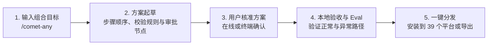

在日常开发中，单一的 Skill 通常只是一份静态 Prompt（`SKILL.md`）。面对多步骤的复杂业务时，它缺乏状态机保护和人工确认节点，也无法在意外中断后可靠恢复。

**Comet Any 让你在 Agent 中用自然语言，把多个现有 Skill、工具和校验脚本组合成可验收、可恢复的工作流应用**。Agent 负责梳理步骤间的输入输出、编写入口规则和业务校验条件，SDK 将方案打包为带验收关卡、支持断点恢复的可执行应用。



## 第 1 步：准备环境并描述目标

确保已全局安装 Comet 并在项目根目录完成初始化。在支持的 Agent（如 Codex、Claude Code）对话框中输入 `/comet-any` 并提出你的组合目标：

```text
/comet-any
把本地调研和报告生成 Skill 组合成自动化项目周报流程：
1. 先整理本周已验收的变更清单；
2. 生成周报初稿，包含“本周完成”和“风险与下一步”两节；
3. 检查每条结论是否有具体的来源依据，缺少报告或来源不完整时禁止进入发布；
4. 必须等待我人工确认实际报告初稿后，才能写入最终发布文件。
```

<Tip>
  描述目标时，建议写清：**前置输入**、**关键执行步骤**、**核心交付物**、**自动校验条件**以及**必须由人决定的审批节点**。
</Tip>

## 第 2 步：确认应用类型与结构

Agent 会分析你的目标，并推荐合适的应用类型：

| 应用类型 | 适用场景 | 结构特点 |
| --- | --- | --- |
| **独立 SDK 应用** | 周报、技术调研、内容生成等专用业务流程 | 为特定任务自定义执行阶段、审批节点和业务验证器。 |
| **Native 扩展** | 定制自身研发流程 | 保留 Native 的 Builder、独立 Verifier 与 Archive，在指定节点追加团队业务检查。 |
| **Classic 组合** | 标准化规范流程 | 沿用五阶段状态机，增加或替换符合阶段要求的特定 Skill。 |

Agent 会就关键分歧向你说明，并将所有步骤、依赖与校验规则整理成结构化方案。

## 跟随一个完整场景深入

<CardGroup cols={3}>
  <Card
    title="组合任意 Skill"
    icon="wand-magic-sparkles"
    href="/zh/skill-creator/standalone-composition"
  >
    用调研、写作与来源审查组合生成需人工审批后发布的周报应用。
  </Card>
  <Card title="定制 Native" icon="meteor" href="/zh/skill-creator/native-customization">
    增加团队实现规范与安全审查，保留原有的独立验收。
  </Card>
  <Card title="定制 Classic" icon="signature" href="/zh/skill-creator/classic-customization">
    替换 Design 执行 Skill，并追加接口向后兼容性检查。
  </Card>
</CardGroup>

## 第 3 步：阅读并核准完整方案

在正式构建前，Agent 会展示完整的执行方案。你可以逐项核对：

- **执行流程与依赖**：调用了哪些现有 Skill，以及各步骤的先后顺序；
- **业务验证器（Validators）**：检查输出文件是否缺失、内容是否符合业务规则；
- **人工确认节点（Approvals）**：明确在哪个阶段必须由人工确认后才能继续。

你可以选择批准、要求修订或拒绝。方案修改后会重新生成并等待你的再次确认。

## 第 4 步：本地自动验收与可选 Eval

方案核准后，Comet SDK 会将其编译为锁定依赖的完整应用包，并在临时沙箱中执行本地验收：

- **正常路径测试**：验证在正常输入下能否顺利产出预期结果文件；
- **异常拦截测试**：故意制造空文件、缺失来源或格式错误，验证校验规则能否准确识别并拦截；
- **可选模型 Eval 评测**：本地检查通过后，可选择运行模型 Eval，测试应用在真实模型下的表现与稳定性。

## 第 5 步：确认安装预览与分发导出

本地验收通过后，Comet Any 会展示安装预览，包括目标写入路径、平台 Skill 入口、依赖配置与平台兼容性说明。确认后即可完成安装：

```bash
# 启动本地控制台，查看应用并一键分发
comet dashboard
```

- **安装到本地平台**：写入 Claude Code、Codex 等支持的 Agent 平台，即可在日常对话中使用该应用；
- **导出独立包**：导出不包含本地运行记录的独立应用包，通过 `comet application distribute` 分发到其他项目或平台。

## 中断后一键继续

如果创作流程意外中断，只需在原项目对话中再次输入 `/comet-any`，或在终端运行：

```bash
# 查看创作状态
comet creator status weekly-report --project . --json

# 执行下一步
comet creator next weekly-report --project . --json
```

Comet 会根据磁盘上的检查点从断点恢复，无需重新输入需求。你也可以在 **Comet Dashboard → Comet Any** 页面查看完整的创作记录、依赖关系和执行证据。

延伸阅读：[SDK 核心概念](/zh/sdk/overview)、[创作首选项配置](/zh/skill-creator/preferences) 以及 [分发与发布](/zh/skill-creator/publishing)。
