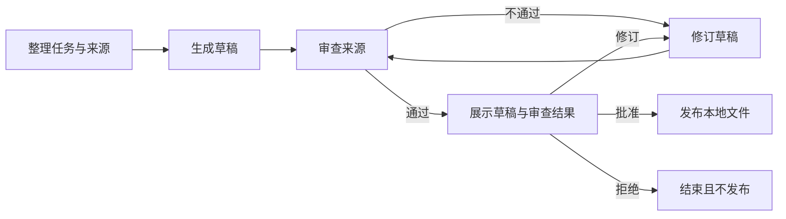

你有几个独立 Skill，希望它们按同一套规则协作，而不是每次重新向 Agent 解释顺序。用 `/comet-any` 创建独立 SDK 应用，把实际输入、步骤、文件、验收和用户决定一起保存。

本教程组合任务整理、报告写作和来源审查 Skill。最终应用接收一周的任务记录，生成周报；来源检查通过且用户批准实际草稿后，才写入本地发布文件。它不使用 Native 或 Classic 的开发阶段。

## 1. 写清输入与最终结果

先确定一次运行处理什么。本例输入为周次、任务记录和输出目录。任务记录至少包含任务名称、验收状态与来源引用；没有验收依据的任务不能进入“已完成”清单。

```json
{
  "week": "2026-W42",
  "tasks": [
    {
      "title": "上线认证限流",
      "accepted": true,
      "source": "records/auth-rate-limit.md"
    }
  ],
  "outputDirectory": "reports/weekly"
}
```

这是提供给生成应用的业务输入示例，不是 `comet runtime dispatch` 的完整请求。把周次、任务和引用换成真实数据，确保来源文件确实可读。

输出目录必须限制在允许的项目范围内。完整应用包、Run 数据和模型凭据不属于报告输出；发布到邮件、网站或其他外部服务时，另行声明权限和结果核对接口。

## 2. 准备可协作的 Skill

本例假设已有三个实际目录：

```text
team-skills/
  task-research/SKILL.md
  report-writing/SKILL.md
  source-review/SKILL.md
```

| Skill    | 接收什么               | 交付什么                                   |
| -------- | ---------------------- | ------------------------------------------ |
| 任务整理 | 任务记录与可读取来源。 | 已验收任务清单、未确认项和来源索引。       |
| 报告写作 | 已整理清单与周次。     | 含必需章节的 Markdown 草稿。               |
| 来源审查 | 草稿、清单和实际来源。 | 结论与来源的对应记录，以及通过或失败结论。 |

路径只是示例。让 Agent 阅读实际正文、脚本和资源，检查输入输出能否衔接。有的 Skill 只会聊天、有的会写文件；这些差异必须进入适配方案。

## 3. 描述工作流与审批范围

在支持 Creator 的 Agent 会话中输入：

```text
/comet-any
把本次创作命名为 weekly-report，组合一个独立 SDK 周报应用。
使用 ./team-skills/task-research、./team-skills/report-writing、./team-skills/source-review。
读取实际 Skill，先整理任务与来源，再写草稿，然后检查每条已完成结论的来源。
输入包含 week、tasks 和 outputDirectory；来源必须真实可读，输出限制在项目 reports/weekly 内。
草稿包含“本周完成”“风险与下一步”，来源审查逐项对应结论和验收依据。
每次运行保存独立的草稿与审查记录，避免覆盖另一周或另一 Run 的产物。
审查失败时保留草稿，修订后重新审查；未检查项不能判定通过。
用户看到实际草稿和审查结果后，可批准本地发布、要求修订或拒绝。
修订后的草稿重新审查和审批；拒绝结束但不发布。
不发邮件、不部署网站，只写本地最终报告，并核对其内容与已批准草稿一致。
请展示完整入口、业务规则、步骤、正常与异常产物样例和主流程验收，再等我确认方案和安装。
```

顺序依赖由实际流程表达，不能只写成提示语。这个例子先整理再写作，因此不需要并行；若以后让多个独立来源同时整理，要求明确合流条件，并为每项任务分配独立输出。

## 4. 检查三种结果路径

方案至少应包含：



确认时关注以下业务条件：

| 条件                               | 为什么需要                                   |
| ---------------------------------- | -------------------------------------------- |
| 只有有验收依据的任务进入完成清单。 | 避免把进行中的任务写成已交付。               |
| 来源审查读取真实来源。             | 一份看起来完整的引用列表不能证明结论有依据。 |
| 草稿与审查记录有明确路径和摘要。   | 让后续步骤核对它们确实存在且没有变化。       |
| 审批展示实际草稿与审查结果。       | 用户需要知道批准的是哪份内容。               |
| 发布核对已批准内容。               | 防止批准后又写入另一份报告。                 |
| 修订轮次与停止条件明确。           | 避免反复失败时无限循环。                     |

每个写文件的步骤声明真实产物。交互或纯计算步骤如果没有文件，说明原因和结果如何保存。要求 Agent 展示实际异常样例和业务验证器，见 [阶段产物验收](/zh/sdk/artifact-validation)。

## 5. 验证主流程，不只检查文件

独立应用需要在隔离项目中演练实际工作流。为本例要求这些场景：

| 场景                                   | 应得到的结果                                   |
| -------------------------------------- | ---------------------------------------------- |
| 来源完整，用户批准。                   | 生成真实草稿和审查记录，批准后才生成最终报告。 |
| 草稿章节完整，但一条结论没有验收依据。 | 业务检查拒绝并进入修订，不能发布。             |
| 审查通过，用户拒绝发布。               | 正常结束，最终发布文件不存在。                 |
| 用户要求修改草稿。                     | 修改后重新审查并产生当前审批，不复用旧批准。   |
| 审批前退出进程。                       | 原 Run 保存草稿与等待，重启后继续同一审批。    |

还有缺失文件、空内容和摘要漂移等基础检查。纯对话步骤没有文件，也需要纳入主流程演练，不能以“无产物”为由跳过。

本地检查使用隔离执行，不等于真实模型调用质量。选择模型 Eval 时，检查实际 Skill 是否能衔接、审查是否发现异常、审批分支和恢复是否执行。评估报告没有覆盖的路径保持未验证。

## 6. 安装并生成第一份周报

确认当前安装预览后，完整包导出到方案指定目录，并安装平台入口与固定依赖。检查入口名称、报告范围、宿主工具和 Hook 激活要求，参见 [安装与分发](/zh/skill-creator/publishing)。

加载安装结果列出的应用入口，并提供真实业务数据：

```text
使用已安装的 weekly-report 应用，整理 2026-W42 周报。
任务记录来自 records/week-42.json，来源文件位于 records/。
输出在 reports/weekly 内。先给我看通过审查的实际草稿，再等我决定是否本地发布。
```

第一次运行应停在展示草稿的用户等待。你可以要求修订、拒绝或批准；批准之后查看实际最终文件是否与该草稿一致。

如果 Run 沿拒绝分支结束，`completed` 表示声明的路径完成，不表示报告已经发布。Dashboard 中分别查看创作记录和每次生成周报的应用 Run；创建应用与使用应用是两个过程。

## 7. 恢复与增加新能力

创作中断时用原名称检查：

```bash
comet creator status weekly-report --project . --json
comet creator next weekly-report --project . --json
```

已经安装后的报告任务中断，则继续原应用 Run 和当前 Wait。不要另起一次运行去重复发布。外部发布结果未知时，先查询原请求；本例只做本地发布，将来接外部服务时要补充相应恢复契约。

以后想加入翻译 Skill、多个报告渠道或 child 审查流程，提供原应用包并说明新增输入、输出、审批与失败条件，准备和确认新版本。多个渠道的发布分别声明副作用与核对方式，不能把一次草稿批准解释为任意渠道的发送许可。
