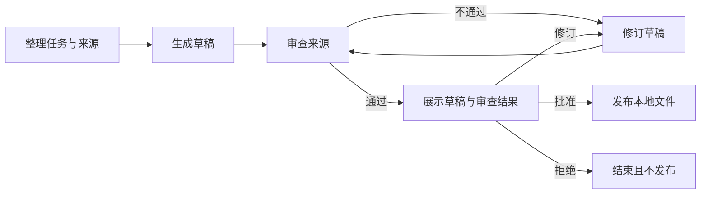

当你有几个独立 Skill，希望它们每次都按同一套流程协作，而不是每次重新向 Agent 解释执行顺序时，可以用 `/comet-any` 创建独立 SDK 应用，把输入要求、执行步骤、输出文件、业务校验和用户审批打包在一起。

本教程将任务整理、报告写作和来源审查三个 Skill 组合成周报应用：读取一周的任务记录生成草稿，只有来源审查通过且用户确认草稿后，才写入本地发布文件。它不依赖 Native 或 Classic 的软件开发阶段。

## 1. 用自然语言说明你要做什么

你只需要告诉 Comet Any：要处理哪些材料、希望得到什么结果、哪些环节必须由你确认。可以直接口头描述，也可以提供现有文档或文件路径，不需要手写 JSON、Schema 或执行请求。

例如：

```text
我想每周自动整理一份项目周报。
从我提供的任务记录和验收文档中找出本周真正完成的工作，不能把进行中的任务写成已交付。
报告包含“本周完成”和“风险与下一步”，每条完成结论都有可查阅的来源。
先给我看草稿和来源审查结果，经我批准后才保存最终报告到 reports/weekly。
```

某个细节还没想清楚时，可以直接说“不确定”。Comet Any 会先读取你的材料和本地 Skill，追问缺少的信息，再给出包含输入、输出、步骤和验收条件的方案供你确认。

| 你提供或确认什么 | Comet Any 负责生成或检查什么 |
| --- | --- |
| 任务目标（例如每周整理一份周报）。 | 应用方案、工作流结构和入口 Skill。 |
| 可用材料（例如任务列表、验收文档或现有系统）。 | 读取方式、所需字段、输入结构与校验规则。 |
| 期望结果（例如报告章节与保存位置）。 | 步骤输出、文件路径、文件检查和业务校验条件。 |
| 审批要求（例如确认草稿后才发布）。 | 针对当前草稿的审批节点，以及修订、拒绝和恢复路径。 |

你只需要核对方案是否符合业务需求，不需要自己设计字段名或编写 SDK 请求。Comet Any 会检查输出路径是否在允许的项目范围内；如果以后想发布到邮件、网站或其他外部服务，它也会说明所需权限和结果核对方式，由你决定。

## 2. 准备可协作的 Skill

本例假设项目中已有三个本地 Skill 目录：

```text
team-skills/
  task-research/SKILL.md
  report-writing/SKILL.md
  source-review/SKILL.md
```

| Skill | 接收什么 | 产出什么 |
| --- | --- | --- |
| 任务整理 | 任务记录与可查阅的来源文档。 | 已验收任务清单、未确认项和来源索引。 |
| 报告写作 | 已整理清单与周次。 | 包含必需章节的 Markdown 草稿。 |
| 来源审查 | 草稿、清单和原始来源文档。 | 结论与来源的对应记录，以及通过或失败结论。 |

以上路径仅为示例。让 Agent 读取这些 Skill 的正文、脚本和参考文件，确认上下游输入输出能否衔接。有些 Skill 只会输出聊天回复，有些会直接写文件，这些差异需要在适配方案里处理。

## 3. 描述工作流与审批范围

在支持的 Agent 会话中输入：

```text
/comet-any
把本次创作命名为 weekly-report，组合一个独立 SDK 周报应用。
使用 ./team-skills/task-research、./team-skills/report-writing、./team-skills/source-review。
读取这些 Skill 的内容，先整理任务与来源，再写草稿，然后检查每条已完成结论的来源。
每次运行我会告诉你周次，并提供任务记录或现有文档；请设计相应的输入和读取方式。
来源必须可读，输出限制在项目 reports/weekly 内。
草稿包含“本周完成”“风险与下一步”，来源审查逐项对应结论和验收依据。
每次运行保存独立的草稿与审查记录，避免覆盖另一周或其他任务的产物。
审查失败时保留草稿，修订后重新审查；未检查项不能判定通过。
用户看到草稿和审查结果后，可批准本地发布、要求修订或拒绝。
修订后的草稿重新审查和审批；拒绝时结束流程且不发布。
不发邮件、不部署网站，只写本地最终报告，并核对其内容与已批准草稿一致。
请展示完整入口、业务规则、步骤、正常与异常产物样例和主流程验收，再等我确认方案和安装。
```

步骤的先后顺序必须写进工作流定义，不能只靠提示语约束。本例需要“先整理再写作”，因此按顺序串行执行；如果以后想让多个独立来源同时整理，需要明确汇总条件，并为每条并行分支分配独立的输出文件。

## 4. 检查三种结果路径

方案至少应包含以下流转路径：



确认方案时重点关注以下业务条件：

| 条件 | 为什么需要 |
| --- | --- |
| 只有具备验收依据的任务进入完成清单。 | 避免把进行中的任务写成已交付。 |
| 来源审查读取原始来源文档。 | 看起来格式完整的引用列表，不能证明结论确实有依据。 |
| 草稿与审查记录有明确路径和校验摘要。 | 供后续步骤核对文件确实存在且未被修改。 |
| 审批时展示草稿全文与审查结果。 | 让用户清楚自己批准的是哪一份内容。 |
| 发布前核对内容与已批准草稿一致。 | 防止批准后又写入另一份不同内容的报告。 |
| 明确修订轮次上限与停止条件。 | 避免反复校验失败时陷入无限循环。 |

每个写文件的步骤都要声明对应的输出文件。纯交互或纯计算步骤如果不生成文件，需要说明原因以及结果的保存方式。确认前让 Agent 展示异常样例和业务验证器，详见 [阶段产物验收](/zh/sdk/artifact-validation)。

## 5. 验证主流程，不只检查文件

独立应用会在隔离项目中演练完整流程。本例建议至少验证以下场景：

| 场景 | 预期结果 |
| --- | --- |
| 来源完整，用户批准。 | 生成草稿和审查记录，批准后才写入最终报告。 |
| 草稿章节齐全，但有一条结论缺少验收依据。 | 业务校验拒绝并退回修订，不能发布。 |
| 审查通过，用户拒绝发布。 | 流程正常结束，不生成最终发布文件。 |
| 用户要求修改草稿。 | 修改后重新审查并发起新的审批，不复用旧批准。 |
| 审批前进程中断退出。 | 已有草稿和等待审批状态会保留在磁盘上，重启后直接继续这次审批。 |

除此之外，还会自动检查文件缺失、空内容和文件内容变动导致校验摘要不匹配等基础异常。不生成文件的纯对话步骤也会纳入主流程演练，不会因为“没有产物”而被跳过。

本地验收运行在隔离环境中，只验证流程和校验逻辑本身，不能代替真实模型的调用效果。选择运行模型 Eval 时，重点观察 Skill 之间能否顺利衔接、审查能否发现问题，以及审批分支和中断恢复是否正常工作。未测到的路径会保持未验证状态。

## 6. 安装并生成第一份周报

确认安装预览后，完整应用包会导出到方案指定的目录，同时安装平台入口和已锁定的依赖。安装前核对入口名称、报告目录范围、平台工具以及是否需要手动开启 Hook，参见 [安装与分发](/zh/skill-creator/publishing)。

加载安装结果列出的入口 Skill，用自然语言给出本次周次和材料位置：

```text
使用已安装的 weekly-report 应用，整理 2026-W42 周报。
任务记录来自 records/week-42.md，验收文档位于 records/。
输出保存在 reports/weekly 内。先给我看通过审查的草稿，再等我决定是否本地发布。
```

首次运行会停在展示草稿的审批节点。你可以选择修订、拒绝或批准；批准后可以检查生成的最终文件是否与刚才确认的草稿一致。

如果用户选择了拒绝，运行状态虽然会标记为 `completed`（表示已按预期走完拒绝分支），但不会生成最终发布文件。在 Dashboard 中，创作应用的记录和每次生成周报的任务记录会分开展示。

## 7. 恢复与增加新能力

创作中途中断时，用原名称查看状态并继续：

```bash
comet creator status weekly-report --project . --json
comet creator next weekly-report --project . --json
```

如果是已经安装好的周报任务在运行中途中断，直接继续原来的任务并完成当前审批，不要新建一次运行去重复发布。如果外部发布后结果未回传，先向外部系统核对状态；本例仅写入本地文件，以后接入邮件或网站发布时，需要补充中断后的状态核对与恢复规则。

以后想加入翻译 Skill、多个发布渠道或子任务审查流程时，向 Comet Any 提供原应用包，说明新增的输入、输出、审批和失败处理条件，生成并确认新版本。不同渠道的发布要分别声明影响范围和核对方式，不能把一次草稿批准当成所有渠道的发送许可。
