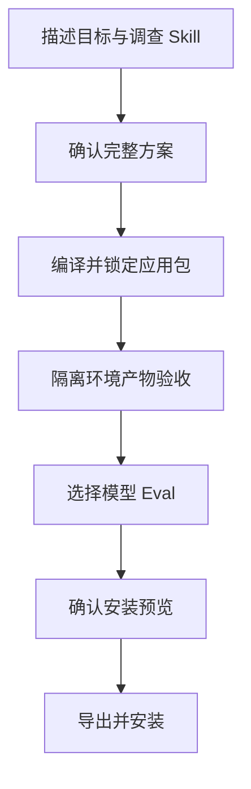

一次创作过程从头到尾记录在同一条运行记录（Run）里，包含你的目标、确认过的方案、应用包和安装结果。流程暂停或中断时，先读取这条记录，再接着当前步骤继续。



## 1. 调查目标与本地依赖

Agent 会读取本地 Skill 的正文、脚本和参考文件，理清输入输出、用户交互、外部副作用以及失败恢复方式。遇到缺少 Skill、同名歧义或能力不满足要求时，会先提出并解决，再往下推进。

## 2. 确认完整业务方案

方案包含应用类型、工作流结构、完整的 Skill 和 Rule 正文、依赖清单以及阶段产物要求。每个新增或替换的步骤都需要声明必需的输出文件；如果某一步确实不生成文件，需要写明原因。

业务验证器会同时附带正常和异常测试用例。你阅读完整方案后可以选择批准、要求修订或拒绝，确认结果只绑定当前版本的方案。

## 3. 编译并验收应用包

SDK 会锁定依赖版本并生成完整应用包，随后在隔离的 Node 进程和临时项目中运行产物验收，不使用真实 Agent 平台的凭据。

| 验收结果 | 下一步 |
| --- | --- |
| 检查通过 | 进入可选模型 Eval。 |
| 检查失败 | 修复后重试、修订方案或拒绝。 |
| 依赖或模块中途变动 | 恢复锁定前的原文件，或修订方案后重新确认。 |
| 中断后不确定是否执行成功 | 先核对目标文件或外部状态，再按实际情况回传结果。 |

本地验收无法跳过。异常测试用例必须构造“文件存在、格式合法，但违反业务规则”的样本，确保能真正测到业务校验逻辑，而不是只测到空文件或格式报错。

独立应用还会在隔离项目中演练主流程，覆盖执行、交互、子流程和审批分支；不生成文件的纯对话步骤也会参与检查。文件检查通过不代表所有分支都已走通，示例见 [组合任意 Skill 成独立工作流](/zh/skill-creator/standalone-composition)。

## 4. 选择模型 Eval

你可以运行模型 Eval，也可以明确选择跳过。运行时会锁定当前应用包、依赖和 2–4 个测试用例；中断或修订后继续复用同一组用例。

评估报告展示模型表现和实际测到的路径。未执行的路径保持未覆盖状态，模型 Eval 的结果也不能代替本地文件验收或 Agent 平台实测。

## 5. 确认安装预览

安装前需核对导出目录、平台入口、Runtime、共享 Rule/Hook、文件冲突和平台缺少的能力。只有确认当前预览后，SDK 才会写入文件。如果文件或配置发生改动，旧的预览确认会失效，需要重新预览。

## 6. 安装后使用与观测

在目标 Agent 平台加载安装好的入口 Skill，按应用流程发起任务。Dashboard 会将创作记录和应用运行记录分开展示，保留各次运行的版本、执行尝试、用户确认和输出文件。

如果需要将应用安装到其他项目或平台，或执行升级和选择性卸载，使用 [comet application](/zh/cli/application)。

## 中断后查看下一步

```bash
comet creator status weekly-report --project . --json
comet creator next weekly-report --project . --json
```

命令会返回当前待执行的步骤（Action）、等待确认项（Wait）以及方案摘要，说明下一步该做什么。Agent 平台执行完操作或拿到用户确认后，再通过 [comet creator dispatch](/zh/cli/creator) 回传结果。不要手动编辑 Run JSON 文件，也不要为同一次安装或发布另建一条运行记录。
