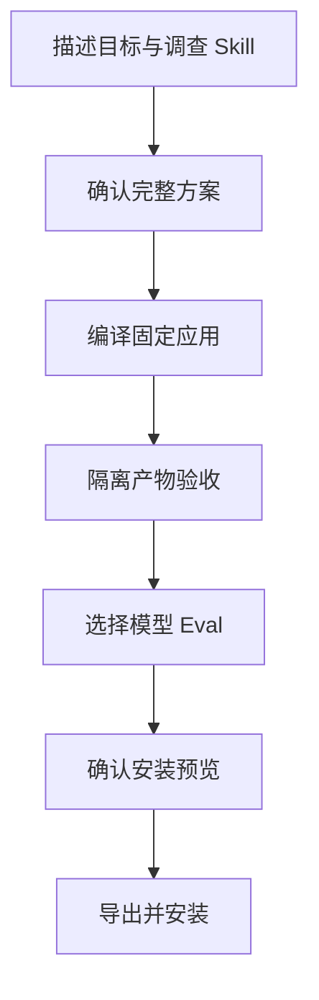

Creator 使用同一个 Run 关联目标、实际方案、用户决定、编译包和安装结果。流程暂停时先读取这个 Run，再按当前动作继续。



## 1. 调查目标与真实依赖

Agent 阅读 Skill 正文、脚本和资源，确认输入输出、用户交互、副作用、失败与恢复方式。缺少 Skill、来源有歧义或能力不满足时，先解决问题。

## 2. 确认完整业务方案

方案包含应用类型、实际工作流图、完整 Skill/Rule 正文、依赖和产物要求。每个新增或替换的执行步骤声明必需文件；确实不产生文件时，说明原因。

业务验证器同时准备正常与异常样例。用户阅读方案后选择批准、修订或拒绝，决定绑定当前提案。

## 3. 编译并验收实际包

SDK 固定依赖内容并生成包。Creator 在隔离 Node 进程和临时项目中运行产物检查，不使用真实 Agent 平台凭据。

| 结果           | 下一步                             |
| -------------- | ---------------------------------- |
| 检查通过       | 进入可选模型 Eval                  |
| 检查失败       | 修复后重试、修订方案或拒绝         |
| 依赖或模块变化 | 恢复固定内容，或重新准备并确认     |
| 执行结果未知   | 核对原动作与实际文件，再回报原结果 |

本地验收没有“跳过”路径。业务验证器的异常样例要能通过通用文件和格式检查，再被业务条件拒绝。

独立应用还需在隔离项目中演练实际主流程，包括执行、交互、子流程与审批；纯对话步骤也参与检查。文件通过检查不代表所有分支已走通，示例见 [组合任意 Skill 成独立工作流](/zh/skill-creator/standalone-composition)。

## 4. 选择模型 Eval

你可以运行模型 Eval，也可以明确跳过。执行时固定实际应用、依赖及 2–4 个用例；中断和修订后复用原用例。

评估报告说明模型行为与实际覆盖。没有执行的路径保持未覆盖，模型结果也不能替代本地文件验收或真实 Agent 平台验证。

## 5. 确认安装预览

核对导出位置、平台入口、Runtime、Rule/Hook、冲突和缺少的能力。用户确认当前预览后，SDK 才执行写入。文件或配置变化会使原预览批准失效。

## 6. 安装后使用与观测

在目标平台加载安装的入口 Skill，沿应用 Run 执行。Dashboard 将创作记录与应用运行分开展示，保留固定版本、执行尝试、决定和产物。

其他项目或平台的安装、升级和选择性卸载使用 [comet application](/zh/cli/application)。

## 中断时读取下一步

```bash
comet creator status weekly-report --project . --json
comet creator next weekly-report --project . --json
```

返回的 Action、Wait 和提案摘要决定当前可以做什么。Agent 平台执行的操作与用户决定通过 [comet creator dispatch](/zh/cli/creator) 回报。不要编辑 Run JSON，也不要为同一次安装或发布另建 Run。
